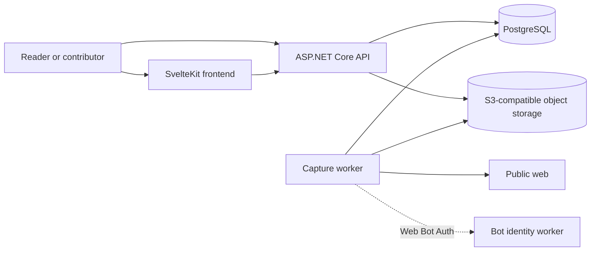
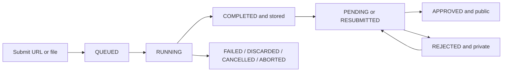

# Architecture

Archive separates browser-facing HTTP work from capture processing. PostgreSQL coordinates both processes and holds the visibility decision; S3-compatible object storage holds archived bytes.

## System context



The frontend and API normally use different browser-visible origins. Server-side frontend requests may use an internal API address, but the browser uses `PUBLIC_API_BASE_URL`. Archived content is delivered by the API and rendered in a sandboxed iframe; the frontend does not proxy snapshot resources.

## Components

### Frontend

`frontend/` is a SvelteKit application built with the Bun adapter. Its main route groups are:

- `/` for public search and the snapshot register;
- `/archive/new` for URL and file submission;
- `/snapshots/{id}` for public or authorized private playback;
- `/account/complete` for the local profile created after external sign-in;
- `/account/submissions` for owner-visible records and history;
- `/admin/snapshots` for moderation;
- `/admin/users` for roles and permission overrides.

Public search uses a SvelteKit remote function. Authenticated server loads forward the session cookie only to the configured API origin. Browser submission status uses server-sent events and falls back to polling after a connection error.

### API

`backend/Archive.Api` owns the HTTP contract. It provides:

- public snapshot search, metadata, screenshots, and content;
- URL and multipart file submission;
- transient processing status, events, and cancellation;
- Google authentication and the application session;
- profile completion and profile images;
- owner-only submission details and resubmission;
- administrative moderation and access management;
- OpenAPI and Scalar in Development;
- `/healthz` for container and operator checks.

The API applies EF Core migrations when `Database:Initialize` is enabled. In the production Compose stack that responsibility belongs to the API, while the worker explicitly disables initialization.

### Worker

`backend/Archive.Worker` is a background service with no HTTP endpoint. It acquires the processing lease, recovers interrupted work, and claims queued snapshots in queue order.

URL submissions use Playwright Chromium. The browser path checks crawl policy and target-network eligibility, rate-limits by origin, optionally signs requests with Web Bot Auth, collects eligible resources, rewrites stored references to route-neutral paths, and captures a screenshot.

File submissions select a decoder by validated content and extension:

| Source | Decoder path |
| --- | --- |
| HTML | HTML document and referenced inline/local content |
| MHTML | MIME document with related resources |
| WebArchive | Apple property-list archive, including subframes |

Imported documents are normalized to the same stored-content model as browser captures and rendered for a screenshot.

### Core

`backend/Archive.Core` is referenced by both executables. It contains the EF Core model and migrations, repository contracts and implementations, option validation, authorization definitions, processing lease, upload-format selection, and object-storage access.

The dependency direction is deliberate: API and worker depend on Core; Core does not depend on either host.

### Bot identity worker

`cloudflare/archive-bot-identity` serves the bot description, `robots.txt`, and a signed HTTP Message Signatures key directory. The capture worker's signature agent must identify the same HTTPS origin. See [Bot identity worker](../cloudflare/archive-bot-identity/README.md).

## Snapshot lifecycle

Processing status and moderation status answer different questions:

- **Processing**: Were the source and resources captured and stored?
- **Moderation**: May the stored snapshot appear in the public register?



Users with `snapshots.publish_without_approval` start in `APPROVED`. Other submissions start in `PENDING`. Processing can proceed independently of that decision; public queries still require both stored content and approval.

### Submission transaction

The API validates metadata and the source before creating work. A file upload is placed under `jobs/{snapshotId}/source.{extension}`. It then writes the snapshot, initial history, tags, and queued processing record in one PostgreSQL transaction. If the transaction fails unambiguously, the temporary upload is removed.

### Claim and progress

The worker uses a PostgreSQL advisory lock through `ProcessingLease` so only one lease coordinates recovery and new claims. It claims the oldest queued row with `FOR UPDATE SKIP LOCKED`, changes it to `RUNNING`, and records a random owner token. Updates and completion require that token, which prevents an old worker from publishing after losing ownership.

Progress moves through `SOURCE_CHECK`, `LOADING_PAGE`, `LOADING_DYNAMIC_CONTENT`, and `SAVING_SNAPSHOT`. The API exposes the current state through a status resource and a server-sent event stream.

### Completion and recovery

The worker stores objects before publishing the database result. A successful database transaction adds capture metadata and history, sets the active content prefix, and changes processing to `COMPLETED`.

If capture fails, is cancelled, or exceeds a limit, the worker records a terminal processing state and removes temporary or unpublished objects when it is safe to do so. At startup, the lease reconciles rows left `RUNNING`: stored results become completed; other rows become cancelled or aborted. The API later removes expired terminal processing records. Snapshot metadata and history are durable even after transient processing state expires.

## Persistence

### PostgreSQL

The EF Core model uses separate schemas for concerns such as archive data, authentication, processing, and enum types. Principal records are:

- snapshots, tags, and snapshot-tag associations;
- append-only snapshot lifecycle history;
- transient snapshot-processing state;
- users, external identities, roles, and permission overrides.

PostgreSQL is authoritative for ownership, moderation, visibility, processing state, and the active content prefix. Object presence alone never grants public access.

### Object storage

The configured bucket contains two main key spaces:

```text
jobs/{snapshotId}/...             temporary uploaded source
snapshots/{snapshotId}/
├── index.html                    archived entry document
├── screenshot.png                capture preview
├── manifest.json                 stored object inventory and capture metadata
├── assets/...                    captured or imported resources
├── frames/...                    imported frame documents when present
└── source.{html|mhtml|webarchive} original uploaded document when present
```

The exact resource set is recorded in the manifest. `Snapshot.ContentPrefix` selects the active stored set. Archived documents use relative, route-neutral resource references so the same bytes can be served through public, owner, and administrator routes.

Profile images are stored with the user record in PostgreSQL. Their public or owner-only visibility is decided by the profile repository and API route.

## Access model

### Authentication

Google authentication creates or locates an internal user and issues a server-side cookie session. New users have the `USER` role and must complete a display name and handle before registered-user authorization succeeds.

Production frontend and API origins must use HTTPS and the same scheme. When they use sibling hosts, the configured session cookie domain must include both. The cookie lasts 12 hours without sliding renewal.

### Roles and permissions

Roles provide defaults; individual `ALLOW` or `DENY` overrides take precedence. Stable permission keys are:

| Permission | Capability |
| --- | --- |
| `admin.access` | Enter the administration portal. |
| `admin.users.access` | Read users, roles, and overrides. |
| `admin.snapshots.access` | Read and moderate all submissions. |
| `snapshots.publish_without_approval` | Publish the user's own completed captures without review. |
| `users.assign_roles` | Change another user's role. |
| `users.assign_permissions` | Change another user's overrides. |

Administrative access changes cannot target the current actor and cannot leave the system without a fully authorized administrator.

### Snapshot visibility

| Caller and state | Metadata/content route | Result |
| --- | --- | --- |
| Anonymous, stored and `APPROVED` | `/api/snapshots/{id}` | Public metadata and resources. |
| Owner, any stored moderation state | `/api/users/snapshots/{id}` | Private detail, history, screenshot, and content. |
| Authorized reviewer, any stored moderation state | `/api/admin/snapshots/{id}` | Private review detail, history, screenshot, and content. |
| Any caller outside those rules | Any route | Not found, unauthenticated, or forbidden according to the route contract. |

Private responses use `private, no-store`. Mutations for moderation, resubmission, roles, and permission overrides require the configured frontend origin and one strong `If-Match` value obtained from the corresponding detail response.

## Archived-content isolation

Archived pages are untrusted input. Content responses apply a restrictive content security policy:

- scripts, connections, objects, and form submissions are disabled;
- images, styles, fonts, media, and frames are limited to the snapshot content scope and data URLs where supported;
- public playback uses a sandboxed document;
- private HTML navigation must originate from the configured frontend or the same authorized snapshot scope;
- the frontend iframe uses `sandbox="allow-same-origin"` without script or form permissions;
- original uploaded source files are served as downloads rather than active documents.

The worker separately restricts what it captures. URL normalization accepts HTTP and HTTPS, `PublicNetworkGuard` rejects non-public targets, crawl policy reads applicable directives, and resource, byte, duration, and import-depth limits bound work. See [Configuration](configuration.md) for the controls.

## Related documentation

- [Development](development.md)
- [Configuration](configuration.md)
- [Deployment](deployment.md)
