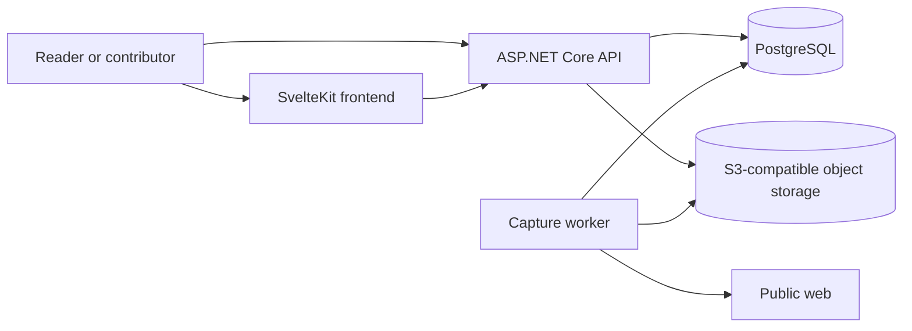
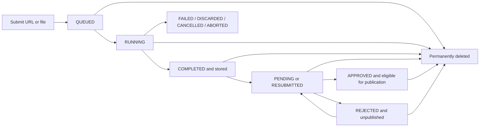

# Architecture

Archive separates browser-facing HTTP work from capture processing. PostgreSQL coordinates both processes and holds the visibility decision; S3-compatible object storage holds archived bytes.

## System context



The frontend and API normally use different browser-visible origins. Server-side frontend requests may use an internal API address, but the browser uses `PUBLIC_API_BASE_URL`. Archived content is delivered by the API and rendered in a sandboxed iframe; the frontend does not proxy snapshot resources.

## Components

### Frontend

`frontend/` is a SvelteKit application built with the Bun adapter. Its main route groups are:

- `/` for public search and the snapshot register;
- `/archive/new` for URL and file submission;
- `/snapshots/{id}` for public or authorized private playback;
- `/account/complete` for the local profile created after external sign-in;
- `/account/submissions` for owner-visible records and history;
- `/admin/snapshots` for moderation;
- `/admin/users` for roles and permission overrides.

Public search uses a SvelteKit remote function. Authenticated server loads forward the session cookie only to the configured API origin. Browser submission status uses server-sent events and falls back to polling after a connection error.

### API

`backend/Archive.Api` owns the HTTP contract. It provides:

- public snapshot search, metadata, screenshots, and content;
- URL and multipart file submission;
- transient processing status, events, and cancellation;
- Google authentication and the application session;
- profile completion and profile images;
- owner-only submission details, editing, and resubmission;
- owner and administrative permanent snapshot deletion;
- administrative snapshot editing, moderation, attribution, and access management;
- OpenAPI and Scalar in Development;
- `/healthz` for container and operator checks.

The API applies EF Core migrations when `Database:Initialize` is enabled. In the production Compose stack that responsibility belongs to the API, while the worker explicitly disables initialization.

### Worker

`backend/Archive.Worker` is a background service with no HTTP endpoint. It acquires the processing lease, recovers interrupted work, and claims queued snapshots in queue order.

URL submissions use Playwright Chromium. The browser path checks target-network eligibility, captures the submitted document and recursively discovered same-origin links in breadth-first order, collects eligible resources across the complete crawl, rewrites stored references to route-neutral paths, and captures a screenshot of the root document. Traversal is serial and bounded by the linked-page, duration, resource, and storage limits.

File submissions select a decoder by validated content and extension:

| Source     | Decoder path                                      |
| ---------- | ------------------------------------------------- |
| HTML       | HTML document and referenced inline/local content |
| MHTML      | MIME document with related resources              |
| WebArchive | Apple property-list archive, including subframes  |

Imported documents are normalized to the same stored-content model as browser captures and rendered for a screenshot.

### Core

`backend/Archive.Core` is referenced by the API, worker, and one-shot snapshot migrator. It contains the EF Core model and migrations, repository contracts and implementations, option validation, authorization definitions, processing lease, upload-format selection, versioned manifest reading, and object-storage access.

The dependency direction is deliberate: API, worker, and migrator depend on Core; Core does not depend on any host.

Snapshot manifest delivery depends on `ISnapshotManifestReader`. Its implementation dispatches the declared contract
version to one explicitly registered typed adapter per supported version, then applies shared content-boundary validation
to the version-independent resolved model. Historical contracts therefore remain isolated from the current V4 writer
contract and adding a future version does not require modifying an existing adapter.

The implementation is contained in `Archive.Core/Storage/Manifests`: `Contracts` separates shared and version-specific
persisted types, `Adapters` contains one strategy type per file, and `Models` contains the version-independent delivery
model. General object-storage and document-normalization primitives remain outside this module.

## Snapshot lifecycle

Processing status, moderation status, and owner visibility answer different questions:

- **Processing**: Were the source and resources captured and stored?
- **Moderation**: May the stored snapshot appear in the public register?
- **Owner visibility**: Has its fully registered owner chosen to keep the snapshot private?



A submission records `CreatedByUserId` only for an authenticated account that has completed registration. Anonymous callers and authenticated callers with incomplete registration create unattributed snapshots and cannot use the owner routes for them. Only a fully registered owner may request private visibility. Users with `snapshots.publish_without_approval` start in `APPROVED`. Other submissions start in `PENDING`. Processing can proceed independently; public queries require stored content, approval, and `IsPrivate == false`.

Owners may edit title, description, tags, and public visibility without changing moderation. Changing the source provenance URL moves an owned stored snapshot to `RESUBMITTED`, which removes it from public reads until another approval. Authorized administrators may edit the shared metadata and change or remove account attribution without changing moderation, but only the current owner can change `IsPrivate`.

Fully registered owners may permanently delete their own snapshots in every processing or moderation state. Users with both `admin.access` and `admin.snapshots.access` may delete any snapshot, including unattributed submissions. Deletion uses the same strong conditional validator as editing and moderation, so an unseen concurrent capture completion, edit, attribution change, or review decision must be reloaded before it can be deleted.

The database deletion transaction inserts a minimal storage-cleanup work item and then removes the snapshot. Foreign-key cascades remove processing state, tag associations, and lifecycle history; tags without any remaining snapshot association are removed as part of the transaction. The work item retains only the snapshot ID, object prefix, optional temporary upload key, and retry timing. It is not a recoverable tombstone and is removed after object storage confirms that the upload and complete snapshot prefix are empty.

For a running capture, the missing snapshot record causes subsequent continuation and publication checks to fail. The worker rolls back the objects it tracked. A delayed final cleanup pass after the configured maximum capture duration also removes objects from an upload that was already in progress when deletion committed. This keeps the snapshot immediately inaccessible while making physical byte removal durable across API, worker, or object-storage interruptions.

### Snapshot history

Lifecycle and edit events are append-only, versioned JSON envelopes. Owner visibility changes use `snapshot.visibility_updated@1` and commit with the visibility value. The API exposes audience-specific projections: owners and administrators receive the events permitted by their private routes, while public history includes only events suitable for an approved public record and omits visibility changes, rejected decisions, review notes, previous source URLs, complete before-and-after metadata values, and actor identities. Existing public tag-addition/removal deltas remain available for compatibility.

Attribution events persist nullable internal user IDs so a later handle change cannot break the reference. Reads resolve those IDs to the current public user contract; internal IDs are replaced before serialization and never leave the API. The frontend dispatches event types through an extensible component registry and renders unknown versions as a neutral record rather than raw JSON.

### Submission transaction

The API validates metadata and the source before creating work. A file upload is placed under `jobs/{snapshotId}/source.{extension}`. It then writes the snapshot, initial history, tags, and queued processing record in one PostgreSQL transaction. If the transaction fails unambiguously, the temporary upload is removed.

### Claim and progress

The worker uses a PostgreSQL advisory lock through `ProcessingLease` so only one lease coordinates recovery and new claims. It claims the oldest queued row with `FOR UPDATE SKIP LOCKED`, changes it to `RUNNING`, and records a random owner token. Updates and completion require that token, which prevents an old worker from publishing after losing ownership.

Progress moves through `SOURCE_CHECK`, `LOADING_PAGE`, `LOADING_DYNAMIC_CONTENT`, and `SAVING_SNAPSHOT`. The API exposes the current state through a status resource and a server-sent event stream.

### Completion and recovery

The worker stores objects before publishing the database result. A successful database transaction adds capture metadata and history, sets the active content prefix, and changes processing to `COMPLETED`.

If capture fails, is cancelled, or exceeds a limit, the worker records a terminal processing state and removes temporary or unpublished objects when it is safe to do so. At startup, the lease reconciles rows left `RUNNING`: stored results become completed; other rows become cancelled or aborted. The API later removes expired terminal processing records. Snapshot metadata and history are durable even after transient processing state expires.

## Persistence

### PostgreSQL

The EF Core model uses separate schemas for concerns such as archive data, authentication, processing, and enum types. Principal records are:

- snapshots, tags, and snapshot-tag associations;
- append-only snapshot lifecycle history;
- transient snapshot-processing state;
- temporary, metadata-free object-cleanup work for permanently deleted snapshots;
- users, external identities, roles, and permission overrides.

PostgreSQL is authoritative for ownership, moderation, visibility, processing state, and the active content prefix. Object presence alone never grants public access.

### Object storage

The configured bucket contains two main key spaces:

```text
jobs/{snapshotId}/...             temporary uploaded source
snapshots/{snapshotId}/
├── index.html                    canonical normalized entry document
├── pages/...                     normalized linked same-origin documents
├── screenshot.png                capture preview
├── manifest.json                 snapshot allowlist, hashes, roles, provenance, and diagnostics
├── assets/...                    captured or imported resources
├── frames/...                    imported frame documents when present
└── source.{html|mhtml|webarchive} immutable main response or uploaded source
```

The exact resource set is recorded in the snapshot manifest. `Snapshot.ContentPrefix` selects the active stored generation. Archived documents use relative, route-neutral resource references so the same bytes can be served through public and access-controlled snapshot URLs. Linked pages are `nested-document` resources within the same snapshot, not separate snapshot records. The manifest and browser security boundary determine interactive delivery for every stored document.

Profile images are stored with the user record in PostgreSQL. Their public or owner-only visibility is decided by the profile repository and API route.

## Access model

### Authentication

Google authentication creates or locates an internal user and issues a server-side cookie session. New users have the `USER` role and must complete a display name and handle before registered-user authorization succeeds.

Production frontend and API origins must use HTTPS and the same scheme. When they use sibling hosts, the configured session cookie domain must include both. The cookie lasts 12 hours without sliding renewal.

### Roles and permissions

Roles provide defaults; individual `ALLOW` or `DENY` overrides take precedence. Stable permission keys are:

| Permission                           | Capability                                                |
| ------------------------------------ | --------------------------------------------------------- |
| `admin.access`                       | Enter the administration portal.                          |
| `admin.users.access`                 | Read users, roles, and overrides.                         |
| `admin.snapshots.access`             | Read, edit, delete, reattribute, and moderate submissions; owner visibility remains owner-controlled. |
| `snapshots.publish_without_approval` | Publish the user's own completed captures without review. |
| `users.assign_roles`                 | Change another user's role.                               |
| `users.assign_permissions`           | Change another user's overrides.                          |

Administrative access changes cannot target the current actor and cannot leave the system without a fully authorized administrator.

### Snapshot visibility

| Caller and state | Metadata/content route | Result |
| --- | --- | --- |
| Anonymous, stored, `APPROVED`, and public | `/api/snapshots/{id}` | Public metadata and resources. |
| Anonymous, owner-private in any moderation state | Public metadata, history, screenshot, content, or processing route | `404`; the record is also absent from search, totals, year distributions, and recent captures. |
| Registered owner, any stored moderation or visibility state | `/api/users/snapshots/{id}` | Authorized detail, history, screenshot, content, and owner visibility control. |
| Unattributed and not public | `/api/users/snapshots/{id}` | No owner access; only an authorized reviewer can open it. |
| User effectively allowed `admin.access` and `admin.snapshots.access` | `/api/admin/snapshots/{id}` | Authorized detail, history, screenshot, and content; no visibility mutation. |
| Any caller outside those rules | Any route | Not found, unauthenticated, or forbidden according to the route contract. |

Private responses use `private, no-store`. Mutations for moderation, resubmission, roles, and permission overrides require the configured frontend origin and one strong `If-Match` value obtained from the corresponding detail response.

Permanent deletion follows the same origin and `If-Match` boundary. The owner endpoint returns `404` for a foreign or unattributed record; the administration endpoint re-evaluates current portal and snapshot permissions inside the deletion transaction. After commit, public, private, status, history, screenshot, and content routes all return the same missing result they use for an unknown snapshot.

Snapshot edits use the same conditional-write boundary. A full owner update includes the desired visibility state; the administrator contract intentionally does not. The edit, tag relationships, moderation transition, visibility value, and resulting history events commit in one database transaction and participate in the strong ETag.

Every completed snapshot uses the dedicated credential-free origin as its `contentUrl`. Public metadata returns `/api/snapshots/{id}/content/index.html` only for a stored, approved, non-private record; authorized owner and administrator metadata returns the same path with a short-lived signed capability prefix. A private capability is bound to the caller, and every resource request revalidates current ownership, registration, role, and permission state, including for an approved owner-private snapshot. Captured executable content receives the same replay policy in every browser, independent of moderation or owner visibility.

## Archived-content isolation

Archived pages are untrusted input. Canonical replay applies the same trust boundary to every browser:

- approved versioned public captures load from a dedicated credential-free origin in an opaque iframe with `sandbox="allow-scripts"`;
- archived scripts, modules, styles, images, fonts, media, frames, and captured reads are limited to the current snapshot path;
- finite native audio and video are activated during URL capture; MHTML ingestion can complete only explicit missing media, poster, and text-track references through credential-free, public-network-guarded requests;
- immutable manifest assets support bounded single-range delivery on public and access-controlled paths, while partial capture responses are never published as complete media;
- snapshot-scoped CSP, the iframe sandbox, method checks, and a snapshot shim prevent live network access, forms, persistent workers, pop-ups, storage privileges, and top navigation in every browser;
- `Connection-Allowlist` is sent unconditionally as an additional restriction for browsers that implement it, without controlling whether JavaScript executes;
- page-created `blob:` workers are rejected, while exact captured worker scripts run through a local bootstrap that installs snapshot URL mapping and connection guards before classic or module code executes;
- the isolated snapshot origin strips credentials and exposes only the snapshot content route; metadata, authentication, administration, and mutation routes remain unavailable there;
- public and access-controlled content use the same opaque `sandbox="allow-scripts"` iframe and response policy in Safari, Firefox, Chromium, and clients without a browser-identification hint;
- the parent viewer limits its frame to the origin derived from the authorized `contentUrl`, and replay responses disable DNS prefetching;
- original source objects are downloads and are never manifest-authorized browser resources.

The snapshot manifest assigns each public object a `root-document`, `nested-document`, or `asset` role. The shared content endpoint enforces that allowlist for every snapshot and prevents active asset formats such as SVG or XML from being navigated as documents. Root documents alone permit the configured frontend in `frame-ancestors`; nested documents remain mutually opaque. New captures persist normalizer v3. Existing v1 and v2 root and nested documents are re-normalized in memory at the manifest-authorized read boundary so they receive the current shim without mutating preserved objects or provenance hashes; unknown normalizers fail closed.

The worker separately restricts what it captures. URL normalization accepts HTTP and HTTPS, `PublicNetworkGuard` rejects non-public targets, and page, resource, byte, duration, and import-depth limits bound work. Every redirect hop is revalidated. The final seed response is retained as `source.html`; `index.html` and linked documents below `pages/` are derived through the versioned parser and keep scripts while rewriting captured literal dependencies. Only rendered HTTP(S) anchor and area links on the seed's effective origin enter the recursive queue; forms, downloads, external origins, subdomains, and undiscoverable routes do not. HTML, MHTML, and WebArchive imports use the same normalizer, with JavaScript disabled only during their screenshot pass. See [Configuration](configuration.md) for the controls.

Media support is intentionally classified by replay properties rather than adding browser roles. Complete directly addressable audio, video, posters, and text tracks remain ordinary manifest assets. Nested players remain nested documents. Adaptive manifests and segments are best-effort observations only; live, device, encrypted, and plugin media are unsupported because they cannot be made into finite self-contained HTTP resources without weakening isolation.

## Related documentation

- [Development](development.md)
- [Configuration](configuration.md)
- [Deployment](deployment.md)
- [Interactive snapshots](interactive-snapshots.md)
