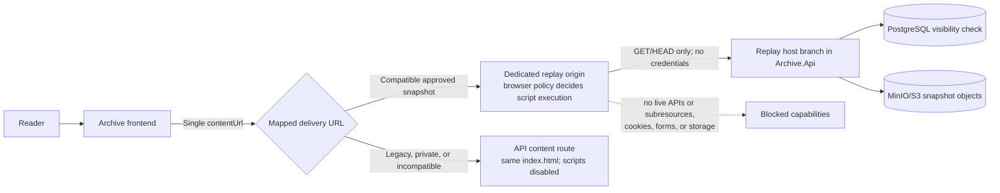

# Proposal: isolated JavaScript replay for archived pages

## Status

- **Document status:** accepted design record; implemented on the target branch.
- **Target branch:** `codex/feat/interactive-archive-replay`, created from the updated local `master` at `a180ea6`.
- **Decision:** implementation approved on 2026-10-24.
- **Result:** the implementation retains one canonical `index.html`, one existing `contentUrl`, automatic interactive playback for compatible approved captures, and static fallback without a replay feature switch.

## Objective

Archive should be able to replay JavaScript that was captured with an approved snapshot so that preserved client-side interactions can work without granting the archived code the privileges of the Archive application.

The proposed feature is an **archive-contained interactive replay**, not a live proxy of the original website. It should support deterministic interactions whose code and resources were captured, such as disclosure controls, tabs, client-side filtering, local form validation, animations, canvas rendering, bounded client-side routing, and reads of resources stored within the same snapshot. It must not reconnect an archived page to its original APIs, submit forms, open pop-ups, use browser storage, register service workers, access Archive sessions, or control the surrounding application.

The feature must preserve the existing static playback path as a compatibility fallback, not as an interaction gate. When an approved snapshot has a replay-compatible `index.html`, the snapshot page loads that interactive replay immediately. There is no `Enable interaction` action, consent step, or static/interactive mode switch. Snapshots without a compatible entry document continue to open statically without presenting a disabled control.

## Current implementation and gap analysis

The repository already provides most of the capture and storage foundation:

- URL captures run in Playwright Chromium. `CapturedResourceCollector` already accepts JavaScript and JSON response types and stores their response bodies.
- The URL capture rewriter already rewrites HTML `src` attributes, which covers ordinary external `<script src="…">` references when the resource was captured.
- MHTML and WebArchive decoders preserve the HTML root and embedded resources. Inline scripts remain part of the imported HTML.
- Stored references are route-neutral, allowing the same object set to be served through public, owner, and administrator paths.
- The API already applies a restrictive CSP and the frontend already embeds content in a sandboxed iframe.

JavaScript cannot currently run during snapshot playback because two independent controls intentionally disable it:

1. Public and private content responses send `script-src 'none'`.
2. The viewer iframe omits `allow-scripts`.

Separately, offline import screenshot rendering starts Chromium with `JavaScriptEnabled = false`. That is an ingestion safeguard, not a playback control, and remains unchanged.

There are also compatibility gaps that become visible once execution is enabled:

- Original `<meta http-equiv="Content-Security-Policy">` policies can continue to block rewritten local resources because browser policies are cumulative.
- Module imports, literal dynamic imports, and `new URL(..., import.meta.url)` references inside JavaScript bodies are not currently rewritten.
- Captured assets use hashed flat paths. A module that imports `./chunk.js` relative to its original URL therefore cannot resolve the chunk from the stored hash path.
- The current resource media-type allowlist omits common runtime data such as `model/*`, WebAssembly, and generic binary responses used by JavaScript loaders.
- Subresource integrity attributes cease to be valid if a JavaScript body is rewritten.
- `CapturedResourceCollector` deliberately excludes the main navigation response, while the current URL `index.html` is derived from the post-execution DOM; Wayback-style initialization requires retaining the original main response separately.
- The stored `index.html` has no explicit normalization version, so the application cannot distinguish a replay-compatible entry document from a legacy static snapshot.

## Recommended architecture

### Core decision

Make the single stored `index.html` replay-compatible and serve those same bytes through two separately secured delivery paths without changing the shape of `SnapshotResponse`. Its existing `contentUrl` remains the only playback URL. For an approved public snapshot with a supported `ReplayVersion`, the mapper points `contentUrl` at the dedicated replay origin. Legacy, incompatible, failed-normalization, and private snapshots keep their existing static API content URL. The replay endpoint decides from the requesting browser whether to send the interactive or script-disabled policy; the frontend does not choose between two response fields.



The replay origin can be served by the existing `Archive.Api` process, so this proposal does not require a new deployable. The reverse proxy exposes a second origin and the API branches requests by validated host. Both the replay route and static content route resolve the same stored object key; their host, iframe sandbox, and response policies—not a second HTML file or second response field—determine whether scripts can execute.

This follows the capture/storage/replay separation documented by Internet Archive without copying its WARC-scale architecture. Archive keeps its existing object layout and performs deterministic normalization during ingestion, while replay-time routing and security headers determine execution behavior. The immutable source remains separate provenance material; `index.html` is explicitly a derived display document.

- Development API: `http://localhost:5200`
- Development replay: `http://127.0.0.1:5200`
- Production API example: `https://api.archive.example.com`
- Production replay example: `https://archive-replay.example.net`

The production replay origin must not be a subdomain covered by `Authentication:SessionCookieDomain`. A separate registrable domain is preferred. The host branch rejects every path except the replay route and removes `Cookie` and `Authorization` before routing as defense in depth. The normal API origin rejects replay paths.

### Why interactive replay is public-only

The first implementation should expose interactive replay only when a snapshot is stored and `APPROVED`.

An iframe sandbox can prevent access to the parent, storage, forms, pop-ups, and top-level navigation. CSP can block ordinary `fetch`, XHR, WebSocket, resource, and worker requests. Browser sandboxing does not, however, provide a dependable way to stop hostile code from navigating its own nested browsing context to an external URL. A private MHTML or WebArchive can contain sensitive material, and executing its scripts would create an avoidable exfiltration risk.

Consequently:

- public approved snapshots automatically use interactive replay on a credential-free origin when their canonical `index.html` has a supported `ReplayVersion` and the client passes the replay capability policy;
- pending, rejected, resubmitted, owner-only, and administrator-only content remains static;
- no private bearer token, session bridge, or replay cookie is introduced;
- server-side remote-browser replay can be evaluated later if private interactive review becomes a requirement.

This boundary keeps the first implementation substantially smaller and easier to audit.

### Browser isolation policy

The root interactive `index.html` should carry a server-controlled CSP similar to the following. The exact path source is built from the configured replay origin and the current snapshot ID, never from request text.

```text
default-src 'none';
script-src https://archive-replay.example.net/replay/snapshots/{id}/ 'unsafe-inline';
style-src https://archive-replay.example.net/replay/snapshots/{id}/ 'unsafe-inline' data:;
img-src https://archive-replay.example.net/replay/snapshots/{id}/ data: blob:;
font-src https://archive-replay.example.net/replay/snapshots/{id}/ data:;
media-src https://archive-replay.example.net/replay/snapshots/{id}/ data: blob:;
frame-src https://archive-replay.example.net/replay/snapshots/{id}/ data:;
connect-src https://archive-replay.example.net/replay/snapshots/{id}/;
worker-src 'none';
object-src 'none';
form-action 'none';
base-uri https://archive-replay.example.net/replay/snapshots/{id}/;
frame-ancestors https://archive.example.com;
sandbox allow-scripts;
```

Nested captured HTML receives the same source, sandbox, form, worker, and object restrictions but omits `frame-ancestors`. A nested document's direct parent has a sandbox-created opaque origin and therefore cannot satisfy a frontend-only `frame-ancestors` expression. Omitting that directive for nested HTML permits the captured frame to load without granting it same-origin access to its parent; the inherited iframe sandbox and its own CSP still apply.

The manifest classifies every stored object as `root-document`, `nested-document`, or `asset`; request headers never choose the role. HTML, XHTML, SVG, XML with active transforms, and any other browser-active document type receive a document CSP and sandbox when their role permits document use. Version 1 supports HTML/XHTML nested documents. SVG and other active formats remain asset-only: ordinary image use remains available, but the replay endpoint rejects them as frame or navigation targets and sends an inert `default-src 'none'; script-src 'none'; connect-src 'none'; object-src 'none'; form-action 'none'; sandbox` policy as defense in depth. Inert assets receive only media-appropriate headers, CORS, and `nosniff`. The policy builder combines the manifest role, stored media type, and expected destination; unlisted or role-incompatible requests fail closed.

Additional response controls:

- `Referrer-Policy: no-referrer`
- `X-Content-Type-Options: nosniff`
- `Permissions-Policy` denying camera, microphone, geolocation, payment, USB, serial, Bluetooth, display capture, clipboard access, and other unrelated device capabilities
- `Access-Control-Allow-Origin: *` for replay resources, without credentials, so JavaScript modules and archived same-snapshot reads can load from the iframe's opaque origin
- `Connection-Allowlist: ("https://archive-replay.example.net/replay/snapshots/{id}/*")` as a mandatory Chromium 152+ replay boundary; redirects and WebRTC remain disallowed by omission
- `Cache-Control: no-store` for replay HTML; immutable public caching may be considered later for versioned assets
- only `GET`, `HEAD`, and narrowly handled `OPTIONS`; all other methods return `405`

The frontend iframe uses:

```html
<iframe
  sandbox="allow-scripts"
  referrerpolicy="no-referrer"
  title="Archived page: …"
></iframe>
```

It deliberately omits `allow-same-origin`, `allow-forms`, `allow-popups`, `allow-top-navigation`, `allow-downloads`, `allow-modals`, `allow-storage-access-by-user-activation`, and every device permission. Omitting `allow-same-origin` gives the replayed document a unique opaque origin, preventing it from reading Archive cookies or origin storage. The same `sandbox allow-scripts` restriction is also sent through CSP so directly opening the replay URL does not remove the sandbox boundary.

The public static content policy also supports this opaque iframe: public static assets send credential-free `Access-Control-Allow-Origin: *` where browser loading rules require CORS, including fonts. Its document CSP still sends `script-src 'none'` and `sandbox` without `allow-scripts`, so the iframe's outer `allow-scripts` token cannot make legacy or rejected-client content executable. Authenticated private content does not use this policy and retains the existing same-origin, script-disabled iframe.

`'unsafe-inline'` is normally inappropriate for trusted application code. It is required here because inline scripts and inline event handlers are part of the untrusted historical artifact. It is acceptable only in combination with the dedicated credential-free origin, the opaque-origin sandbox, the restricted path sources, and the public-only visibility rule. `'unsafe-eval'`, `blob:` scripts, workers, and WebAssembly compilation remain disabled in the initial version.

### Replay-capable client gate

Connection allowlisting is a prerequisite for executing archived code, not an optional hardening layer. Version 1 therefore supports only tested Chrome/Chromium-family releases at version 152 or newer that enforce `Connection-Allowlist` for subresources, navigation, redirects, and WebRTC. Firefox, Safari, older Chromium releases, clients without an accepted browser brand/version signal, and any client that fails the conformance probe receive the same replay URL and bytes under the static policy. This is automatic response-policy selection, not a user-facing interaction choice.

A documented `ReplayClientCapabilityPolicy` runs only at the replay content boundary. It parses the low-entropy structured `Sec-CH-UA` brand/major-version hint that Chromium sends by default and validates it against a deployment-configured allowlist before selecting an executable CSP. A rejected or indeterminate client receives the canonical bytes under the static script-disabled headers at the same `contentUrl`. Directly opening or guessing a replay URL therefore does not bypass the gate. The policy fails closed when hints are missing, malformed, conflicting, or outside the tested matrix, sends `Vary: Sec-CH-UA` on capability-dependent responses, and never treats a legacy User-Agent string as a permissive fallback.

Client hints identify an ordinary browser build; they are not proof against a deliberately modified client. That distinction is acceptable because the boundary protects readers from untrusted archived code, while a reader who intentionally forges browser security capabilities already controls their own client and network. Deployments that must defend against modified clients require server-side browser replay with network egress isolation.

### Residual risk

Interactive replay cannot promise perfect behavior or zero risk:

- hostile code can consume CPU or memory until the iframe is removed;
- browser vulnerabilities remain outside application control;
- code that depends on live APIs, service workers, storage, authentication, cross-origin resources, `eval`, or uncaptured chunks will degrade;
- imported MHTML or WebArchive content may contain a post-execution DOM that is initialized a second time when preserved scripts run again.

The first release enforces external connection restrictions through the mandatory client gate and `Connection-Allowlist`, with CSP, snapshot-scoped routing, server method checks, and the replay shim as independent layers. On admitted clients, archived code can connect only to the current snapshot path; redirects, WebRTC, original hosts, live APIs, and arbitrary external navigation are not allowlisted. Forms, workers, pop-ups, downloads, top-level Archive navigation, credentials, and Archive API access remain unavailable. Clients for which that boundary cannot be established receive static playback and never execute archived scripts. A future cross-browser interactive implementation would require server-side browser replay with network egress isolation rather than weakening this invariant.

## Capture and storage design

### Single versioned entry document

Each newly processed snapshot writes one canonical `index.html`. The shared normalizer makes that document suitable for both static delivery and interactive replay. The worker does not create `replay.html` or a second transformed copy.

```text
snapshots/{snapshotId}/
├── index.html          canonical normalized document; scripts preserved
├── screenshot.png
├── manifest.json
├── assets/...
├── frames/...
└── source.{html|mhtml|webarchive} immutable captured main response or uploaded source
```

The public replay route and every static content route map their virtual `index.html` to this same stored object. Other safe relative paths map to the same assets and frames. The document keeps a `./` base relative to the virtual content root, and both route layouts must preserve identical relative paths.

Add nullable `ReplayVersion` metadata to `Snapshot`:

- `null`: legacy or fallback `index.html` whose replay compatibility is not established; this includes every existing snapshot;
- `1`: canonical `index.html` produced successfully by the first replay-capable normalizer.

The normalizer sets `ReplayVersion = 1` whenever it successfully produces the canonical document, including for a page without executable JavaScript. This keeps delivery behavior consistent for all newly normalized public snapshots and avoids making script detection an API concern. The manifest separately records whether executable scripts or inline handlers were observed.

A replay-normalization failure must not discard an otherwise readable capture. The worker falls back to the existing safe static normalization, stores that result as `index.html`, leaves `ReplayVersion = null`, and records the diagnostic reason in the manifest. This is a compatibility fallback, not a second entry document.

The database migration does not backfill existing rows. Existing snapshots stay static and safe. Re-capture is the explicit upgrade path. This avoids claiming compatibility without reprocessing the source.

For URL captures, the canonical document is derived from the captured final main-document response, not from `page.Content()` after application scripts have already mutated the DOM. This matches a Wayback-style replay model in which archived scripts initialize the captured source once. The capture path must retain that main response body and its relevant response metadata as `source.html`; redirect history belongs in the manifest. The post-execution DOM may still be used only by the legacy static fallback when the main response cannot be captured, in which case `ReplayVersion` remains null.

Imported HTML, MHTML, and WebArchive files can already contain a post-execution serialized DOM. Their source bytes remain immutable and their manifest records the source kind as `imported-serialized`; replay can still be offered, but double initialization is a documented compatibility risk and must be included in diagnostics. The normalizer must never label the derived `index.html` as the original source.

The manifest moves to a new version and records replay diagnostics and provenance:

```json
{
  "provenance": {
    "derivedDisplayDocument": true,
    "sourceObjectKey": "snapshots/{id}/source.html",
    "sourceSha256": "…",
    "indexSha256": "…",
    "sourceUrl": "https://example.com/",
    "sourceMimeType": "text/html; charset=utf-8",
    "sourceStatusCode": 200,
    "capturedAt": "2026-10-23T20:00:00Z",
    "documentState": "original-response"
  },
  "replay": {
    "version": 1,
    "normalizer": "archive-replay-v1",
    "entryObjectKey": "snapshots/{id}/index.html",
    "scriptCount": 4,
    "moduleCount": 1,
    "rewrittenReferenceCount": 7,
    "unresolvedReferenceCount": 0
  }
}
```

Each resource entry additionally records its original URL, stored object key, media type, SHA-256 digest, and validated replay role (`nested-document` or `asset`); `index.html` is the only `root-document`. Diagnostics are operational data, not a claim that arbitrary JavaScript will work.

### Shared document normalization

Replace the duplicated regex-oriented document rewriting paths with a small shared normalization layer in `Archive.Worker`. The public surface should stay narrow:

```csharp
/// <summary>Builds the canonical archive document used by static and interactive delivery.</summary>
public interface IArchivedDocumentNormalizer
{
    ArchivedDocument Normalize(ArchivedDocumentInput input);
}
```

The implementation should use a standards-aware HTML parser, such as AngleSharp, rather than extending the current regular expressions for security-sensitive element and attribute changes. It should:

1. Resolve the original base URL before replacing `<base>`.
2. Rewrite captured HTML, stylesheet, image, media, frame, and script references to safe stored paths and assign each stored object an explicit replay role.
3. Preserve inline scripts and event-handler attributes in `index.html`; static delivery prevents their execution through both iframe sandboxing and response CSP.
4. Remove author-supplied CSP, refresh, and referrer meta elements from `index.html`; Archive-controlled response headers remain authoritative for both delivery modes.
5. Remove or recalculate `integrity`, `crossorigin="use-credentials"`, and incompatible `crossorigin` attributes when their local resource body or request mode changes. Remove element-level `referrerpolicy`, anchor `ping`, and external `preconnect`, `dns-prefetch`, `prefetch`, and `prerender` hints. Rewrite captured same-snapshot `modulepreload` references and remove external ones.
6. Rewrite ordinary external anchors to a non-navigating archived record containing the original URL. Fragment links and captured same-snapshot frame links may remain functional.
7. Inject a small, fixed replay shim before archived scripts. It maps exact captured URLs used by `fetch` and XHR `GET`/`HEAD` calls to their same-snapshot replay paths, rebuilds them with `credentials: "omit"`, forces XHR `withCredentials = false`, and removes `Authorization` and unapproved request headers. It rejects uncaptured or unsupported requests, disables `RTCPeerConnection` as a best-effort compatibility guard, and blocks ordinary external navigation and submits. It does not communicate with or control the Archive parent. The shim remains inert during static delivery because scripts cannot run there.
8. Produce deterministic output so identical input and resource maps generate identical replay bytes.

The stored document itself is neither a trusted application page nor a security boundary. Static delivery remains non-executable because its response sends `script-src 'none'` and a CSP sandbox without `allow-scripts`; private static delivery additionally omits `allow-scripts` from the iframe. Interactive delivery uses the dedicated replay origin and an opaque-origin iframe. The replay shim is a compatibility layer, not the primary security boundary.

### JavaScript resource references

JavaScript bodies need a bounded reference pass so modern module graphs do not fail solely because assets were flattened into hash paths. Implement a tested tokenizer/parser-based `ArchivedJavaScriptReferenceRewriter`; do not use regular expressions over arbitrary JavaScript.

Version 1 rewrites only string-literal forms that can be resolved deterministically against the resource's original URL:

- static `import … from "…"`;
- side-effect `import "…"`;
- `export … from "…"`;
- literal `import("…")`;
- literal `new URL("…", import.meta.url)`;
- literal `fetch("…")` and `new Request("…")` inputs.

The replacement is the correct relative path from the stored script to a captured target. The replay shim additionally resolves computed `fetch` and XHR URLs only when their absolute original URL is an exact member of the captured-resource map. Missing references increment `unresolvedReferenceCount`; uncaptured and external requests are rejected by the shim and independently blocked by replay CSP. The replay host serves captured runtime data only beneath the current snapshot path and only through `GET` or `HEAD` without credentials. Classic scripts require no body rewrite unless they contain one of the explicitly supported literal patterns.

This rewriter is used for URL, MHTML, and WebArchive inputs. CSS rewriting remains in the shared resource normalizer. A snapshot with required missing resources remains `INCOMPLETE` under the existing quality model.

### Offline import execution

Keep `JavaScriptEnabled = false` while the worker renders screenshots for uploaded HTML, MHTML, and WebArchive files. Uploaded documents are attacker-controlled, and executing them inside the worker is unnecessary for producing the canonical document. Their preserved scripts execute only after the snapshot is approved and only on the public, credential-free replay origin.

URL capture continues to execute the live page in the existing guarded Playwright context because that is required to discover dynamic resources and produce the screenshot. The collector must additionally retain the final successful main-document response body, status, media type, URL, and redirect chain before page scripts mutate the DOM. That response is the input for canonical normalization; the post-execution DOM is limited to screenshots, diagnostics, and the explicit legacy-static fallback. No new live-network permission is added.

Expand the bounded resource collector to retain observed runtime data types required by accepted fixtures, including `model/*`, JSON/XML, WebAssembly, and generic binary bodies, while preserving existing count and byte limits. Store the server media type and serve it with `nosniff`; executable classification remains explicit and never derives from a filename alone. WebAssembly is retained for provenance and forward compatibility but marked `captured-but-not-executable` in replay version 1 because `'wasm-unsafe-eval'` is intentionally absent. Resources that would only be requested after an interaction not exercised during capture remain uncaptured and fail closed during replay.

## Backend and API changes

### Core and persistence

Expected changes:

- `backend/Archive.Core/Entities/Snapshot.cs`
  - add nullable `short ReplayVersion` with an XML summary;
- `backend/Archive.Core/Configurations/SnapshotConfiguration.cs`
  - map and constrain the replay version;
- new EF Core migration
  - add a nullable small integer column; no data backfill;
- `backend/Archive.Core/Models/Processing/SnapshotProcessingResults.cs`
  - carry the replay version from worker completion;
- processing repository completion mapping
  - persist replay version atomically with content prefix and quality;
- snapshot detail projections
  - include replay availability without additional per-row object-storage requests;
- snapshot content storage
  - reuse the existing active content prefix and safe object lookup for the replay route, so both static and interactive delivery read the same `index.html` and resources without duplicating objects.

### Replay host boundary

Add validated replay options:

```json
{
  "Replay": {
    "PublicOrigin": "http://127.0.0.1:5200"
  }
}
```

There is deliberately no `Replay__Enabled` or equivalent interaction switch. Replay is a normal part of serving a compatible approved snapshot. `Replay__PublicOrigin` is required configuration rather than a feature flag: validation requires an absolute HTTP origin in Development, HTTPS outside Development, no path/query/fragment/credentials, and an origin different from both frontend and public API origins. Production validation rejects a replay host covered by `SessionCookieDomain` and fails application startup when the origin is absent or invalid.

At the start of the HTTP pipeline:

1. compare the normalized request origin/host to the configured replay origin;
2. on the replay host, remove credential headers and route only `/replay/snapshots/{snapshotId}/{**path}`;
3. on the API host, reject `/replay`;
4. reject unexpected forwarded hosts, methods, and malformed paths before controller execution.

The replay endpoint is anonymous and reads through the same public repository visibility predicate as `/api/snapshots/{id}`: `APPROVED`, stored quality, and active content prefix are mandatory. Object presence alone never authorizes replay. The endpoint serves only `index.html` plus paths and media types listed as replay resources in the current manifest; it never exposes the manifest, immutable source object, or an arbitrary object-prefix path. Replay resource requests never redirect to another path, snapshot, or origin: an absent resource returns a terminal `404`, preserving the snapshot-scoped CSP and routing boundary.

Centralize public static, private static, interactive root document, interactive nested document, active-format asset, and inert asset header construction in a documented `ArchivedContentPolicyBuilder`. This removes the current CSP duplication between `SnapshotsController` and `SnapshotSubmissionControllerBase` while making the different trust modes explicit.

### Public contract

Do not add, remove, or rename a `SnapshotResponse` field. The existing contract remains:

```json
{
  "contentUrl": "https://archive-replay.example.net/replay/snapshots/{id}/index.html"
}
```

Only its documented delivery semantics change. `contentUrl` remains null until stored content exists. For an approved public snapshot with a supported `ReplayVersion`, it points to the replay origin; otherwise it retains the existing scope-appropriate static API URL. Owner and moderator responses always retain their authenticated static URL. A replay URL may still return the static policy when `ReplayClientCapabilityPolicy` does not admit the browser. `SnapshotResponse` never contains both an interactive and a static playback URL.

Because implementation updates the OpenAPI description of the existing public contract, it must still regenerate frontend types with the exact existing workflow even though no TypeScript property is added:

1. start the backend in Development so its OpenAPI document is available;
2. from `frontend/`, run `bun --bun run generate:api`;
3. commit the generated type changes;
4. do not alter how `@hey-api/openapi-ts` or `frontend/openapi-ts.config.ts` reaches the OpenAPI document.

## Frontend replay behavior and design

### Interaction model

The snapshot page should feel like entering a Wayback Machine capture: the preserved page is immediately visible and its captured client-side behavior is available without an Archive-specific activation flow.

The iframe always receives the existing `contentUrl`. The page does not branch between static and interactive response properties and does not render an `Enable interaction`, `Stop interaction`, or `Return to static view` control. Archive chrome remains outside the iframe and does not intercept ordinary interaction with the preserved document.

For public snapshots, the iframe uses `sandbox="allow-scripts"` and an opaque origin. Whether scripts actually execute is determined solely by the response policy at `contentUrl`: compatible replay on an admitted browser permits them, while a static API response or rejected replay client sends a CSP sandbox without `allow-scripts`. Private owner and moderator views keep their existing static API URL and `sandbox="allow-same-origin"` without `allow-scripts`, preserving authenticated subresource access without executing archived code.

No replay readiness handshake or second-URL retry is introduced. Missing scripts or assets degrade inside the preserved document in the same manner as other incomplete archives and remain visible through capture diagnostics; they are never fetched from the live web. Reloading the outer snapshot URL creates a fresh archived frame.

### Editorial design requirements

The implementation follows the repository's editorial interface system:

- Archive controls remain visually separate from the original page and never recolor archived content for dark mode.
- No replay-mode badge, switch, or status copy is required; the existing information dialog remains focused on snapshot provenance.
- Time Copper remains reserved for snapshot time and selection.
- Existing Archive controls keep a minimum `44 × 44px` target and the existing `3px` focus outline.
- The explanation uses Source Sans 3; URLs and technical replay version data use IBM Plex Mono only where needed.
- No floating card, gradient, glass effect, oversized radius, animation loop, or decorative warning panel is introduced.
- Archive chrome reflows at 320 CSS pixels and remains usable at 200% text zoom.
- Archived content keeps a white/own-page background even when Archive uses Night Stacks.
- The archived page occupies the primary surface immediately; Archive must not add an interstitial, warning card, or activation overlay.
- Motion in Archive chrome is limited to existing short state transitions and respects `prefers-reduced-motion`; preserved page motion is governed by the replay sandbox and captured code.

The final copy remains English. The feature should not add promotional or anthropomorphic text.

Expected frontend files:

- `frontend/src/routes/snapshots/[snapshotId]/+page.svelte`
  - keep `contentUrl` as the sole iframe source, apply the opaque script-capable sandbox only to public playback, and retain the authenticated static sandbox for private review;
- `frontend/src/lib/api/types.gen.ts`
  - regenerate from OpenAPI and never edit by hand; no new response property is expected.

No application design change is complete until the integrated browser has been used to inspect light and dark themes at desktop and mobile widths, keyboard focus, 200% zoom, long titles/URLs, legacy static snapshots, unsupported-client static policy, and automatic interactive replay.

## Security verification

### Automated probes

Add a deliberately hostile replay fixture whose script attempts each capability below. The test passes only when the observable result matches the table.

| Attempt | Required result |
| --- | --- |
| Read or mutate `window.parent.document` | blocked by cross-origin/opaque-origin boundary |
| Read `document.cookie`, `localStorage`, or IndexedDB | unavailable or empty; no Archive credential exposed |
| `fetch` or XHR `GET`/`HEAD` for an exactly captured resource in the same snapshot | rewritten to the replay path and succeeds without credentials |
| `fetch` or XHR for an uncaptured URL, external host, other snapshot, or unsupported method | rejected by the shim and independently blocked by CSP or routing |
| Originally credentialed captured `fetch` or XHR | replayed with credentials omitted, `withCredentials` false, and authorization headers removed |
| EventSource, WebSocket, or WebTransport | blocked or unsupported by the replay host |
| RTCPeerConnection, ICE/STUN, or WebRTC data channel on an admitted client | blocked by the mandatory connection allowlist's default WebRTC policy; the shim is defense in depth |
| Register service worker or create worker | blocked |
| Submit form | blocked |
| Open pop-up or new tab | blocked |
| Navigate top-level Archive page | blocked |
| Trigger download | blocked |
| Access camera, microphone, geolocation, clipboard, USB | blocked |
| Request another snapshot's private or public replay path as a subresource | blocked by snapshot-scoped CSP path; private replay does not exist |
| Call `/api/*` through replay host | `404` before API routing and without credentials |
| Send `POST`, `PUT`, `PATCH`, or `DELETE` to replay host | `405` |
| Open replay URL directly | scripts stay under response CSP sandbox |
| Load scripted SVG/XML as an image | renders only in its inert asset role; script and external connections do not execute |
| Load an asset-role SVG/XML as an iframe or document | rejected or served under the inert document policy |
| Navigate the replay iframe itself to a controlled external test origin | blocked before the request is sent by the mandatory connection allowlist |
| Send arbitrary replay `postMessage` payloads to the parent | ignored; the parent has no replay command or readiness protocol |
| Request a compatible snapshot from an old Chromium build, Firefox, Safari, or without a valid low-entropy `Sec-CH-UA` brand/major-version hint | `contentUrl` remains the replay URL, but its response uses the script-disabled static policy |

Tests should also assert exact security headers, host gating, approved visibility, path normalization, no credentialed CORS, MIME handling with `nosniff`, and the absence of `allow-same-origin`. A storage-level assertion verifies that static and replay routes resolve the same `index.html` object and that processing creates no `replay.html` object. Response tests verify that the bytes are identical while their security headers differ intentionally. Capability tests cover the minimum admitted Chromium version, a current admitted version, a lower version, a valid allowed Chromium/product combination that also contains a GREASE brand, missing, malformed, and conflicting structured hints, unknown-only or non-allowed product brands, cache variation, and direct replay navigation. Browser-network tests run an instrumented external DNS/HTTP/STUN target and fail if an admitted replay emits any request outside its snapshot path; the same suite confirms unsupported browsers remain static. Browser tests also verify `Origin: null` for module and same-snapshot CORS requests, correct JavaScript MIME types under `nosniff`, static and dynamic modules, fonts, Canvas/WebGL rendering, removal of credentialed CORS attributes, and separate policies for root documents, nested documents, active asset types, and inert assets. Pixel readback is required only in a fixture that explicitly sets `crossorigin="anonymous"` before assigning its image or media source; replay version 1 does not rewrite every image load into CORS mode because doing so would break credentialed private static delivery of the same canonical bytes.

### Functional probes

Fixtures cover:

- inline event handlers and `addEventListener`;
- external classic scripts;
- ES module import/export;
- literal dynamic import;
- `new URL(..., import.meta.url)` assets;
- timers, DOM mutation, animation, canvas, fragment navigation, and client-side filters;
- nested archived frames that load successfully while remaining unable to access the opaque-origin parent DOM;
- successful captured JSON/model reads through `fetch` and XHR;
- graceful failure for uncaptured or live `fetch`, missing chunks, service workers, and storage;
- graceful non-execution of captured WebAssembly under replay version 1;
- automatic interactive startup for admitted clients and automatic static response policy at the same replay URL when the required browser capability is unavailable.

Add focused worker tests for normalization and JavaScript reference rewriting, API integration tests for `contentUrl` mapping, replay routing, and headers, and browser tests for automatic policy selection and isolation. The repository currently has no automated test projects, so the implementation should introduce small, responsibility-specific test projects rather than a broad test utility layer.

## Three-page acceptance archive

### Complexity measure

Use a documented **Archive Replay Complexity Score** to select test pages instead of relying on subjective labels. Score each dimension from `0` to `2` before capture:

| Dimension | 0 | 1 | 2 |
| --- | --- | --- | --- |
| DOM | fewer than 300 nodes | 300–1,500 | more than 1,500 |
| captured resources | fewer than 10 | 10–50 | more than 50 |
| JavaScript graph | none | classic scripts only | modules, chunks, or dynamic imports |
| interaction/state | none | local controls | routing, persistent state, animation, or complex state |
| rich composition | plain document | responsive media | frames, canvas, WebGL, or comparable composition |

Interpretation: `0–2` simple, `3–5` intermediate, `6–10` complex. A score of six requires three maximum-complexity dimensions, so a small but stateful WebGL/module application is still treated as complex even when its DOM and resource count are low. Record the measured node and resource counts, observed script forms, expected interactions, final score, capture time, source format, and any missing resources in the test notes.

### Minimum matrix

After implementation, archive at least these three pages so the required source formats and complexity range are represented:

| Level | Candidate | Ingestion format | Expected proof |
| --- | --- | --- | --- |
| Simple | `http://info.cern.ch/hypertext/WWW/TheProject.html` | WebArchive | the canonical historical document opens automatically through replay delivery and remains readable without executable behavior or an interaction control |
| Intermediate | `https://mdn.github.io/learning-area/javascript/oojs/bouncing-balls/index-finished.html` | MHTML | the captured classic script initializes its canvas animation and advances the bouncing-ball scene without live requests |
| Complex | `https://mdn.github.io/dom-examples/webgl-examples/tutorial/sample4/` | URL | the statically referenced local ES-module graph and captured gl-matrix dependency render the continuously rotating, vertex-colored WebGL square without contacting the original or CDN hosts |

These are candidates, not immutable dependencies. Before capture, verify that each page is reachable, permits archiving under robots and `noarchive` policy, and still fits the intended score. For every scripted candidate, statically and dynamically verify that its tested path does not require workers, WebAssembly, import maps, `eval`, `document.write`, dynamic `script`/`link`/`img` URL construction, path-based script self-location, or other behavior outside the v1 rewrite matrix. If a candidate changed or violates that matrix, replace it with a stable page in the same class and document the reason instead of widening replay permissions for the test.

Chromium DevTools `Page.captureSnapshot` can produce the MHTML artifact after the page settles. A WebArchive is a Safari property-list format; in the Windows/WSL environment, create the simple fixture as an XML or binary property list containing `WebMainResource`, `WebSubresources`, and any subframes from the captured page, matching the structure consumed by `WebArchiveDecoder`. If access to Safari is available, prefer a real Safari-generated file and retain its provenance in the test notes. Test artifacts and notes must not contain account data, cookies, tokens, or unrelated browsing history.

For stronger cross-format confidence, repeat the intermediate page in all three formats after the minimum matrix passes. That comparison is useful but is not required to establish the first acceptance baseline.

The completed local baseline is recorded in [Interactive archive replay acceptance](interactive-archive-replay-acceptance.md).

## Local implementation and test environment

No services are started while this proposal is awaiting approval. Once approved, use WSL for the worker, PostgreSQL, and MinIO, while starting the API and frontend directly on Windows as requested.

### Container inventory and cleanup

Before creating services:

1. inspect all running and stopped containers from WSL;
2. inspect Docker Compose project labels, mounts, networks, and named volumes;
3. identify only resources belonging to this repository or the selected Compose project;
4. stop and remove those project containers if they conflict;
5. remove only confirmed project database and MinIO volumes when a clean acceptance run is required;
6. leave unrelated containers, networks, images, and volumes untouched;
7. report what was removed and that volume deletion is not recoverable through Docker.

Use a distinct Compose project name such as `archive-js-replay`. Add a temporary local override, kept out of Git, that publishes:

- PostgreSQL `127.0.0.1:5432:5432` for the Windows API;
- MinIO `127.0.0.1:9000:9000` and console `127.0.0.1:9001:9001` for the Windows API and inspection;
- no worker port; the worker reaches `postgres:5432` and `minio:9000` on the Docker network.

The API remains the only process with `Database:Initialize=true`; the worker uses `false`. MinIO initialization creates the configured bucket before worker startup.

### Windows processes and credentials

Start on Windows:

1. `Archive.Api` on `http://localhost:5200`, also accepting the validated replay host `http://127.0.0.1:5200`;
2. SvelteKit on `http://localhost:5173`;
3. frontend API generation only while the Development API is running.

Inject the supplied Google OAuth client ID and secret only through ignored local settings or process environment variables. Do not write either value to this proposal, tracked configuration, shell history, logs, screenshots, test artifacts, or commits. Use the registered callback `http://localhost:5200/api/auth/callback/google`.

If an authenticated flow is required, pause and ask the user to sign in with the Google test account. Never request the Google password or attempt to automate credential entry.

## Implementation sequence

1. **Persistence and processing result**
   - add `ReplayVersion`, migration, projections, completion mapping, and documentation comments;
   - keep existing rows null.
2. **Shared replay normalization**
   - introduce parsed HTML normalization and JavaScript literal-reference rewriting;
   - retain and normalize the original URL main-document response instead of the post-execution DOM;
   - capture required bounded runtime-data media types and build the exact original-URL-to-object map used by the replay shim;
   - write one replay-compatible `index.html` plus manifest diagnostics for URL, MHTML, and WebArchive captures;
   - keep offline import screenshot JavaScript disabled.
3. **Replay host and content delivery**
   - add required replay-origin configuration without an enabled flag, early host/method gate, structured client-hint validation through `ReplayClientCapabilityPolicy`, manifest-allowlisted object roles, and distinct root document, nested document, active asset, inert asset, and static policies;
   - add API/security tests before shipping the feature.
4. **Existing API contract**
   - keep `SnapshotResponse` unchanged and update the existing `contentUrl` mapping and OpenAPI description for replay-capable approved public snapshots;
   - run `bun --bun run generate:api` against the running backend without changing the generator configuration.
5. **Frontend playback sandbox**
   - keep `contentUrl` as the only iframe source, use the opaque script-capable iframe sandbox for public playback, and retain the authenticated static sandbox for private review;
   - keep all UI copy in English.
6. **Validation environment**
   - inspect and, where confirmed, clean existing project containers/volumes;
   - start worker/PostgreSQL/MinIO through WSL and API/frontend through Windows;
   - use local-only OAuth settings and request user sign-in only if needed.
7. **Acceptance archive and browser review**
   - capture the three-page minimum matrix;
   - execute interaction and hostile-capability probes;
   - inspect desktop/mobile, light/dark, keyboard, zoom, legacy static captures, rejected-client static policy, and automatic interactive replay in the integrated browser.
8. **Documentation and final checks**
   - update architecture, configuration, development, and deployment documentation;
   - run builds, tests, generated-type checks, formatting, and production frontend build;
   - require a valid dedicated replay origin in every non-test deployment; do not introduce an interaction enable flag.

## Expected file-level changes

The final implementation is expected to touch or add files in these areas:

- `backend/Archive.Core`
  - snapshot entity/configuration, migration, processing result, mappings, repositories, and replay object access;
- `backend/Archive.Worker`
  - main-response capture, bounded runtime-data media types, shared HTML/resource normalizer, JavaScript reference rewriter, URL storage path, offline import path, and manifest;
- `backend/Archive.Api`
  - required replay-origin options/validation, host boundary, replay controller or endpoint group, content policy builder, existing `contentUrl` mapping, and OpenAPI descriptions;
- `frontend/src/lib/api`
  - generated API types;
- `frontend/src/routes/snapshots/[snapshotId]/+page.svelte`
  - public/private iframe sandbox selection while retaining `contentUrl` as the only source;
- test projects and browser fixtures
  - normalizer, policy, routing, security, and interaction coverage;
- `docs/architecture.md`, `docs/configuration.md`, `docs/development.md`, and `docs/deployment.md`
  - trust boundary, origins, settings, local workflow, and rollout.

Production code additions receive concise professional `///`, `//`, or `/* … */` documentation where they explain a contract, security boundary, non-obvious browser behavior, or algorithm. Comments should explain why a restriction exists, not restate syntax.

## Validation commands

The exact test project names will be finalized during implementation, but the final verification should include at least:

```powershell
dotnet build backend/Archive.slnx
dotnet test backend/Archive.slnx
```

With the Development API running:

```powershell
Set-Location frontend
bun --bun run generate:api
bun run check
bun run lint
bun run build
bun run build:storybook
```

Any introduced browser test command must be documented and run against the real local API, replay origin, PostgreSQL, MinIO, and worker. Successful compilation alone is not acceptance for this feature.

## Acceptance criteria

Implementation is complete only when all of the following are true:

- compatible approved public snapshots open directly in interactive replay without an activation action;
- static playback remains automatic for existing snapshots, failed normalization, private views, and clients outside the tested connection-allowlist matrix;
- existing snapshots do not claim interactive support;
- approved new URL, MHTML, and WebArchive captures can expose a versioned interactive replay from their canonical `index.html`;
- static and interactive routes read that same stored entry document, and no `replay.html` is created;
- `SnapshotResponse` retains only its existing `contentUrl`; no `interactiveContentUrl` or other parallel playback field exists;
- no `Replay__Enabled` or equivalent interaction feature switch exists, and a valid dedicated replay origin is mandatory deployment configuration;
- private snapshots never expose or execute interactive replay;
- replay is served on a dedicated credential-free origin, and normal API routes are unavailable there;
- admitted public replay combines an `allow-scripts` iframe with an executable response policy without granting same-origin privileges; static response policy remains non-executable at the same replay URL for rejected clients;
- captured same-snapshot `fetch`/XHR `GET` and module requests resolve with forced credential omission, while external or uncaptured subresources, live APIs, unsupported methods, workers, forms, pop-ups, downloads, top navigation, device access, and Archive API access are blocked by independently tested controls;
- archived scripts execute only when the replay content boundary admits a tested Chromium 152+ client and the required `Connection-Allowlist` controls pass an end-to-end conformance test, including its default redirect and WebRTC blocks; every other client receives the static policy;
- an admitted replay emits no DNS, HTTP(S), WebSocket, WebTransport, WebRTC/STUN, or redirect request outside the current snapshot path in hostile browser-network tests;
- root and nested archived documents load under their distinct tested policies while remaining mutually opaque, and active-format assets cannot become unrestricted documents;
- the frontend has no replay readiness or command protocol and ignores arbitrary replay messages;
- module literals supported by version 1 resolve to captured resources, and unresolved dependencies fail closed;
- source and derived-document hashes, capture metadata, transformation version, and per-resource provenance are recorded in the manifest;
- public contracts and generated TypeScript types agree;
- the three-page format/complexity matrix is archived and its expected interactions are verified;
- the integrated browser review finds no desktop/mobile, light/dark, focus, zoom, overflow, or archived-content theming defects;
- OAuth secrets and local infrastructure credentials are absent from Git and logs;
- architecture, configuration, development, and deployment documentation describe the feature and its limitations.

## Alternatives considered

### Add `Replay__Enabled` or a second `interactiveContentUrl`

Rejected. Interaction is the normal playback behavior of every compatible approved public snapshot, not an operator-selected mode or a second user-facing destination. The existing `contentUrl` maps to the correct delivery origin from snapshot metadata, while the replay endpoint fails closed to a static response policy for unsupported clients. A boolean switch and parallel URL would add divergent states without strengthening the isolation boundary.

### Add `allow-scripts` to the existing iframe and API CSP

Rejected. It would keep untrusted script delivery on the authenticated API origin, provide no compatibility version or distinct static fallback, and make direct replay URLs harder to isolate. Keeping `allow-same-origin` while adding scripts would also remove the opaque-origin defense.

### Store separate `index.html` and `replay.html` documents

Rejected. Static and interactive delivery can apply different iframe and response policies to the same canonical bytes. A second transformed HTML entry would duplicate normalization output, create opportunities for the representations to diverge, complicate provenance, and provide no additional security boundary. If evidentiary preservation of the unmodified source is required, retain the original uploaded file or captured response material separately instead of treating a second display document as the source record.

### Enable scripts for private owner and moderator previews

Rejected for the first release. Client-side sandboxing cannot provide the confidentiality guarantee required for attacker-controlled private archives. A remote, network-isolated browser session is the appropriate future direction if this becomes mandatory.

### Reconnect missing resources to the original web

Rejected. It would undermine reproducibility, disclose reader activity to third parties, change historical behavior over time, and expand SSRF/tracking risk. Missing content must remain missing and observable.

### Replace the viewer with remote browser streaming immediately

Deferred. It could provide cross-browser interactive replay and support private captures, but requires session scheduling, input transport, frame streaming, quotas, recovery, and substantially more operational capacity. Version 1 instead fails closed to static playback outside its tested connection-allowlist client matrix; it must not weaken the no-live-network invariant to broaden browser support.

## Standards and security references

- [Archive-It: capture, storage, and replay as separate web-archiving stages](https://support.archive-it.org/hc/en-us/articles/360041674111-What-is-web-archiving)
- [Internet Archive Liveweb: captured responses are stored in ARC/WARC and processed by Wayback](https://github.com/internetarchive/liveweb)
- [Internet Archive: limitations of JavaScript and origin-dependent functionality in archived pages](https://archivesupport.zendesk.com/hc/en-us/articles/360004651732-Using-The-Wayback-Machine)
- [WHATWG HTML: the iframe element and sandbox tokens](https://html.spec.whatwg.org/dev/iframe-embed-object.html)
- [W3C Content Security Policy Level 3](https://www.w3.org/TR/CSP3/)
- [Chrome for Developers: Connection Allowlist header and its navigation/WebRTC boundary](https://developer.chrome.com/blog/connection-allowlist-announcement)
- [WICG: Connection Allowlists specification](https://wicg.github.io/connection-allowlists/)
- [MDN: `<iframe>` sandbox behavior and origin isolation](https://developer.mozilla.org/en-US/docs/Web/HTML/Reference/Elements/iframe)
- [OWASP HTML5 Security Cheat Sheet: sandboxed frames](https://cheatsheetseries.owasp.org/cheatsheets/HTML5_Security_Cheat_Sheet.html#sandboxed-frames)
- [OWASP Micro Frontend Security: isolate different trust levels](https://cheatsheetseries.owasp.org/cheatsheets/Micro_Frontend_Security_Cheat_Sheet.html#isolate-features-with-different-trust-levels)

## Implementation record

Implementation began only after explicit user approval. The code, migration, generated API types, focused tests, runtime validation, and acceptance notes are committed separately from the design-history commits.
