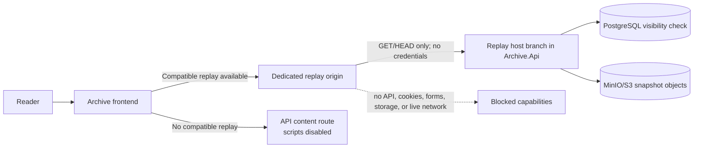

# Proposal: isolated JavaScript replay for archived pages

## Status

- **Document status:** implementation proposal; no product code has been changed.
- **Target branch:** `codex/feat/interactive-archive-replay`, created from the updated local `master` at `a180ea6`.
- **Decision requested:** approval to implement the design described below.
- **Scope of this commit:** documentation only. The local runtime, containers, OAuth credentials, database, object storage, API contracts, generated frontend types, and UI remain unchanged.

## Objective

Archive should be able to replay JavaScript that was captured with an approved snapshot so that preserved client-side interactions can work without granting the archived code the privileges of the Archive application.

The proposed feature is an **offline interactive replay**, not a live proxy of the original website. It should support deterministic interactions whose code and resources were captured, such as disclosure controls, tabs, client-side filtering, local form validation, animations, canvas rendering, and bounded client-side routing. It must not reconnect an archived page to its original APIs, submit forms, open pop-ups, use browser storage, register service workers, access Archive sessions, or control the surrounding application.

The feature must preserve the existing static playback path as a compatibility fallback, not as an interaction gate. When an approved snapshot has a compatible replay artifact, the snapshot page loads that interactive replay immediately. There is no `Enable interaction` action, consent step, or static/interactive mode switch. Snapshots without a compatible replay artifact continue to open as static documents without presenting a disabled control.

## Current implementation and gap analysis

The repository already provides most of the capture and storage foundation:

- URL captures run in Playwright Chromium. `CapturedResourceCollector` already accepts JavaScript and JSON response types and stores their response bodies.
- The URL capture rewriter already rewrites HTML `src` attributes, which covers ordinary external `<script src="…">` references when the resource was captured.
- MHTML and WebArchive decoders preserve the HTML root and embedded resources. Inline scripts remain part of the imported HTML.
- Stored references are route-neutral, allowing the same object set to be served through public, owner, and administrator paths.
- The API already applies a restrictive CSP and the frontend already embeds content in a sandboxed iframe.

JavaScript cannot currently run because three independent controls intentionally disable it:

1. Public and private content responses send `script-src 'none'`.
2. The viewer iframe omits `allow-scripts`.
3. Offline import screenshot rendering starts Chromium with `JavaScriptEnabled = false`.

There are also compatibility gaps that become visible once execution is enabled:

- Original `<meta http-equiv="Content-Security-Policy">` policies can continue to block rewritten local resources because browser policies are cumulative.
- Module imports, literal dynamic imports, and `new URL(..., import.meta.url)` references inside JavaScript bodies are not currently rewritten.
- Captured assets use hashed flat paths. A module that imports `./chunk.js` relative to its original URL therefore cannot resolve the chunk from the stored hash path.
- Subresource integrity attributes cease to be valid if a JavaScript body is rewritten.
- Static and interactive playback currently share one stored entry document, leaving no explicit compatibility version or safe fallback for older snapshots.

## Recommended architecture

### Core decision

Add a versioned replay document and a dedicated public replay origin. Keep the current `contentUrl` as the static, script-disabled fallback and add a nullable `interactiveContentUrl` for approved snapshots that have a compatible replay document. The frontend selects `interactiveContentUrl` as the initial iframe source whenever it is present; otherwise it uses `contentUrl`.



The replay origin can be served by the existing `Archive.Api` process, so this proposal does not require a new deployable. The reverse proxy exposes a second origin and the API branches requests by validated host:

- Development API: `http://localhost:5200`
- Development replay: `http://127.0.0.1:5200`
- Production API example: `https://api.archive.example.com`
- Production replay example: `https://archive-replay.example.net`

The production replay origin must not be a subdomain covered by `Authentication:SessionCookieDomain`. A separate registrable domain is preferred. The host branch rejects every path except the replay route and removes `Cookie` and `Authorization` before routing as defense in depth. The normal API origin rejects replay paths.

### Why interactive replay is public-only

The first implementation should expose interactive replay only when a snapshot is stored and `APPROVED`.

An iframe sandbox can prevent access to the parent, storage, forms, pop-ups, and top-level navigation. CSP can block ordinary `fetch`, XHR, WebSocket, resource, and worker requests. Browser sandboxing does not, however, provide a dependable way to stop hostile code from navigating its own nested browsing context to an external URL. A private MHTML or WebArchive can contain sensitive material, and executing its scripts would create an avoidable exfiltration risk.

Consequently:

- public approved snapshots automatically use interactive replay on a credential-free origin when a compatible replay artifact is available;
- pending, rejected, resubmitted, owner-only, and administrator-only content remains static;
- no private bearer token, session bridge, or replay cookie is introduced;
- server-side remote-browser replay can be evaluated later if private interactive review becomes a requirement.

This boundary keeps the first implementation substantially smaller and easier to audit.

### Browser isolation policy

Interactive HTML responses should carry a server-controlled CSP similar to the following. The exact path source is built from the configured replay origin and the current snapshot ID, never from request text.

```text
default-src 'none';
script-src https://archive-replay.example.net/replay/snapshots/{id}/ 'unsafe-inline';
style-src https://archive-replay.example.net/replay/snapshots/{id}/ 'unsafe-inline' data:;
img-src https://archive-replay.example.net/replay/snapshots/{id}/ data: blob:;
font-src https://archive-replay.example.net/replay/snapshots/{id}/ data:;
media-src https://archive-replay.example.net/replay/snapshots/{id}/ data: blob:;
frame-src https://archive-replay.example.net/replay/snapshots/{id}/ data:;
connect-src 'none';
worker-src 'none';
object-src 'none';
form-action 'none';
base-uri https://archive-replay.example.net/replay/snapshots/{id}/;
frame-ancestors https://archive.example.com;
sandbox allow-scripts;
```

Additional response controls:

- `Referrer-Policy: no-referrer`
- `X-Content-Type-Options: nosniff`
- `Permissions-Policy` denying camera, microphone, geolocation, payment, USB, serial, Bluetooth, display capture, clipboard access, and other unrelated device capabilities
- `Access-Control-Allow-Origin: *` for replay resources, without credentials, so JavaScript modules can load from the iframe's opaque origin
- `Cache-Control: no-store` for replay HTML; immutable public caching may be considered later for versioned assets
- only `GET`, `HEAD`, and narrowly handled `OPTIONS`; all other methods return `405`

The frontend iframe uses:

```html
<iframe
  sandbox="allow-scripts"
  referrerpolicy="no-referrer"
  title="Interactive archived page: …"
></iframe>
```

It deliberately omits `allow-same-origin`, `allow-forms`, `allow-popups`, `allow-top-navigation`, `allow-downloads`, `allow-modals`, `allow-storage-access-by-user-activation`, and every device permission. Omitting `allow-same-origin` gives the replayed document a unique opaque origin, preventing it from reading Archive cookies or origin storage. The same `sandbox allow-scripts` restriction is also sent through CSP so directly opening the replay URL does not remove the sandbox boundary.

`'unsafe-inline'` is normally inappropriate for trusted application code. It is required here because inline scripts and inline event handlers are part of the untrusted historical artifact. It is acceptable only in combination with the dedicated credential-free origin, the opaque-origin sandbox, the restricted path sources, and the public-only visibility rule. `'unsafe-eval'`, `blob:` scripts, workers, and WebAssembly compilation remain disabled in the initial version.

### Residual risk

Interactive replay cannot promise perfect behavior or zero risk:

- hostile code can consume CPU or memory until the iframe is removed;
- code can navigate its own frame away from the replay, although it cannot navigate the Archive application or read Archive credentials;
- browser vulnerabilities remain outside application control;
- code that depends on live APIs, service workers, storage, authentication, cross-origin resources, `eval`, or uncaptured chunks will degrade;
- a post-capture DOM may be initialized a second time when original scripts run again.

These are reasons for a separate origin, strict sandboxing, a public-only first release, versioned compatibility metadata, and a retained static fallback. They do not require a user-facing activation step because the replay receives no Archive credentials or live-network capability.

## Capture and storage design

### Versioned replay artifact

Each newly processed snapshot always writes the static entry document. It additionally writes a replay entry document only when executable content is present and the normalizer can produce a compatible replay. Both entry documents reference the same captured resource objects; this is not a second full copy of the archive.

```text
snapshots/{snapshotId}/
├── index.html          static representation; existing behavior
├── replay.html         optional normalized executable representation
├── screenshot.png
├── manifest.json
├── assets/...
├── frames/...
└── source.{html|mhtml|webarchive} when uploaded
```

The replay route maps its virtual `index.html` to stored `replay.html`; other safe relative paths map to the existing assets and frames. The stored replay document keeps a `./` base relative to the virtual replay root.

Add nullable `ReplayVersion` metadata to `Snapshot`:

- `null`: no compatible interactive replay or no `replay.html`; this includes every existing snapshot;
- `1`: replay document produced by the first normalizer version.

The normalizer writes `replay.html` and sets a replay version only when it finds executable content—a non-empty executable `<script>`, an executable script resource, or an inline event-handler attribute—and successfully produces the replay document. A document without executable content keeps `ReplayVersion = null`, so the frontend transparently renders `index.html` instead of routing it through the replay origin. A replay-normalization failure must not discard an otherwise readable snapshot: storage keeps `index.html`, omits the replay entry and version, and records the diagnostic reason in the manifest.

The database migration does not backfill existing rows. Existing snapshots stay static and safe. Re-capture is the explicit upgrade path. This avoids claiming compatibility without reprocessing the source.

The manifest moves to a new version and records replay diagnostics:

```json
{
  "replay": {
    "version": 1,
    "entryObjectKey": "snapshots/{id}/replay.html",
    "scriptCount": 4,
    "moduleCount": 1,
    "rewrittenReferenceCount": 7,
    "unresolvedReferenceCount": 0
  }
}
```

Diagnostics are operational data, not a claim that arbitrary JavaScript will work.

### Shared document normalization

Replace the duplicated regex-oriented document rewriting paths with a small shared normalization layer in `Archive.Worker`. The public surface should stay narrow:

```csharp
/// <summary>Builds static and executable archive documents from one captured page.</summary>
public interface IArchivedDocumentNormalizer
{
    ArchivedDocumentSet Normalize(ArchivedDocumentInput input);
}
```

The implementation should use a standards-aware HTML parser, such as AngleSharp, rather than extending the current regular expressions for security-sensitive element and attribute changes. It should:

1. Resolve the original base URL before replacing `<base>`.
2. Rewrite captured HTML, stylesheet, image, media, frame, and script references to safe stored paths.
3. Preserve inline scripts and event-handler attributes only in `replay.html`.
4. Remove author-supplied CSP and refresh meta elements from `replay.html`; response headers remain authoritative.
5. Remove or recalculate `integrity` and incompatible `crossorigin` attributes when their local resource body or request mode changes.
6. Rewrite ordinary external anchors to a non-navigating archived record containing the original URL. Fragment links and captured same-snapshot frame links may remain functional.
7. Inject a small, fixed replay guard before archived scripts. It blocks ordinary link and submit interactions, reports navigation attempts to the parent for neutral status text, and contains no privileged bridge or general `postMessage` command channel.
8. Produce deterministic output so identical input and resource maps generate identical replay bytes.

Static `index.html` retains the present non-executable behavior. The replay guard is a usability layer, not the primary security boundary.

### JavaScript resource references

JavaScript bodies need a bounded reference pass so modern module graphs do not fail solely because assets were flattened into hash paths. Implement a tested tokenizer/parser-based `ArchivedJavaScriptReferenceRewriter`; do not use regular expressions over arbitrary JavaScript.

Version 1 rewrites only string-literal forms that can be resolved deterministically against the resource's original URL:

- static `import … from "…"`;
- side-effect `import "…"`;
- `export … from "…"`;
- literal `import("…")`;
- literal `new URL("…", import.meta.url)`.

The replacement is the correct relative path from the stored script to a captured target. Missing or computed references remain unchanged and increment `unresolvedReferenceCount`. They are then blocked by replay CSP rather than reaching the live web. Classic scripts require no body rewrite unless they contain one of the explicitly supported literal patterns.

This rewriter is used for URL, MHTML, and WebArchive inputs. CSS rewriting remains in the shared resource normalizer. A snapshot with required missing resources remains `INCOMPLETE` under the existing quality model.

### Offline import execution

Keep `JavaScriptEnabled = false` while the worker renders screenshots for uploaded HTML, MHTML, and WebArchive files. Uploaded documents are attacker-controlled, and executing them inside the worker is unnecessary for producing the replay artifact. Their scripts execute only after the snapshot is approved and only on the public, credential-free replay origin.

URL capture continues to execute the live page in the existing guarded Playwright context because that is already required to capture dynamic content. No new live-network permission is added.

## Backend and API changes

### Core and persistence

Expected changes:

- `backend/Archive.Core/Entities/Snapshot.cs`
  - add nullable `short ReplayVersion` with an XML summary;
- `backend/Archive.Core/Configurations/SnapshotConfiguration.cs`
  - map and constrain the replay version;
- new EF Core migration
  - add a nullable small integer column; no data backfill;
- `backend/Archive.Core/Models/Processing/SnapshotProcessingResults.cs`
  - carry the replay version from worker completion;
- processing repository completion mapping
  - persist replay version atomically with content prefix and quality;
- snapshot detail projections
  - include replay availability without additional per-row object-storage requests;
- snapshot content storage
  - add a replay read path that maps virtual `index.html` to `replay.html` and retains existing path traversal checks.

### Replay host boundary

Add validated replay options:

```json
{
  "Replay": {
    "Enabled": false,
    "PublicOrigin": "http://127.0.0.1:5200"
  }
}
```

Validation requires an absolute HTTP origin in Development, HTTPS outside Development, no path/query/fragment/credentials, and an origin different from both frontend and public API origins. Production validation should also reject a replay host covered by `SessionCookieDomain`.

At the start of the HTTP pipeline:

1. compare the normalized request origin/host to the configured replay origin;
2. on the replay host, remove credential headers and route only `/replay/snapshots/{snapshotId}/{**path}`;
3. on the API host, reject `/replay`;
4. reject unexpected forwarded hosts, methods, and malformed paths before controller execution.

The replay endpoint is anonymous and reads through the same public repository visibility predicate as `/api/snapshots/{id}`: `APPROVED`, stored quality, and active content prefix are mandatory. Object presence alone never authorizes replay.

Centralize public static, private static, and public interactive header construction in a documented `ArchivedContentPolicyBuilder`. This removes the current CSP duplication between `SnapshotsController` and `SnapshotSubmissionControllerBase` while making the different trust modes explicit.

### Public contract

Add to `SnapshotResponse`:

```json
{
  "interactiveContentUrl": "https://archive-replay.example.net/replay/snapshots/{id}/index.html"
}
```

The value is nullable and is returned only when replay is globally enabled, the snapshot is approved and stored, and `ReplayVersion` is supported. `contentUrl` remains unchanged and always denotes static playback.

Because this edits a public API contract, implementation must regenerate frontend types with the exact existing workflow:

1. start the backend in Development so its OpenAPI document is available;
2. from `frontend/`, run `bun --bun run generate:api`;
3. commit the generated type changes;
4. do not alter how `@hey-api/openapi-ts` or `frontend/openapi-ts.config.ts` reaches the OpenAPI document.

## Frontend replay behavior and design

### Interaction model

The snapshot page should feel like entering a Wayback Machine capture: the preserved page is immediately visible and its captured client-side behavior is available without an Archive-specific activation flow.

When `interactiveContentUrl` is non-null, it is the iframe's initial source. The page does not render an `Enable interaction`, `Stop interaction`, or `Return to static view` control. Archive chrome remains outside the iframe and does not intercept ordinary interaction with the preserved document.

When `interactiveContentUrl` is null, the iframe uses `contentUrl`. This applies to existing snapshots, documents without executable content, unsupported replay versions, private views, and deployments where replay is disabled. The distinction may be reported passively in the existing snapshot information dialog as `Interactive replay` or `Static capture`; it must not become a prerequisite for using the page.

If the replay entry cannot be delivered, the viewer falls back to `contentUrl` where that failure can be detected safely. The only user-facing copy should be a flat status message such as `Interactive replay is unavailable. Showing the preserved static copy.` Individual missing scripts or assets degrade inside the replay and remain visible through capture diagnostics; they must never be fetched from the live web.

### Editorial design requirements

The implementation follows the repository's editorial interface system:

- Archive controls remain visually separate from the original page and never recolor archived content for dark mode.
- Replay state, when shown in snapshot information, is communicated with concise text and semantic state rather than color alone.
- Time Copper remains reserved for snapshot time and selection; replay status uses the existing neutral metadata treatment.
- Existing Archive controls keep a minimum `44 × 44px` target and the existing `3px` focus outline.
- The explanation uses Source Sans 3; URLs and technical replay version data use IBM Plex Mono only where needed.
- No floating card, gradient, glass effect, oversized radius, animation loop, or decorative warning panel is introduced.
- Archive chrome and passive replay metadata reflow at 320 CSS pixels and remain usable at 200% text zoom.
- Archived content keeps a white/own-page background even when Archive uses Night Stacks.
- The archived page occupies the primary surface immediately; Archive must not add an interstitial, warning card, or activation overlay.
- Motion in Archive chrome is limited to existing short state transitions and respects `prefers-reduced-motion`; preserved page motion is governed by the replay sandbox and captured code.

The final copy remains English. The feature should not add promotional or anthropomorphic text.

Expected frontend files:

- `frontend/src/routes/snapshots/[snapshotId]/+page.svelte`
  - select the interactive replay URL as the initial source and use static content as fallback;
- the existing snapshot information components
  - optionally report replay availability as passive provenance metadata;
- `frontend/src/lib/api/types.gen.ts`
  - generated, never edited by hand;
- optional Storybook story for passive replay-status and fallback states if they can be rendered independently.

No application design change is complete until the integrated browser has been used to inspect light and dark themes at desktop and mobile widths, keyboard focus, 200% zoom, long titles/URLs, failed replay fallback, legacy static snapshots, and automatic interactive replay.

## Security verification

### Automated probes

Add a deliberately hostile replay fixture whose script attempts each capability below. The test passes only when the observable result matches the table.

| Attempt | Required result |
| --- | --- |
| Read or mutate `window.parent.document` | blocked by cross-origin/opaque-origin boundary |
| Read `document.cookie`, `localStorage`, or IndexedDB | unavailable or empty; no Archive credential exposed |
| `fetch`, XHR, EventSource, WebSocket, WebTransport | blocked |
| Register service worker or create worker | blocked |
| Submit form | blocked |
| Open pop-up or new tab | blocked |
| Navigate top-level Archive page | blocked |
| Trigger download | blocked |
| Access camera, microphone, geolocation, clipboard, USB | blocked |
| Request another snapshot's private or public replay path as a subresource | blocked by snapshot-scoped CSP path; private replay does not exist |
| Call `/api/*` through replay host | `404` before API routing and without credentials |
| Send `POST`, `PUT`, `PATCH`, or `DELETE` to replay host | `405` |
| Open replay URL directly | scripts stay under response CSP sandbox |

Tests should also assert exact security headers, host gating, approved visibility, path normalization, no credentialed CORS, MIME handling with `nosniff`, and the absence of `allow-same-origin`.

### Functional probes

Fixtures cover:

- inline event handlers and `addEventListener`;
- external classic scripts;
- ES module import/export;
- literal dynamic import;
- `new URL(..., import.meta.url)` assets;
- timers, DOM mutation, animation, canvas, fragment navigation, and client-side filters;
- nested archived frames;
- graceful failure for live `fetch`, missing chunks, service workers, and storage;
- automatic interactive startup and static fallback when replay is unavailable.

Add focused worker tests for normalization and JavaScript reference rewriting, API integration tests for replay routing and headers, and browser tests for automatic replay selection, fallback, and isolation. The repository currently has no automated test projects, so the implementation should introduce small, responsibility-specific test projects rather than a broad test utility layer.

## Three-page acceptance archive

### Complexity measure

Use a documented **Archive Replay Complexity Score** to select test pages instead of relying on subjective labels. Score each dimension from `0` to `2` before capture:

| Dimension | 0 | 1 | 2 |
| --- | --- | --- | --- |
| DOM | fewer than 300 nodes | 300–1,500 | more than 1,500 |
| captured resources | fewer than 10 | 10–50 | more than 50 |
| JavaScript graph | none | classic scripts only | modules, chunks, or dynamic imports |
| interaction/state | none | local controls | routing, persistent state, animation, or complex state |
| rich composition | plain document | responsive media | frames, canvas, WebGL, or comparable composition |

Interpretation: `0–2` simple, `3–6` intermediate, `7–10` complex. Record the measured node and resource counts, observed script forms, expected interactions, final score, capture time, source format, and any missing resources in the test notes.

### Minimum matrix

After implementation, archive at least these three pages so the required source formats and complexity range are represented:

| Level | Candidate | Ingestion format | Expected proof |
| --- | --- | --- | --- |
| Simple | `https://example.com/` | WebArchive | static document remains readable when no executable content is detected, without an interaction gate or disabled control |
| Intermediate | `https://mdn.github.io/web-components-examples/expanding-list-web-component/` | MHTML | the captured custom element initializes and nested list branches expand and collapse without live requests |
| Complex | `https://threejs.org/examples/webgl_animation_keyframes.html` | URL | captured module/resource graph starts and the archived animation renders without contacting the original host |

These are candidates, not immutable dependencies. Before capture, verify that each page is reachable, permits archiving under robots and `noarchive` policy, and still fits the intended score. If a candidate changed, replace it with a stable page in the same class and document the reason.

Chromium DevTools `Page.captureSnapshot` can produce the MHTML artifact after the page settles. A WebArchive is a Safari property-list format; in the Windows/WSL environment, create the simple fixture as a binary property list containing `WebMainResource`, `WebSubresources`, and any subframes from the captured page, matching the structure consumed by `WebArchiveDecoder`. If access to Safari is available, prefer a real Safari-generated file and retain its provenance in the test notes. Test artifacts and notes must not contain account data, cookies, tokens, or unrelated browsing history.

For stronger cross-format confidence, repeat the intermediate custom-element page in all three formats after the minimum matrix passes. That comparison is useful but is not required to establish the first acceptance baseline.

## Local implementation and test environment

No services are started while this proposal is awaiting approval. Once approved, use WSL for the worker, PostgreSQL, and MinIO, while starting the API and frontend directly on Windows as requested.

### Container inventory and cleanup

Before creating services:

1. inspect all running and stopped containers from WSL;
2. inspect Docker Compose project labels, mounts, networks, and named volumes;
3. identify only resources belonging to this repository or the selected Compose project;
4. stop and remove those project containers if they conflict;
5. remove only confirmed project database and MinIO volumes when a clean acceptance run is required;
6. leave unrelated containers, networks, images, and volumes untouched;
7. report what was removed and that volume deletion is not recoverable through Docker.

Use a distinct Compose project name such as `archive-js-replay`. Add a temporary local override, kept out of Git, that publishes:

- PostgreSQL `127.0.0.1:5432:5432` for the Windows API;
- MinIO `127.0.0.1:9000:9000` and console `127.0.0.1:9001:9001` for the Windows API and inspection;
- no worker port; the worker reaches `postgres:5432` and `minio:9000` on the Docker network.

The API remains the only process with `Database:Initialize=true`; the worker uses `false`. MinIO initialization creates the configured bucket before worker startup.

### Windows processes and credentials

Start on Windows:

1. `Archive.Api` on `http://localhost:5200`, also accepting the validated replay host `http://127.0.0.1:5200`;
2. SvelteKit on `http://localhost:5173`;
3. frontend API generation only while the Development API is running.

Inject the supplied Google OAuth client ID and secret only through ignored local settings or process environment variables. Do not write either value to this proposal, tracked configuration, shell history, logs, screenshots, test artifacts, or commits. Use the registered callback `http://localhost:5200/api/auth/callback/google`.

If an authenticated flow is required, pause and ask the user to sign in with the Google test account. Never request the Google password or attempt to automate credential entry.

## Implementation sequence

1. **Persistence and processing result**
   - add `ReplayVersion`, migration, projections, completion mapping, and documentation comments;
   - keep existing rows null.
2. **Shared replay normalization**
   - introduce parsed HTML normalization and JavaScript literal-reference rewriting;
   - write `replay.html` and manifest diagnostics for URL, MHTML, and WebArchive captures;
   - keep offline import screenshot JavaScript disabled.
3. **Replay host and content delivery**
   - add validated options, early host/method gate, public replay route, safe object mapping, and centralized policies;
   - add API/security tests before enabling the feature.
4. **API contract**
   - add nullable `interactiveContentUrl` with OpenAPI documentation;
   - run `bun --bun run generate:api` against the running backend without changing the generator configuration.
5. **Frontend replay selection**
   - make compatible interactive replay the automatic initial source, retain transparent static fallback, and add restrained error handling without a mode gate;
   - keep all UI copy in English.
6. **Validation environment**
   - inspect and, where confirmed, clean existing project containers/volumes;
   - start worker/PostgreSQL/MinIO through WSL and API/frontend through Windows;
   - use local-only OAuth settings and request user sign-in only if needed.
7. **Acceptance archive and browser review**
   - capture the three-page minimum matrix;
   - execute interaction and hostile-capability probes;
   - inspect desktop/mobile, light/dark, keyboard, zoom, failure fallback, legacy static captures, and automatic interactive replay in the integrated browser.
8. **Documentation and final checks**
   - update architecture, configuration, development, and deployment documentation;
   - run builds, tests, generated-type checks, formatting, and production frontend build;
   - keep replay disabled by default until the dedicated production origin is configured.

## Expected file-level changes

The final implementation is expected to touch or add files in these areas:

- `backend/Archive.Core`
  - snapshot entity/configuration, migration, processing result, mappings, repositories, and replay object access;
- `backend/Archive.Worker`
  - shared HTML/resource normalizer, JavaScript reference rewriter, URL storage path, offline import path, and manifest;
- `backend/Archive.Api`
  - replay options/validation, host boundary, replay controller or endpoint group, content policy builder, response contract, mapping, and OpenAPI descriptions;
- `frontend/src/lib/api`
  - generated API types;
- `frontend/src/lib/components/archive` and snapshot route
  - automatic replay URL selection, passive status metadata, and static fallback state;
- test projects and browser fixtures
  - normalizer, policy, routing, security, and interaction coverage;
- `docs/architecture.md`, `docs/configuration.md`, `docs/development.md`, and `docs/deployment.md`
  - trust boundary, origins, settings, local workflow, and rollout.

Production code additions receive concise professional `///`, `//`, or `/* … */` documentation where they explain a contract, security boundary, non-obvious browser behavior, or algorithm. Comments should explain why a restriction exists, not restate syntax.

## Validation commands

The exact test project names will be finalized during implementation, but the final verification should include at least:

```powershell
dotnet build backend/Archive.slnx
dotnet test backend/Archive.slnx
```

With the Development API running:

```powershell
Set-Location frontend
bun --bun run generate:api
bun run check
bun run lint
bun run build
bun run build:storybook
```

Any introduced browser test command must be documented and run against the real local API, replay origin, PostgreSQL, MinIO, and worker. Successful compilation alone is not acceptance for this feature.

## Acceptance criteria

Implementation is complete only when all of the following are true:

- compatible approved public snapshots open directly in interactive replay without an activation action;
- static playback remains available as the transparent fallback and existing snapshots still work unchanged;
- existing snapshots do not claim interactive support;
- approved new URL, MHTML, and WebArchive captures can expose a versioned interactive replay;
- private snapshots never expose or execute interactive replay;
- replay is served on a dedicated credential-free origin, and normal API routes are unavailable there;
- the iframe and response both allow scripts without allowing same-origin privileges;
- live connections, workers, forms, pop-ups, downloads, top navigation, device access, and Archive API access are blocked by independently tested controls;
- module literals supported by version 1 resolve to captured resources, and unresolved dependencies fail closed;
- public contracts and generated TypeScript types agree;
- the three-page format/complexity matrix is archived and its expected interactions are verified;
- the integrated browser review finds no desktop/mobile, light/dark, focus, zoom, overflow, or archived-content theming defects;
- OAuth secrets and local infrastructure credentials are absent from Git and logs;
- architecture, configuration, development, and deployment documentation describe the feature and its limitations.

## Alternatives considered

### Add `allow-scripts` to the existing iframe and API CSP

Rejected. It would keep untrusted script delivery on the authenticated API origin, provide no compatibility version or distinct static fallback, and make direct replay URLs harder to isolate. Keeping `allow-same-origin` while adding scripts would also remove the opaque-origin defense.

### Enable scripts for private owner and moderator previews

Rejected for the first release. Client-side sandboxing cannot provide the confidentiality guarantee required for attacker-controlled private archives. A remote, network-isolated browser session is the appropriate future direction if this becomes mandatory.

### Reconnect missing resources to the original web

Rejected. It would undermine reproducibility, disclose reader activity to third parties, change historical behavior over time, and expand SSRF/tracking risk. Missing content must remain missing and observable.

### Replace the viewer with remote browser streaming immediately

Deferred. It offers stronger containment and could support private replay, but requires session scheduling, input transport, frame streaming, quotas, recovery, and substantially more operational capacity. The public-only, dedicated-origin design provides a smaller auditable first increment.

## Standards and security references

- [WHATWG HTML: the iframe element and sandbox tokens](https://html.spec.whatwg.org/dev/iframe-embed-object.html)
- [W3C Content Security Policy Level 3](https://www.w3.org/TR/CSP3/)
- [MDN: `<iframe>` sandbox behavior and origin isolation](https://developer.mozilla.org/en-US/docs/Web/HTML/Reference/Elements/iframe)
- [OWASP HTML5 Security Cheat Sheet: sandboxed frames](https://cheatsheetseries.owasp.org/cheatsheets/HTML5_Security_Cheat_Sheet.html#sandboxed-frames)
- [OWASP Micro Frontend Security: isolate different trust levels](https://cheatsheetseries.owasp.org/cheatsheets/Micro_Frontend_Security_Cheat_Sheet.html#isolate-features-with-different-trust-levels)

## Approval gate

No implementation, environment mutation, container cleanup, service startup, OAuth use, API generation, migration, or browser capture should begin until the user explicitly approves this proposal.
