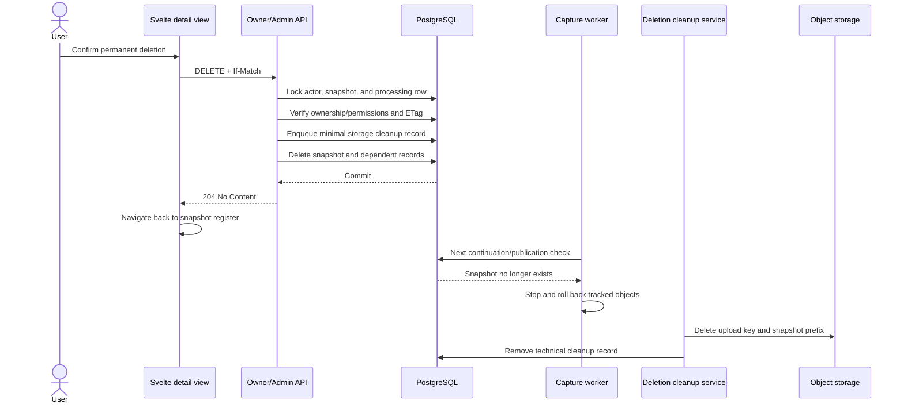

# Plan: Permanent snapshot deletion

**Status:** Approved and implemented

**Prepared:** 2026-10-27

**Scope:** Owner and administrative deletion of complete snapshot records and their stored objects

## 1. Objective and approved product decisions

The archive will allow a fully registered, authenticated user to permanently delete a snapshot attributed to that account. A user who already has snapshot administration access will be able to permanently delete any snapshot, including an unattributed submission.

The following decisions were confirmed during analysis:

- deletion is available in every processing and moderation state, including `QUEUED`, `RUNNING`, `APPROVED`, `REJECTED`, and `RESUBMITTED`;
- no new permission key will be introduced;
- administrative deletion uses the existing combined requirements `admin.access` and `admin.snapshots.access`;
- deletion removes the snapshot, its processing data, lifecycle history, tag associations, uniquely orphaned tags, temporary upload, screenshot, manifest, source, pages, and resources;
- no domain audit entry, soft-delete record, or recoverable tombstone remains after cleanup;
- the user interface uses a clear confirmation dialog with Cancel and permanent-delete actions; it does not require entering the title or the word `DELETE`.

“Permanent” has two observable guarantees:

1. After the database transaction commits, the snapshot is immediately unavailable through public, owner, administration, status, history, screenshot, and content routes.
2. Stored bytes are removed durably and retried until object storage confirms cleanup. A minimal technical cleanup record may exist temporarily for this purpose; it contains no title, URL, owner, tags, history, or other snapshot content and is removed after successful storage cleanup.

## 2. Current implementation and constraints

### 2.1 Existing ownership and authorization boundaries

- `api/users/snapshots` is protected by the registered-user policy and repository methods scope records by `CreatedByUserId`.
- `api/admin/snapshots` requires both `admin.access` and `admin.snapshots.access` at controller level.
- Roles provide default permissions and per-user `ALLOW`/`DENY` overrides take precedence.
- Snapshot mutations already require the configured frontend `Origin` and one strong `If-Match` value derived from the private detail response.

The deletion contract should reuse these boundaries. In particular, another user's snapshot must remain indistinguishable from a missing record on the owner route and return `404`, while revoked administrative permission returns `403` on the administration route.

### 2.2 Persistence and processing behavior

- PostgreSQL is authoritative for snapshot visibility and owns the `Snapshot`, `SnapshotProcessing`, `SnapshotHistoryEntry`, and `SnapshotTag` relationships.
- Processing and history rows already cascade when a snapshot is removed.
- Stored capture objects live below `snapshots/{snapshotId:N}/`; file submissions also have a temporary `jobs/...` upload key.
- The worker writes objects before publishing the completed result in PostgreSQL and checks `CanContinueAsync` while processing.
- Object storage and PostgreSQL cannot participate in one atomic transaction.

Deleting storage before the database row would risk leaving a publicly visible but damaged snapshot if only part of the storage operation succeeds. Deleting only the database row and attempting storage cleanup once would risk orphaned bytes after a process or storage failure. A durable cleanup queue is therefore necessary for complete deletion.

### 2.3 Frontend structure

- Owner and administrator detail pages both render `SubmissionDetail.svelte`.
- The existing reusable dialog family already provides native dialog semantics, focus containment and restoration, escape/backdrop handling, responsive sizing, and accessible title/description relationships.
- `Button.svelte` currently offers `primary`, `secondary`, and `text` variants, but no semantic destructive action.

No new route or independent view is required. Consequently, the project rule requiring an HTML mockup for a new route does not apply. The existing detail page and dialog primitives provide the visual context for the change.

## 3. Proposed architecture



The database transaction is the point at which the snapshot ceases to exist. Storage cleanup is intentionally outside the transaction but is made durable through a retryable technical record.

## 4. Backend changes

### 4.1 Deletion outcome and repository contract

Add a small deletion result model with the outcomes:

- `Deleted`
- `NotFound`
- `Forbidden`
- `Stale`

Extend `ISnapshotSubmissionRepository` with two explicit operations:

```csharp
Task<SnapshotDeletionResult> DeleteOwnAsync(
    Guid userId,
    Guid snapshotId,
    string expectedTag,
    CancellationToken token);

Task<SnapshotDeletionResult> DeleteForAdminAsync(
    Guid actorId,
    Guid snapshotId,
    string expectedTag,
    CancellationToken token);
```

Keeping separate owner and administrator entry points makes the security scope visible in the interface and follows the existing read/update pattern.

### 4.2 Transactional deletion algorithm

Implement deletion in `SnapshotSubmissionRepository.Writes.cs` using the same lock order already established by processing writes:

1. Start a PostgreSQL transaction.
2. Lock and validate the actor's current database user.
3. For administrative deletion, evaluate the existing `admin.access` and `admin.snapshots.access` permissions again inside the write transaction. No new permission is added.
4. Lock the snapshot row with `FOR UPDATE`.
5. On the owner path, return `NotFound` unless `CreatedByUserId` equals the actor ID.
6. Read the current history sequence and compare the scope-specific strong ETag. A changed capture, moderation decision, edit, or attribution produces `Stale` instead of deleting an unseen revision.
7. Lock/read the optional processing row and retain its temporary upload key and current processing status for cleanup scheduling.
8. Insert the minimal technical storage-cleanup record described below.
9. Remove the snapshot. Existing foreign keys cascade to processing, history, and snapshot-tag rows.
10. Remove only tag rows formerly referenced by this snapshot that no longer have any snapshot association. Shared tags remain untouched.
11. Save and commit.

Concurrency behavior is deterministic:

- if an edit, review, or capture completion commits first, deletion sees a stale ETag and returns `412`;
- if deletion commits first, subsequent worker publication cannot find the snapshot and is rejected;
- a second deletion attempt returns `404`;
- an active content capability immediately resolves to `404` because every content request revalidates the database record.

### 4.3 Durable object-deletion queue

Add an EF Core entity and migration for a table such as `processing.snapshot_deletions`. It is not a snapshot tombstone and has no foreign key to the deleted snapshot. Proposed columns:

| Column | Purpose |
| --- | --- |
| `snapshot_id` | Technical identifier and primary key |
| `content_prefix` | Exact snapshot object prefix to remove |
| `uploaded_object_key` | Optional temporary source upload key |
| `cleanup_after` | Earliest safe final cleanup time |
| `attempt_count` | Retry/backoff state |
| `next_attempt_at` | Next eligible cleanup attempt |
| `created_at` | Operational age and diagnostics |

No title, source URL, account ID, tags, review state, reason, or history is retained.

For queued, terminal, or completed snapshots, cleanup can start immediately. For a `RUNNING` snapshot, the cleanup record remains until at least the configured maximum capture duration plus a small safety margin. This closes the race where the worker is already uploading an object while deletion commits. The worker should normally stop within its existing continuation polling interval and roll back its tracked objects; the delayed final prefix pass guarantees removal even if the worker terminates unexpectedly.

Add a scoped cleanup repository/service and an API-hosted background service that:

1. reads a bounded batch of due cleanup records;
2. deletes the exact temporary upload key, when present;
3. lists all objects using the snapshot prefix with a trailing `/` and deletes every returned key;
4. verifies that the prefix is empty;
5. removes the cleanup record only after successful cleanup;
6. retains and reschedules the record with bounded backoff when listing or deletion fails.

Object deletion is idempotent, so duplicate attempts from multiple API instances are safe. PostgreSQL remains the source of truth; a cleanup failure never makes the deleted snapshot visible again.

The existing `IArchiveObjectStore.ListAsync` and `DeleteAsync` operations are sufficient. A small shared prefix-deletion helper should centralize trailing-slash normalization and exact-prefix behavior rather than duplicating storage loops.

### 4.4 HTTP API

Add two endpoints:

| Method and path | Scope | Success |
| --- | --- | --- |
| `DELETE /api/users/snapshots/{id}` | Registered owner only | `204 No Content` |
| `DELETE /api/admin/snapshots/{id}` | Existing admin snapshot access | `204 No Content` |

Both endpoints:

- use `ValidateWrite` for trusted frontend origin and a single strong `If-Match` value;
- accept no request body;
- return `404` for a missing record and, on the owner route, for a foreign record;
- return `403` when current administrative access is not sufficient;
- return `412 snapshot_changed` when the ETag is stale;
- return `428` when `If-Match` is missing and `400` when malformed;
- remain covered by the existing private, no-store response policy.

The OpenAPI operation descriptions must state that deletion is irreversible and may cancel active processing. The generated frontend API types must be regenerated from the running Development API so the two new operations and response types remain synchronized. No new JSON request or response contract is required.

### 4.5 Existing permission description

Because no new permission is desired, update the human-readable description of `admin.snapshots.access` in `PermissionCatalog` and `docs/architecture.md` to include permanent deletion. The key, default roles, override semantics, and administration navigation remain unchanged.

## 5. Frontend changes

### 5.1 Reusable destructive button treatment

Extend the reusable button API with a semantic `critical` variant rather than adding feature-specific button CSS. The variant will:

- use the existing critical/Time Copper semantic tokens with the documented light- and dark-theme contrast;
- preserve the existing 44-pixel minimum target, visible focus outline, loading state, disabled state, and native button semantics;
- use color together with a trash icon and explicit text, never color alone;
- receive documentation-only coverage in `Button.stories.svelte` for default, disabled, loading, light, and dark presentation.

No separate component test will be introduced for this UI primitive, following the repository's reusable-component workflow; Storybook documents its public capability.

### 5.2 Feature confirmation dialog

Create a feature component under `frontend/src/lib/components/submissions/`, tentatively `SnapshotDeleteDialog.svelte`, and compose the existing dialog primitives. It remains outside `components/ui` because it owns snapshot API behavior and archive-specific copy.

Suggested English copy:

- title: **Permanently delete snapshot?**
- description: **This removes the snapshot record, history, archived page, screenshot, and all stored resources. This action cannot be undone.**
- additional running-state note: **The active capture will be stopped.**
- actions: **Cancel** and **Permanently delete**

The dialog will:

- open from a critical **Delete snapshot** button in the shared detail command bar;
- display the snapshot title and source URL, when present, so the target is unmistakable;
- keep initial focus on Cancel, not the destructive action;
- disable dismissal and duplicate submission while the request is in progress;
- show **Deleting snapshot…** through the button's loading state;
- announce request failures with `role="alert"` and move focus to the message;
- keep the dialog open on failure so the user does not lose context;
- navigate to `/account/submissions` or `/admin/snapshots` after `204`, replacing the now-invalid detail entry and invalidating `app:submissions`;
- treat `412` as a conflict and offer a reload before the user confirms again;
- explain changed access on `401`/`403` and a concurrently removed snapshot on `404`.

The existing edit and archived-page actions remain unchanged. Deletion is added to the same action group but remains visually separated as the destructive action. Responsive behavior must preserve full-width, non-overlapping actions on narrow viewports.

### 5.3 Visual verification

Use the actual application or Storybook in a browser to verify:

- owner and administrator detail pages in light and dark themes;
- desktop layout and reflow down to 320 CSS pixels;
- 200% text enlargement;
- long titles and source URLs;
- keyboard-only open, focus trap, Cancel, Escape, failed request, and return-focus behavior;
- critical action contrast, loading state, and reduced-motion behavior.

## 6. Expected file impact

The exact migration timestamp is generated during implementation. Expected changes are limited to the following areas:

### Backend Core

- `Archive.Core/Models/Snapshots/` — deletion outcome model
- `Archive.Core/Entities/Processing/` — minimal cleanup entity
- `Archive.Core/Configurations/Processing/` — cleanup table/index configuration
- `Archive.Core/DataContext.cs` — cleanup `DbSet`
- `Archive.Core/Migrations/` — generated migration and model snapshot
- `Archive.Core/Repositories/SnapshotSubmissionRepository/` — owner/admin deletion transaction
- a focused deletion-cleanup repository/service under `Archive.Core/Repositories/`
- `Archive.Core/Storage/` — exact prefix-deletion helper
- `Archive.Core/Injection.cs` — dependency registration
- `Archive.Core/Authorization/PermissionCatalog.cs` — description only; no key or default change

### Backend API

- owner and administrator `SnapshotsController` classes — `DELETE` operations
- `SnapshotSubmissionControllerBase.cs` — shared deletion outcome mapping if it keeps both controllers consistent
- API processing/maintenance service registration — durable storage cleanup loop
- generated OpenAPI output is consumed at runtime; no OpenAPI document is committed

### Frontend

- `components/ui/Button.svelte` and `stories/Button.stories.svelte` — critical variant
- `components/submissions/SnapshotDeleteDialog.svelte` — feature dialog and request flow
- `components/submissions/SubmissionDetail.svelte` — integration in the shared detail action group
- generated files under `src/lib/api/` — synchronized endpoint types/exports

### Documentation

- `docs/architecture.md` — deletion lifecycle, access rule, and storage cleanup guarantee
- `docs/development.md` or `docs/deployment.md` only where operational verification or cleanup behavior needs explicit coverage

No unrelated route, search, moderation, account, capture, design-token, or deployment configuration refactoring is planned.

## 7. Validation strategy

### 7.1 Automated backend coverage

Add focused tests for the storage-prefix cleanup helper using an in-memory `IArchiveObjectStore`:

- every object strictly below the requested snapshot prefix is deleted;
- similarly named neighboring prefixes remain untouched;
- the optional temporary upload key is deleted;
- an empty prefix is successful and idempotent;
- storage failure is propagated so the durable job is retained rather than falsely completed.

Where the existing test infrastructure permits repository coverage without adding a new database/test-container dependency, cover outcome mapping and ETag behavior. PostgreSQL-specific row locking, cascading, and retry-table behavior will additionally be verified against the configured development services.

### 7.2 API and persistence scenarios

Verify at minimum:

- an owner can delete an own snapshot in each relevant processing/moderation class;
- the owner route returns `404` for another user's or an unattributed snapshot;
- an administrator with existing access can delete owned, foreign, or unattributed snapshots;
- a denied or revoked `admin.snapshots.access` produces `403`;
- missing, malformed, and stale `If-Match` values produce `428`, `400`, and `412` respectively;
- snapshot, history, processing row, tag associations, and newly orphaned tags are removed;
- shared tags remain;
- temporary upload and all keys below the snapshot prefix disappear;
- a running worker cannot publish after deletion and any late-written object is removed by final cleanup;
- cleanup survives an API restart and retries a simulated object-storage failure;
- public search totals, year distribution, details, screenshots, content, and old private capability URLs no longer expose the snapshot.

### 7.3 Project checks

Run the repository's established checks after implementation:

```powershell
dotnet build backend/Archive.slnx
dotnet test backend/Archive.slnx -m:1

Set-Location frontend
bun run check
bun run lint
bun run build
bun run build:storybook
```

Regenerate the frontend API artifact while the Development API is running:

```powershell
Set-Location frontend
bun run generate:api
```

Inspect the final Git diff to confirm that only deletion-related implementation, migration, generated API types, tests, and directly affected documentation changed.

## 8. Documentation and operational impact

Document that:

- deletion is irreversible and available in all lifecycle states;
- deleting an approved snapshot immediately removes its public record and invalidates playback URLs;
- active capture work is stopped by the missing authoritative database record;
- object cleanup is durable and eventually completes during a temporary storage outage;
- operators can diagnose outstanding cleanup records without seeing retained snapshot metadata;
- database and object-store backups can still contain previously deleted data according to the operator's external backup-retention policy. Purging historical backups is outside this application's deletion transaction and outside the scope of this change.

## 9. Risks and mitigations

| Risk | Mitigation |
| --- | --- |
| Partial object deletion | Durable retry record; remove it only after the prefix is confirmed empty |
| Worker writes during deletion | Database removal rejects publication; delayed final prefix pass covers late writes |
| Accidental deletion of a changed record | Strong representation-specific `If-Match` validation |
| Owner deletes another user's record | Owner-scoped repository check returns `404` |
| Permission changes between page load and action | Re-evaluate current database permissions inside the transaction |
| Deleting similarly named object keys | Normalize and list with an exact trailing-slash prefix |
| Shared tag loss | Delete only captured tag IDs that have no remaining associations |
| Misleading recoverability | Explicit irreversible copy and no soft-delete or domain audit record |
| Stale frontend/API contracts | Regenerate committed TypeScript API artifacts from the updated runtime OpenAPI document |

## 10. Version-control execution

Before implementation, the remote was fetched and local `master` was fast-forwarded to `origin/master` at `c54a335`. The work was then isolated on `codex/permanent-snapshot-deletion`.

Only related files are committed in logical English semantic commits, for example:

   - `feat: add durable snapshot deletion backend`
   - `feat: add snapshot deletion confirmation`
   - `docs: document permanent snapshot deletion`

## 11. Approval and implementation record

The plan was explicitly approved on 2026-10-27. The approval included the temporary metadata-free cleanup record and eventual object-store cleanup described above; there is no recoverable snapshot or user-facing deletion history. Implementation follows this design, including owner and administrator endpoints, transactional removal, durable object cleanup, the confirmation dialog, generated API contracts, tests, and directly affected documentation.
