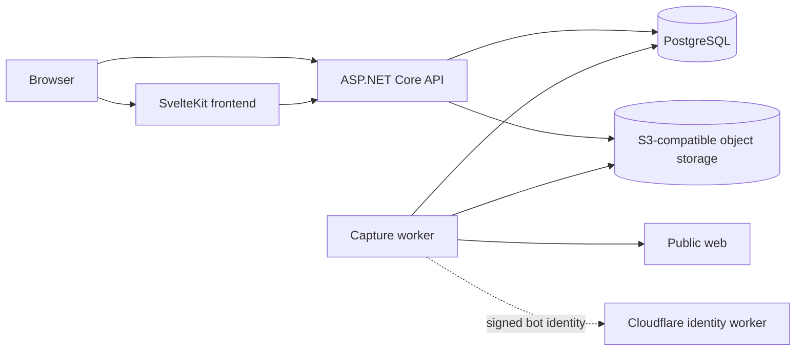
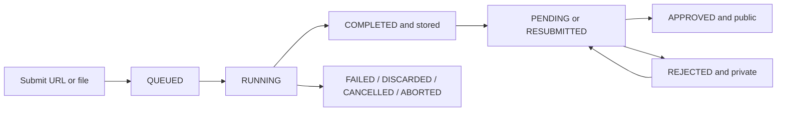

# Project documentation proposal

Date: 2026-10-21

Status: proposal awaiting approval. No README, product documentation, application code, configuration, database, or stored snapshot has been changed.

## 1. Objective and decision

Add a concise root README and a small documentation set that lets a new contributor understand what Archive does, run its components, change it safely, and deploy the current stack without reading the entire repository first.

The documentation will use plain GitHub-flavored Markdown. Mermaid will be used only for the two relationships that are materially easier to understand visually: the runtime component topology and the snapshot lifecycle. No documentation generator will be introduced. The repository is small enough that a generated site would add build and maintenance work without improving the source of truth.

The proposed documentation set is:

| File | Primary question answered |
| --- | --- |
| `README.md` | What is Archive, what can it do, how is the repository organized, and where should a reader go next? |
| `docs/architecture.md` | How do the frontend, API, worker, database, object storage, and bot identity service cooperate? |
| `docs/development.md` | What is required to run and validate changes locally? |
| `docs/configuration.md` | Which settings belong to which process, how are they represented, and which values must agree? |
| `docs/api.md` | Where is the live API contract and which cross-cutting HTTP behaviors matter to clients? |
| `docs/deployment.md` | How is the current Compose stack assembled, initialized, exposed, upgraded, and checked? |
| `cloudflare/archive-bot-identity/README.md` | How is the bot identity worker configured, deployed, and verified? |

The root README will stay intentionally short. Detailed procedures and contracts belong under `docs/`, with links in both directions. This avoids a large README that becomes difficult to scan and prevents the same setup instructions from being maintained in several files.

## 2. Reconstructed current system

### 2.1 Product behavior

Archive is a public register of immutable web-page snapshots. A submission can originate from:

- a public HTTP or HTTPS URL captured by a browser;
- an uploaded HTML document;
- an uploaded MHTML document;
- an uploaded WebArchive document.

A submission records descriptive metadata, tags, source type, capture timestamps, quality, size, resource count, creator attribution when available, and moderation state. Successfully stored and approved snapshots appear in the public searchable register. Owners can inspect their own submissions, and authorized administrators can review snapshots and manage user access.

Snapshot processing and moderation are separate state machines. Processing describes whether bytes have been captured and stored. Moderation describes whether a stored record may be public. Documentation must not collapse these into one generic status.

### 2.2 Runtime components

| Component | Current technology | Responsibility |
| --- | --- | --- |
| `frontend/` | Svelte 5, SvelteKit, TypeScript, Tailwind CSS 4, Bun adapter | Public search and playback, submission UI, Google sign-in flow, account submissions, moderation, and user administration. |
| `backend/Archive.Api` | ASP.NET Core on .NET 10 | Public and private HTTP API, authentication, authorization, search, snapshot submission, processing status/SSE, archived-content delivery, moderation, and database migration at API startup. |
| `backend/Archive.Worker` | .NET 10 worker, Playwright Chromium | Claims queued work, captures URLs or imports uploaded files, applies crawl and network policy, writes snapshot objects, and publishes processing results. |
| `backend/Archive.Core` | EF Core, Npgsql, AWS S3 client | Shared entities, validation, repositories, authorization catalog, PostgreSQL mappings, processing lease, and S3-compatible storage access. |
| PostgreSQL | PostgreSQL 18 in the current Compose definition | Durable metadata, users, permissions, lifecycle history, and transient processing records. |
| MinIO | Source-built by the current deployment Dockerfile | S3-compatible storage for archived content, screenshots, manifests, profile images, and temporary uploads. |
| `cloudflare/archive-bot-identity/` | Cloudflare Worker, TypeScript, Wrangler | Public bot description and the signed Web Bot Auth key directory. |

The intended architecture diagram in `docs/architecture.md` will describe the current dependency direction:



The diagram will distinguish browser-visible origins from internal service addresses. It will not imply that the frontend proxies archived content: the browser obtains public or authorized private content URLs from the API and renders the archived page in a sandboxed iframe.

### 2.3 Submission and publication flow

The documented lifecycle will follow the implementation:

1. `POST /api/snapshots` validates a URL submission or multipart file upload.
2. The API creates the snapshot record, history entry, and queued processing record in one database transaction. Uploaded source bytes are first placed under a temporary `jobs/{snapshotId}/...` object key.
3. The worker holds the processing lease, claims the next queued item, and records transient progress.
4. URL submissions use Playwright. The worker applies public-network checks, crawl policy, host pacing, optional Web Bot Auth signing, capture limits, resource collection, HTML/CSS rewriting, and screenshot generation.
5. File submissions select a decoder for HTML, MHTML, or WebArchive, normalize the offline document and resources, and render a screenshot.
6. The worker writes the content set, screenshot, and manifest under `snapshots/{snapshotId}/...` in object storage.
7. The database result is published only after storage succeeds. Temporary upload data and unpublished objects are then cleaned up according to the processing outcome.
8. The submission UI follows progress through server-sent events and falls back to polling.
9. Capture completion and publication remain distinct. A completed snapshot is publicly searchable only when moderation is `APPROVED`; owners and authorized reviewers use separate private routes for other moderation states.

The lifecycle diagram will show both axes instead of suggesting that `COMPLETED` always means public:



The final wording will note that accounts with `snapshots.publish_without_approval` begin in `APPROVED`, while other submissions require review.

### 2.4 Authentication and authorization

The API uses a server-side cookie session and currently integrates Google as its external identity provider. A first sign-in creates an internal user with the `USER` role; the user must complete the local profile before registered-user policies succeed.

Authorization uses role defaults plus per-user permission overrides. The documentation will identify the stable permission keys and their operational meaning:

| Permission | Effect |
| --- | --- |
| `admin.access` | Enter the administration area. |
| `admin.users.access` | Read the user administration area. |
| `admin.snapshots.access` | Read and moderate submitted snapshots. |
| `snapshots.publish_without_approval` | Publish the user's captures without manual approval. |
| `users.assign_roles` | Change another user's role. |
| `users.assign_permissions` | Change another user's permission overrides. |

The application prevents self-service access changes and prevents removal of the last fully authorized administrator. There is no application command or endpoint for bootstrapping the first administrator. The deployment guide must therefore document the current one-time database bootstrap explicitly and separately from normal access management. It must identify the target account unambiguously, verify the affected row count, and explain that later changes belong in the admin UI. The proposal does not add a bootstrap feature.

### 2.5 Data and access boundaries

The architecture guide will preserve these current invariants:

- PostgreSQL is authoritative for visibility, ownership, status, metadata, permissions, and the active object prefix.
- Object storage contains temporary uploads and stored snapshot resources; it does not decide whether a caller may read them.
- Public snapshot queries return only approved snapshots with stored captures.
- Owner and administrator resources are delivered through distinct API routes after authorization checks.
- Archived HTML is untrusted. API responses apply restrictive content security policy, disable scripts and outbound connections, and the frontend uses a sandboxed iframe.
- Private responses are `private, no-store`; private writes additionally require the configured frontend origin and a strong `If-Match` validator.
- The worker admits public network destinations, respects the implemented crawl policy, and applies configured duration, byte, and resource limits.
- The API performs EF Core migrations when database initialization is enabled. The production API currently owns initialization; the worker disables it.

These are useful project facts, not generic security reminders. Documentation will explain the implemented boundary and point to the relevant configuration rather than add broad advice unrelated to this codebase.

## 3. Documentation information architecture

### 3.1 Root README

`README.md` will be the repository landing page, not an operator manual. Its planned sections are:

1. **Archive** — one paragraph defining the product and the distinction between capture and publication.
2. **Capabilities** — URL capture, offline imports, searchable public register, provenance, moderation, and access administration.
3. **Architecture at a glance** — the six runtime/storage roles in a compact table and a link to `docs/architecture.md`.
4. **Technology** — only the primary technologies and currently required major versions.
5. **Repository layout** — the purpose of `frontend/`, the three backend projects, `deploy/production/`, `cloudflare/archive-bot-identity/`, and `corporate-design/`.
6. **Development entry point** — a minimal sequence that links to the complete setup instead of duplicating it.
7. **Documentation** — direct links to architecture, development, configuration, API, and deployment.
8. **Project state** — factual limitations relevant to contributors: no automated test projects or CI workflows are currently present.

The README will not include badges for services that are not configured, claim a license that is not present, present a roadmap not represented in the repository, or repeat every environment variable.

### 3.2 Architecture guide

`docs/architecture.md` will contain:

- the system context and component diagram;
- responsibilities and dependency direction for `Archive.Api`, `Archive.Worker`, and `Archive.Core`;
- the URL-capture and file-import paths;
- queue ownership and recovery behavior, including the single processing lease, claim owner token, interrupted-work reconciliation, cancellation boundary, and expiry cleanup;
- PostgreSQL schemas and the purpose of the principal records without reproducing every EF property;
- the object layout for temporary uploads and stored snapshots, including manifest, `index.html`, resources, screenshot, and optional original source;
- the processing and moderation lifecycle diagram;
- public, owner, and administrator read boundaries;
- authentication, role defaults, permission overrides, and optimistic concurrency through ETags;
- archived-content isolation and crawler/network controls;
- links to configuration, API, and deployment details.

The guide will describe stable behavior and invariants. Class names will be included only where they help a contributor find the implementation. A complete class inventory would become stale without improving understanding.

### 3.3 Development guide

`docs/development.md` will define a supported, reproducible development path based only on tracked files.

Planned contents:

- prerequisites: .NET SDK 10, Bun 1, PostgreSQL, an S3-compatible store such as MinIO, and Chromium support for the worker;
- copying `backend/Archive.Api/appsettings.Development.example.json` and `backend/Archive.Worker/appsettings.Development.example.json` to their ignored `appsettings.Development.json` counterparts;
- installing frontend dependencies with `bun install --frozen-lockfile`;
- restoring the local .NET tool manifest and .NET dependencies;
- starting API, worker, and frontend as separate processes, with ports `5200`, worker background execution, and `5173` respectively;
- the required startup order: PostgreSQL/object storage, API migration and health check, worker, then frontend;
- the local API and frontend origins and the reason they must match authentication/CORS configuration;
- optional Google sign-in setup and the callback path derived from the configured public API origin;
- EF Core migration commands and the rule that migrations live in `Archive.Core` while the API owns normal startup application;
- regeneration of `frontend/src/lib/api/` from the development OpenAPI document with `bun run generate:api` while the API is running;
- Storybook commands for reusable frontend components;
- validation commands that actually exist: `dotnet build`, `bun run check`, `bun run lint`, `bun run build`, Storybook build when UI components change, and the Cloudflare worker dry run when that package changes;
- a clear statement that no automated test projects or CI workflow are currently present, so the guide does not advertise a nonexistent `test` command;
- targeted manual checks for public search, submission monitoring, private previews, moderation, and archived resource loading.

The ignored `.secrets/local.compose.yml` file is workstation-specific and will not be presented as a repository-supported setup. The tracked production Compose fragments also use a different environment-variable contract from the root development example. The development guide will not combine them into a command that appears reproducible but is not. If a tracked local orchestration file is desired later, that should be a separate configuration change rather than undocumented prerequisite knowledge.

### 3.4 Configuration reference

`docs/configuration.md` will map configuration by consuming process. It will explain .NET's colon-delimited keys and double-underscore environment representation, then use tables with these columns:

- setting or environment variable;
- consumer;
- default or whether it is required in the documented mode;
- effect and validation constraints;

The reference will cover:

- API origins, public base URL, session cookie domain, and Google client settings;
- PostgreSQL connection string and `Database:Initialize` ownership;
- object-storage service URL, access credentials, and bucket;
- archive upload, duration, storage, resource, scrolling, quiet-period, and import limits;
- transient-processing retention and cleanup settings;
- browser headless mode, user agent, and challenge timing;
- crawl-policy enablement, user-agent token, host delay, request timeout, and robots response limit;
- Web Bot Auth enablement, signature agent, private key path, and signature lifetime;
- frontend `PUBLIC_API_BASE_URL`, server-only `INTERNAL_API_BASE_URL`, `ORIGIN`, `HOST`, and `PORT`;
- production Compose variable names and their mapping to application keys.

The document will explicitly call out values that must agree:

- `Authentication:PublicApiOrigin` and the browser-visible API origin;
- `Authentication:FrontendOrigin` and the frontend `ORIGIN`;
- the Google callback registration at `{PublicApiOrigin}/api/auth/callback/google`;
- the session cookie domain when frontend and API use sibling hosts;
- API and worker connection strings, bucket, credentials, and processing-retention values;
- Web Bot Auth's configured signature agent and the origin serving its key directory.

Secrets will be represented by setting names and expected formats, never by fabricated example credentials. The text will omit generic admonitions and focus on how each value is consumed by this repository.

### 3.5 API guide

`docs/api.md` will not duplicate every controller, schema, and response code. ASP.NET's generated OpenAPI document is the authoritative contract and already drives the generated TypeScript types.

The guide will document:

- development discovery at `/openapi/v1.json` and the Scalar reference exposed by the development API;
- generation of the frontend client types through `frontend/openapi-ts.config.ts`;
- endpoint families: health, authentication, public snapshots, current-user profile/submissions, administrator permissions/users/snapshots;
- the two `POST /api/snapshots` media types and accepted offline file formats;
- `202 Accepted`, status resource, SSE event stream, heartbeat behavior, terminal closure, and polling fallback;
- cookie credentials and the configured credentialed CORS origin for authenticated browser operations;
- public CORS behavior where it is deliberately enabled;
- strong ETag/`If-Match` semantics for moderation, resubmission, and access-management writes;
- RFC problem-details responses and meaningful application error codes;
- public versus private content and screenshot routes, range responses, and archived-content restrictions.

The guide will point readers to the live OpenAPI output for field-level details. A generated JSON specification will not be committed because the repository deliberately removed that artifact and already generates the contract from code.

### 3.6 Deployment guide

`docs/deployment.md` will describe the deployment that exists under `deploy/production/`, without claiming a platform-specific reverse proxy that the repository does not provide.

Planned contents:

- required host capabilities: Docker with Compose, DNS/TLS endpoints for frontend and API, and an external Docker network named `archive`;
- copying `deploy/production/.env.example` to the local deployment `.env` and resolving every Compose-required value;
- composing `database.compose.yml`, `minio.compose.yml`, `api.compose.yml`, and `frontend.compose.yml` into one project;
- service dependency and readiness order: PostgreSQL and MinIO, bucket initialization, API migration/health, worker, and frontend;
- the internal ports (`5432`, `9000`/`9001`, `8080`, and `3000`) and which services are intentionally only exposed to the Docker network;
- the external reverse-proxy contract: route the configured frontend origin to port 3000 and API origin to port 8080, preserve SSE streaming, and pass forwarded headers;
- persistent volumes: PostgreSQL data, MinIO data, and API data-protection keys;
- database migration ownership and why only the API initializes the schema in the current stack;
- the one-time first-administrator bootstrap based on the actual authentication schema, followed by normal UI-based role/permission management;
- health checks and direct verification of frontend, API `/healthz`, storage initialization, and worker processing;
- update order and rollback boundaries, especially the compatibility of database migrations and stored snapshot objects;
- backup scope based on actual durable state: PostgreSQL, MinIO, and the API key ring needed to preserve session/data-protection continuity;
- Web Bot Auth key mounting and the link to the Cloudflare worker deployment instructions.

The guide will note that the MinIO image is built from the repository Dockerfile and currently compiles `minio` and `mc` from their upstream `latest` Go targets. It will describe that behavior exactly rather than imply a pinned MinIO release.

### 3.7 Bot identity worker README

The existing `cloudflare/archive-bot-identity/README.md` will be expanded and tightened. It will contain:

- the three served resources (`/`, `/robots.txt`, and `/.well-known/http-message-signatures-directory`);
- prerequisites and dependency installation;
- how to provide the Ed25519 PKCS#8 private key secret and matching public `x` coordinate;
- `npm run check` and `npm run deploy`;
- verification of content type, signed directory response, and key agreement with the archive worker;
- the relationship between `ARCHIVE_WEB_BOT_AUTH_SIGNATURE_AGENT`, the worker custom domain, and the directory endpoint.

The current generic sentence about not committing the private key will be replaced by concrete Wrangler secret/configuration steps. The key distinction that matters here is which value is a secret, which value is public, and how the worker and capture service are kept consistent.

## 4. Cross-linking and ownership

Every page will have one clear owner topic:

```text
README.md
├── docs/architecture.md
│   ├── docs/configuration.md
│   └── docs/api.md
├── docs/development.md
│   ├── docs/configuration.md
│   └── docs/api.md
├── docs/deployment.md
│   ├── docs/configuration.md
│   └── cloudflare/archive-bot-identity/README.md
└── cloudflare/archive-bot-identity/README.md
```

Cross-links will use repository-relative paths so that they work on GitHub and in local Markdown viewers. Commands will state their required working directory. Environment names, routes, permission keys, configuration keys, and status values will use code formatting. Tables will be preferred for exact mappings; narrative text will explain interactions and decisions.

The following duplication rules will be applied:

- README summarizes and links; it does not repeat procedures.
- Architecture owns responsibilities, flows, and invariants.
- Development owns local commands and contributor validation.
- Configuration owns setting semantics and cross-process agreement.
- API owns HTTP-wide behavior, while live OpenAPI owns endpoints and schemas.
- Deployment owns Compose operations and durable production state.
- The bot worker README owns its keys, deployment, and verification.

## 5. Proposed repository changes

Only Markdown files are planned for this documentation extension:

| Path | Change |
| --- | --- |
| `README.md` | Add the repository landing page and documentation index. |
| `docs/architecture.md` | Add the component, data-flow, lifecycle, persistence, and trust-boundary guide. |
| `docs/development.md` | Add tracked-file-based local setup, migration, generation, and validation instructions. |
| `docs/configuration.md` | Add the cross-process settings reference and consistency rules. |
| `docs/api.md` | Add API discovery and cross-cutting client contract documentation. |
| `docs/deployment.md` | Add the current Docker Compose deployment and operations guide. |
| `cloudflare/archive-bot-identity/README.md` | Replace the minimal note with actionable package-specific instructions. |

No application source, package manifest, lockfile, Compose file, environment example, generated API client, OpenAPI artifact, migration, or database data will be changed as part of this scope. If implementation reveals that a documented command cannot be made correct using tracked files, the documentation will narrow the supported path and the missing tooling will be reported rather than silently added.

## 6. Implementation sequence after approval

1. Create the root README with the product description, layout, architecture summary, and document index.
2. Write `docs/architecture.md` from the verified runtime and persistence boundaries.
3. Write `docs/configuration.md` directly from option classes, appsettings files, frontend environment access, and Compose mappings.
4. Write `docs/development.md` using only commands and inputs available in the repository; verify every command in its stated working directory.
5. Write `docs/api.md` against controller routes, OpenAPI setup, authentication/CORS policy, SSE implementation, and ETag handling.
6. Write `docs/deployment.md` against the four Compose fragments, Dockerfiles, health checks, volumes, and database initialization behavior.
7. Update the bot identity README against `wrangler.jsonc`, package scripts, and the worker's actual endpoints.
8. Cross-link the complete set, remove duplicated explanations, and check terminology against code.
9. Run the validation described below and review the rendered Markdown before committing the implementation.

The work should remain one documentation commit unless review uncovers an independently useful correction. The planned implementation commit is `docs: add project documentation`.

## 7. Verification plan

### 7.1 Source verification

Before finalizing each document, verify claims against these sources:

| Claim area | Authoritative source |
| --- | --- |
| Runtime versions and scripts | `.csproj`, `frontend/package.json`, Cloudflare `package.json`, Dockerfiles |
| Routes and HTTP behavior | API controllers, `Program.cs`, authentication/CORS setup, OpenAPI transformers |
| Processing lifecycle | snapshot/processing entities, repositories, `ArchiveWorkerService`, `SnapshotProcessor` |
| Capture/import behavior | browser capture, crawl/network services, offline decoders/normalizer, object writer |
| Authorization | permission catalog, authorization handler/policies, admin and user controllers |
| Settings | option classes, appsettings examples, `.env.example`, production `.env.example`, Compose files |
| Deployment | Compose fragments, Dockerfiles, health checks, volume declarations |
| Frontend behavior | SvelteKit routes, server loaders, submission monitor, auth context, API URL helpers |

### 7.2 Automated and structural checks

After implementation:

- run `git diff --check`;
- validate every relative Markdown link and referenced repository path;
- verify that code fences are balanced and Mermaid blocks parse in a compatible renderer;
- compare all documented commands with available scripts/tools;
- compare every documented environment/configuration name with its consumer;
- confirm that no generated or ignored local files were accidentally added;
- confirm the change set contains Markdown only;
- run `dotnet build backend/Archive.slnx` to detect any stale documented .NET/project assumptions;
- run `bun run check`, `bun run lint`, and `bun run build` in `frontend/` where dependencies are available;
- run `npm run check` in `cloudflare/archive-bot-identity/` where dependencies are available.

Build checks do not prove prose correctness, but they catch renamed projects, broken generated frontend assumptions, and package-script drift while the documentation is being written. If dependencies are unavailable, that limitation will be reported explicitly rather than treating an unrun command as successful.

### 7.3 Content acceptance criteria

The documentation is complete when a reader can answer, without inspecting implementation files:

- what Archive stores and when a capture becomes public;
- which process handles HTTP, capture work, metadata, and objects;
- how URL capture differs from offline import;
- how processing, moderation, ownership, and permissions interact;
- how to configure matching frontend/API origins and storage/database access;
- how to run each component and regenerate frontend API types;
- where the authoritative API schema is exposed;
- how the production Compose fragments fit together and which data persists;
- how the first administrator is established in the current system;
- how the bot identity worker connects to Web Bot Auth;
- which validation commands exist and which automated test coverage does not.

Accuracy takes precedence over apparent completeness. Unsupported procedures, inferred features, and aspirational behavior will not be documented as current capabilities.

## 8. Risks and controls

| Risk | Control in this proposal |
| --- | --- |
| README grows into a duplicate manual | Keep it as an entry point and enforce topic ownership under `docs/`. |
| Endpoint lists drift from controllers | Treat live OpenAPI as authoritative and document only endpoint families plus cross-cutting contracts. |
| Development instructions depend on personal ignored files | Use tracked examples only and explicitly exclude the ignored local Compose override. |
| Processing and moderation are conflated | Give each state machine separate definitions and show their intersection. |
| Deployment guide invents proxy or platform behavior | Specify only the required origin/port/streaming contract, not an untracked proxy product. |
| First-admin setup is omitted | Document the current database bootstrap as a one-time operation and normal UI management thereafter. |
| Configuration is copied into several pages | Keep setting semantics in `docs/configuration.md`; other pages link to the relevant section. |
| Documentation claims tests that do not exist | State the current absence and list only actual build/static/manual checks. |
| Version details become stale | Source exact versions from manifests during implementation and avoid unnecessary patch-version repetition in prose. |

## 9. Scope boundary and approval gate

This proposal is the only change prepared before approval. It does not implement the README or documentation suite and does not alter product behavior.

After explicit approval, implementation is limited to the Markdown paths listed in section 5. Any need for source code, Compose, environment-example, package, migration, or generated-file changes will be reported as a separate decision before such a change is made.
