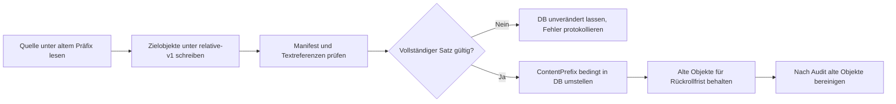

# Implementierungsvorschlag: Route-neutrale Snapshot-Ressourcen mit eigenständigem Migrationsprogramm

Stand: 2026-10-20

Status: konkreter Implementierungsvorschlag; Produktcode und Snapshot-Daten wurden nicht geändert.

## 1. Ziel und Entscheidung

Neue und bestehende Snapshots sollen Ressourcenpfade enthalten, die nicht an eine API-Route gebunden sind. HTML, Stylesheets und weitere archivierte Dokumente referenzieren Ressourcen relativ zu ihrer Position im Snapshot-Inhalt. Dadurch funktionieren dieselben gespeicherten Bytes über öffentliche, Eigentümer- und Moderationsrouten.

Die Fehleranalyse und die Erstempfehlung stehen in [pending-snapshot-private-resources.md](pending-snapshot-private-resources.md). Dieser Vorschlag konkretisiert die dort beschriebene spätere Entkopplung und ergänzt ein sicheres Verfahren für vorhandene Snapshots.

Ein separates, einmalig ausführbares Backend-Konsolenprogramm migriert die bereits gespeicherten Objekte. Die Produktanwendung kennt danach nur noch route-neutrale Ressourcenpfade: Es gibt weder eine Laufzeitumschreibung alter Pfade noch einen dauerhaften Fallback auf die frühere Erzeugungslogik.

Die Migration soll:

- alle erfolgreich verarbeiteten Snapshots migrieren, unabhängig von ihrem Moderationsstatus;
- bestehende Objektpfade innerhalb eines Snapshots beibehalten, aber HTML/CSS-Verweise darin route-neutral umschreiben;
- die aktualisierten Objekte zunächst unter einem neuen Präfix bereitstellen;
- den Datenbankverweis erst nach erfolgreicher Prüfung auf das neue Präfix umstellen;
- die alten Objekte für eine festgelegte Rückrollfrist behalten.

Eine EF-Datenbankmigration ist dafür nicht passend: Der Vorgang verändert große Dateien im Objektspeicher, kann lange laufen und muss unabhängig von PostgreSQL fortsetzbar sein.

## 2. Bestehender Datenvertrag

Die produktiven Objekte liegen unter `snapshots/{snapshotId:N}/...`; `Snapshot.ContentPrefix` verweist auf dieses Präfix. `index.html`, `screenshot.png`, optionale `source.*`-Dateien und Ressourcen liegen darin. Die beiden Capture-Pfade schreiben ein `manifest.json` mit den Objekt-Keys:

- `BrowserCaptureEngine` schreibt Manifestversion 1, eine HTML-Einstiegsdatei und Ressourcen unter `assets/`.
- `OfflineImportEngine` schreibt Manifestversion 2, eine Einstiegsdatei, Ressourcen einschließlich möglicher Frame-Dokumente sowie die ursprüngliche `.html`-, `.mhtml`- oder `.webarchive`-Datei.
- `OfflinePageNormalizer` und `BrowserCaptureEngine` speichern zurzeit Verweise unter `/api/snapshots/{id}/content/`; die GUID wird je nach Pfad im kompakten oder Bindestrichformat ausgegeben.
- `IArchiveObjectStore` bietet derzeit `GetAsync`, `PutAsync` und `DeleteAsync`, jedoch kein serverseitiges Kopieren.

Die Datenbank speichert bereits das aktive `ContentPrefix`. Öffentliche und private Inhaltsrouten wenden ihre Berechtigungs- beziehungsweise Moderationsprüfung an, bevor sie mit diesem Präfix aus dem Objektspeicher lesen. Diese Autorisierungsgrenze soll unverändert bleiben.

## 3. Zielvertrag für neue Snapshots

### 3.1 HTML- und CSS-Pfade

Der Speicher-Key ist die stabile Quelle der relativen URL. API-Origin, `/api`, Snapshot-ID und öffentliche/private Route dürfen nicht in archivierten HTML- oder CSS-Dateien vorkommen. HTML-Referenzen werden relativ zur Inhaltswurzel interpretiert; CSS-Referenzen werden relativ zum jeweiligen Stylesheet interpretiert.

Beispiele bei der vorhandenen flachen Ressourcenstruktur:

| Dokument | Gespeicherter Verweis | Aufgelöster Key |
| --- | --- | --- |
| `index.html` | `assets/{hash}` | `assets/{hash}` |
| `frames/frame-0.html` | Basis `../` plus `assets/{hash}` | `assets/{hash}` |
| `assets/{css-hash}` | `{asset-hash}` | `assets/{asset-hash}` |

HTML verwendet eine relative `<base>`-Angabe, die vom jeweiligen Dokument auf die Inhaltswurzel zeigt, beispielsweise `./` für `index.html` und `../` für `frames/frame-0.html`. HTML-Referenzen wie `assets/{hash}` und `frames/frame-0.html` sind relativ zu dieser Basis. CSS verwendet keine HTML-Basis; seine Ressourcenpfade werden vom Stylesheet-Key aus berechnet.

CSS-Verweise werden relativ zum Stylesheet berechnet, nicht zur HTML-Basis. Für jedes `url(...)` und `@import` wird der relative Pfad von dessen Objekt-Key zum Zielobjekt-Key erzeugt. Bei Assets unter demselben `assets/`-Verzeichnis ist dies normalerweise nur der Dateiname des Zielobjekts.

Unveränderte externe Links oder nicht archivierte Ziele werden nicht durch API-Pfade ersetzt. `data:`-URLs, Fragmente und nicht aufgelöste URLs müssen erhalten bleiben. Es darf keine route-neutrale Referenz mit führendem `/` erzeugt werden, denn diese wäre weiterhin an den Origin und dessen Routenraum gebunden.

### 3.2 Einheitliches Format für alle Eingänge

`BrowserCaptureEngine` und `OfflinePageNormalizer` sollen dieselbe kleine Pfadberechnung verwenden oder dieselbe klar definierte Regel lokal umsetzen. Sie geben Referenzen als relative Pfade aus und entfernen die bisherige Snapshot-API-URL aus `<base>` und Ressourcenverweisen.

Der URL-Capture, HTML-Upload, MHTML-Import und WebArchive-Import müssen denselben Datenvertrag erfüllen. Eingebettete Frames werden als separate HTML-Objekte behandelt; ihre relative Basis wird anhand des jeweiligen Frame-Keys auf die Inhaltswurzel berechnet. CSS-Assets werden unabhängig davon relativ zum eigenen Key normalisiert.

Das Manifest erhält ein zusätzliches Merkmal wie `resourceReferenceMode: "relative-v1"`. Bestehende `version`-Werte bleiben lesbar; das neue optionale Feld erlaubt eine eindeutige Erkennung, ohne die bisherigen Manifestversionen umzudeuten. Neue Capturepfade setzen dieses Merkmal erst, wenn alle HTML- und CSS-Ausgaben dem neuen Vertrag folgen.

## 4. Migration bestehender Objekte

### 4.1 Auswahl und sichere Erkennung

Der Migrationslauf liest Snapshots paginiert aus PostgreSQL. Er berücksichtigt Datensätze mit abgeschlossener Verarbeitung und vorhandenem `ContentPrefix` (`Quality != null`). `PENDING`, `APPROVED` und `REJECTED` sind dabei alle gültige Moderationszustände. Nicht abgeschlossene oder fehlgeschlagene Verarbeitungen werden übersprungen und im Bericht gezählt.

Für jeden Snapshot:

1. `manifest.json` über das aktuelle `ContentPrefix` lesen und JSON-Struktur sowie referenzierte Keys validieren.
2. Alle Keys aus `htmlObjectKey`, `screenshotObjectKey`, optional `sourceObjectKey` und `resources[].objectKey` zusammenführen und Duplikate entfernen.
3. Prüfen, dass alle Keys unter dem aktuellen Präfix liegen, ihre relativen Pfade sicher sind und der HTML-Einstiegskey existiert.
4. Bei `resourceReferenceMode == "relative-v1"` als bereits migriert überspringen.
5. Bei fehlendem oder unbekanntem Manifestformat, fehlenden Objekten oder unsicherem Key den Snapshot unverändert lassen und als Einzelfallfehler protokollieren. Keine Keys anhand eines angenommenen Layouts erraten und keine nicht im Manifest referenzierten Objekte löschen.

Manifestversionen 1 und 2 werden explizit unterstützt. Fehlen in einem Datensatz erwartete Felder, wird er nicht automatisch migriert. Ein manueller Wiederverarbeitungs- oder Reparaturpfad ist sicherer als ein unvollständiges Objektset stillschweigend umzuschalten.

### 4.2 Umschreibung

Der Migrator kopiert sämtliche manifestreferenzierten Objekte in ein deterministisches Zielpräfix, zum Beispiel `snapshots/{snapshotId:N}/relative-v1`. Er erhält die relativen Objektpfade. Binärdateien, Screenshots und Originaluploads werden bytegleich kopiert. Textverarbeitung findet ausschließlich bei HTML- und CSS-Ressourcen statt.

Für jeden Snapshot werden die bekannten Legacy-Präfixe mit der Snapshot-ID im kompakten und Bindestrichformat erkannt:

- `/api/snapshots/{id:N}/content/`
- `/api/snapshots/{id:D}/content/`

Wenn ein gespeicherter Verweis das aktuelle Präfix enthält, wird der Teil nach `content/` als Zielpfad innerhalb des Snapshots validiert. In HTML wird anschließend der Snapshot-interne Zielpfad relativ zur Inhaltswurzel ausgegeben (zum Beispiel `assets/{hash}`); die relative `<base>`-Angabe des Dokuments zeigt auf diese Wurzel. In CSS wird der Zielpfad relativ zum Stylesheet-Key berechnet. Es werden weder Verweise auf andere Snapshot-IDs noch beliebige fremde URLs verändert. HTML-`<base>` wird passend zum Dokumentpfad auf die Inhaltswurzel relativiert.

Die Umschreibung darf nicht als globale Ersetzung des Textes implementiert werden: Sie muss nur syntaktisch relevante HTML-Attribute, CSS-`url(...)`, CSS-`@import` und die bekannte `<base>`-Angabe verarbeiten. Bereits relative Links und externe Links bleiben erhalten. Wo der vorhandene Normalizer Parser oder Tokenizer nutzt, soll dessen vorhandene Konvention beibehalten werden; eine Umstellung von Regex auf Parser ist nur dann nötig, wenn Tests problematische Fälle zeigen.

Die heutigen Capturepfade schreiben HTML und CSS als UTF-8. Der Migrator soll BOMs berücksichtigen und Inhalte mit nicht unterstützter Zeichenkodierung überspringen, statt sie durch fehlerhafte Dekodierung zu beschädigen. Die umgeschriebenen HTML-/CSS-Objekte behalten ihren Content-Type samt Charset.

### 4.3 Manifest und Größenangaben

Im Zielmanifest werden alle Objekt-Keys vom alten auf das neue Präfix umgeschrieben. Die ursprünglichen Manifestversionen bleiben erhalten; `resourceReferenceMode` wird auf `relative-v1` gesetzt. Quellmetadaten, Ressourcen-URLs, Prüfsummen und fehlende URL-Listen bleiben inhaltlich unverändert.

Nach dem Schreiben aller Objekte wird die gespeicherte Gesamtgröße neu berechnet und mit der bisherigen `Snapshot.StorageBytes`-Konvention abgeglichen. Der Writer zählt die Manifestdatei zur Snapshotgröße, während `manifest.storageBytes` derzeit vor dem Schreiben des Manifests erfasst wird. Diese bestehende Differenz ist bei der Berechnung zu berücksichtigen, statt unbeabsichtigt die Bedeutung der Felder zu ändern. Der aktuelle DB-Wert wird beim Umschalten mit aktualisiert; unveränderliche Historieneinträge über die ursprüngliche Aufnahme werden nicht umgeschrieben.

## 5. Staging, Umschalten und Wiederaufnahme

Die Umstellung läuft pro Snapshot in diesen Schritten:

Die DB-Aktualisierung vergleicht den erwarteten alten `ContentPrefix` und setzt den neuen Präfix nur dann, wenn der Eintrag noch auf die erwartete Quelle zeigt. Ist der aktuelle Präfix bereits das Zielpräfix, ist der Lauf erfolgreich wiederaufgenommen und wird übersprungen. Zeigt der Datensatz unerwartet auf einen dritten Präfix, wird kein Überschreiben versucht; der Fall erscheint im Bericht.

Vor der DB-Umschaltung prüft der Migrator mindestens das Zielmanifest und jedes erwartete Objekt. Für kopierte Objekte sollen Content-Type und Länge erhalten beziehungsweise korrekt gesetzt werden. Für transformierte Objekte wird die geschriebene Länge gegen den erzeugten Bytepuffer geprüft. Für besonders belastbare Integritätsprüfung kann der Lauf während des Kopierens SHA-256 pro Quell-/Zielobjekt berechnen; bestehende Manifeste enthalten nicht durchgängig Prüfsummen aller Ressourcen.

Das aktuelle `IArchiveObjectStore` kennt kein Kopieren. Dafür soll eine `CopyAsync(sourceKey, destinationKey, ...)`-Operation ergänzt werden, die S3-kompatibles serverseitiges Kopieren nutzt und Content-Type-Metadaten erhält. Ein Streaming-Fallback über `GetAsync`/`PutAsync` kann für lokale Provider und Tests genutzt werden. Wenn serverseitiges Kopieren nicht zuverlässig verfügbar ist, darf der Vorgang erst nach Prüfung des vollständigen Kopierwegs eingesetzt werden.

Das Zielpräfix ist deterministisch. Bricht ein Lauf vor der Datenbankumschaltung ab, verweist die Anwendung weiter auf die unveränderte Quelle; ein erneuter Lauf überschreibt die bekannten Ziel-Keys und setzt fort. Nicht referenzierte Zielreste sind nicht aktiv und werden erst durch einen gesonderten, manifestgestützten Bereinigungslauf entfernt.

Nach erfolgreichem Umschalten bleiben die Quellobjekte für eine definierte Rückrollfrist erhalten. Ein Rollback setzt `ContentPrefix` bedingt auf den gespeicherten alten Wert zurück. Erst nach erfolgreichem Audit und abgelaufener Frist löscht ein Cleanup-Lauf die alten, im Quellmanifest aufgeführten Keys. Die Bereinigung ist nicht Teil des initialen Migrationslaufs.

## 6. Eigenständiges Programm und Rollout

Der Migrator wird als separates Konsolenprojekt gebaut, beispielsweise `backend/Archive.SnapshotMigration`. Es kann für Datenbank- und Objektspeicherzugriffe gemeinsame Backend-Abstraktionen verwenden, läuft aber als eigener Prozess mit eigenem Entrypoint. Es wird weder beim API- noch beim Workerstart ausgeführt und ist keine EF-Migration. Die Migrationslogik kommt nicht in den Produktpfad des laufenden Capture- oder Inhaltsdienstes.

Das eigenständige Programm erhält:

- `--dry-run` als Standard: Anzahl/Bytes nach Moderationsstatus und Quelle, bereits route-neutrale Einträge, übersprungene/verwaiste/ungültige Manifeste und geschätzten maximalen temporären Zusatzspeicher ausgeben;
- `--apply` für tatsächliche Änderungen;
- optionale Batchgröße und Rate-Limit, damit DB und Objektspeicher nicht überlastet werden;
- strukturierte Fortschritts- und Abschlussberichte mit Snapshot-ID, altem/neuem Präfix, Ergebnis und Fehlergrund;
- einen Exitcode ungleich null bei Einzelfehlern oder nicht migrierten abgeschlossenen Datensätzen, damit das Deployment den Restbestand nicht als vollständig behandeln kann.

Empfohlene Reihenfolge, damit die alte Erzeugungslogik vollständig verschwindet:

1. Das eigenständige Migrationsprogramm und den neuen route-neutralen Writer fertigstellen. Der neue Produktcode enthält keine Erzeugung der bisherigen API-Pfade.
2. Das Migrationsprogramm zunächst im `--dry-run` gegen denselben Datenbank- und Objektspeicherbestand ausführen, der migriert werden soll. Mengen, Speicherbedarf und nicht unterstützte Datensätze prüfen.
3. Während der eigentlichen Migration keine alten Worker neue Snapshots schreiben lassen: Queue abarbeiten und Capture-Worker anhalten oder Submission-Verarbeitung kurz pausieren. Die API kann weiterlaufen und bereits migrierte Snapshots über ihre bestehende Inhaltsroute ausliefern.
4. Das eigenständige Programm mit `--apply` ausführen, bis alle abgeschlossenen und unterstützten Snapshots umgeschaltet sind. Der alte API-Code liefert die relative Inhaltsbasis weiterhin aus der jeweiligen Startseitenroute; die relativen Ressourcen lösen sich damit auch privat auf.
5. Verifikationslauf durchführen: Jeder abgeschlossene Snapshot hat ein gültiges Manifest mit `relative-v1`; alle referenzierten Keys existieren und HTML/CSS enthalten keine alten API-Präfixe der eigenen Snapshot-ID. Nicht migrierte Fälle müssen einzeln geklärt oder explizit als Ausnahmen freigegeben werden.
6. Den neuen route-neutralen API-/Worker-Stand ausrollen und Capture-Verarbeitung fortsetzen. In diesem Stand sind alle alten API-Pfad-Erzeugungen entfernt. Es gibt keinen privaten Legacy-Rewriter und keine doppelte Laufzeitlogik.
7. Nach definierter Rückrollfrist die alten Präfixe separat und mit Bericht bereinigen.

Zusätzlicher temporärer Speicher entspricht ungefähr einer zweiten Kopie der zu migrierenden Snapshots, zuzüglich kleiner Veränderungen in HTML, CSS und Manifesten. Der Dry-run muss den Bedarf auf Basis von `StorageBytes` summieren und vor dem Apply ausweisen. Der tatsächliche Bedarf ist wegen historischer Schätzungen und Manifestgrößen als Näherung zu kennzeichnen.

## 7. Implementierungszuschnitt

| Bereich | Geplante Änderung |
| --- | --- |
| `backend/Archive.Worker/Capture/Browser/BrowserCaptureEngine.cs` | URL-Aufnahmen route-neutral umschreiben; relative CSS-Pfade; Manifestmerkmal ergänzen. |
| `backend/Archive.Worker/Import/OfflinePageNormalizer.cs` | HTML, MHTML, WebArchive und Frame-Dokumente relativ zur Inhaltswurzel normalisieren. |
| `backend/Archive.Worker/Import/OfflineImportEngine.cs` | Route-neutrale Screenshot-Routenabbildung, falls der Screenshot-Renderer intern URL-Pfade benötigt; Manifestmerkmal ergänzen. |
| `backend/Archive.Core/Storage/IArchiveObjectStore.cs` und `S3ArchiveObjectStore.cs` | Sicheres, metadatenerhaltendes Kopieren von Objekten ergänzen. |
| `backend/Archive.SnapshotMigration` (neues Konsolenprojekt) | Eigenständige Migration mit Dry-run, Manifestvalidierung, Staging, bedingtem DB-Umschalten, Berichten, Wiederaufnahme und separatem Cleanup-Befehl. |
| `Snapshot.ContentPrefix`-Repositoryzugriff | Einen gezielten, bedingten Präfixwechsel mit aktualisiertem Größenwert bereitstellen. Keine öffentliche/private Berechtigungslogik ändern. |
| Produktivcode für Capture/Import | Alle bisherigen API-Pfad-Erzeugungen entfernen; nach der Datenmigration ausschließlich route-neutrale relative Referenzen schreiben. |

Die API-Antworten für Snapshot-Detaildaten bleiben verantwortlich dafür, dem Client die jeweilige Startseitenroute zu liefern. Gespeicherte Inhalte enthalten dagegen keine Route mehr. Öffentliche Zugriffsfilter, Eigentümerprüfung, Moderationsberechtigung und CSP bleiben unverändert restriktiv. Das Migrationsprogramm bleibt ein separat ausführbares Betriebswerkzeug und ist kein dauerhaft aktiver Produktbestandteil.

## 8. Test- und Abnahmekriterien

### Neue Daten

- URL-Aufnahme referenziert lokales CSS, Bilder und Fonts ohne `/api/snapshots/{id}/content/` im gespeicherten HTML/CSS.
- HTML-, MHTML- und WebArchive-Import erzeugen denselben route-neutralen Vertrag.
- CSS mit `url(...)` und `@import` sowie Frames mit unterschiedlicher Verzeichnistiefe laden ihre Ressourcen relativ korrekt.
- `data:`-URLs, Fragmente, externe Links und nicht archivierte Verweise werden nicht versehentlich als lokale Ressource umgeschrieben.
- Screenshot-Rendering während des Imports funktioniert mit dem route-neutralen Pfadschema.

### Migration

- Tests decken beide bisherigen Manifestversionen und kompakte sowie Bindestrich-GUIDs in alten Referenzen ab.
- Gültige alte HTML-/CSS-Dateien werden transformiert; Binärdateien und Originalupload-Bytes sind identisch.
- Fremde Snapshot-IDs, externe URLs, bereits relative Referenzen und nicht unterstützte Kodierungen werden nicht beschädigt.
- Dry-run schreibt weder Objekte noch DB-Felder.
- Fehler vor dem DB-Umschalten lassen den alten Inhalt vollständig aktiv.
- Abbruch nach Zielkopie und erneute Ausführung ist idempotent; Abbruch nach DB-Umschalten wird als bereits migriert erkannt.
- Ungültiges Manifest, fehlende Keys, ungültiger Zielpfad und parallele Änderung des `ContentPrefix` führen zu Bericht/Skip statt Teilumschaltung.
- Rollback des DB-Präfixes stellt den alten Snapshot wieder her, solange die Quellobjekte in der Rückrollfrist vorliegen.

### Berechtigung und Darstellung

| Zustand | Route | Erwartung |
| --- | --- | --- |
| `PENDING`, Eigentümer | private Eigentümerroute | HTML und relative Ressourcen laden. |
| `PENDING`, Moderator mit benötigter Berechtigung | private Adminroute | HTML und relative Ressourcen laden. |
| `PENDING`, fremder Benutzer/anonym | öffentliche und private Routen | Unverändert `404` beziehungsweise bestehende Zugriffssperre. |
| `APPROVED` | öffentliche Route | HTML und relative Ressourcen laden. |
| `REJECTED`, Eigentümer/Moderator | private Route gemäß bestehender Regel | Darstellung funktioniert; Moderationsentscheidung ändert keine Speicherpfade. |

Abnahme erfolgt erst, wenn die bestehenden Fehlerfälle visuell behoben sind, alle abgeschlossenen Snapshots entweder `relative-v1` haben oder in einem nachvollziehbaren Fehlerbericht stehen, und öffentliche/private Autorisierungsprüfungen unverändert bestehen.

## 9. Risiken und Grenzen

- Staged Copy benötigt temporär zusätzlichen Speicher in der Größenordnung der zu migrierenden Inhalte. Vor dem Apply ist daher ein Dry-run mit Speicherabschätzung verpflichtend.
- Objektspeicher und Datenbank haben keine gemeinsame Transaktion. Staging plus bedingter DB-Pointerwechsel sorgt dafür, dass ein unvollständiges Ziel nicht aktiv wird; verwaiste Zielobjekte werden separat bereinigt.
- Relative URLs sind empfindlich gegenüber fehlerhafter Berechnung der Dokumenttiefe. Frame- und CSS-Pfade müssen deshalb als eigene Testfälle behandelt werden.
- Alte oder manuell veränderte Manifeste können eine vollständige Migration verhindern. Der Migrator soll solche Snapshots sichtbar auslassen, nicht erraten.
- Bereits genehmigte Snapshots müssen ebenfalls migriert werden, damit späteres Verhalten nicht davon abhängt, über welche Route ein Dokument geladen wird.

## 10. Umfangsgrenze

Dieser Vorschlag ist eine Implementierungsspezifikation, keine Freigabe zur Produktänderung. Es wurden keine Produktdateien geändert, keine Migration ausgeführt und keine bestehenden Objekte oder DB-Einträge verändert. Implementierung, Migration und Bereinigung beginnen erst nach ausdrücklicher Freigabe.
