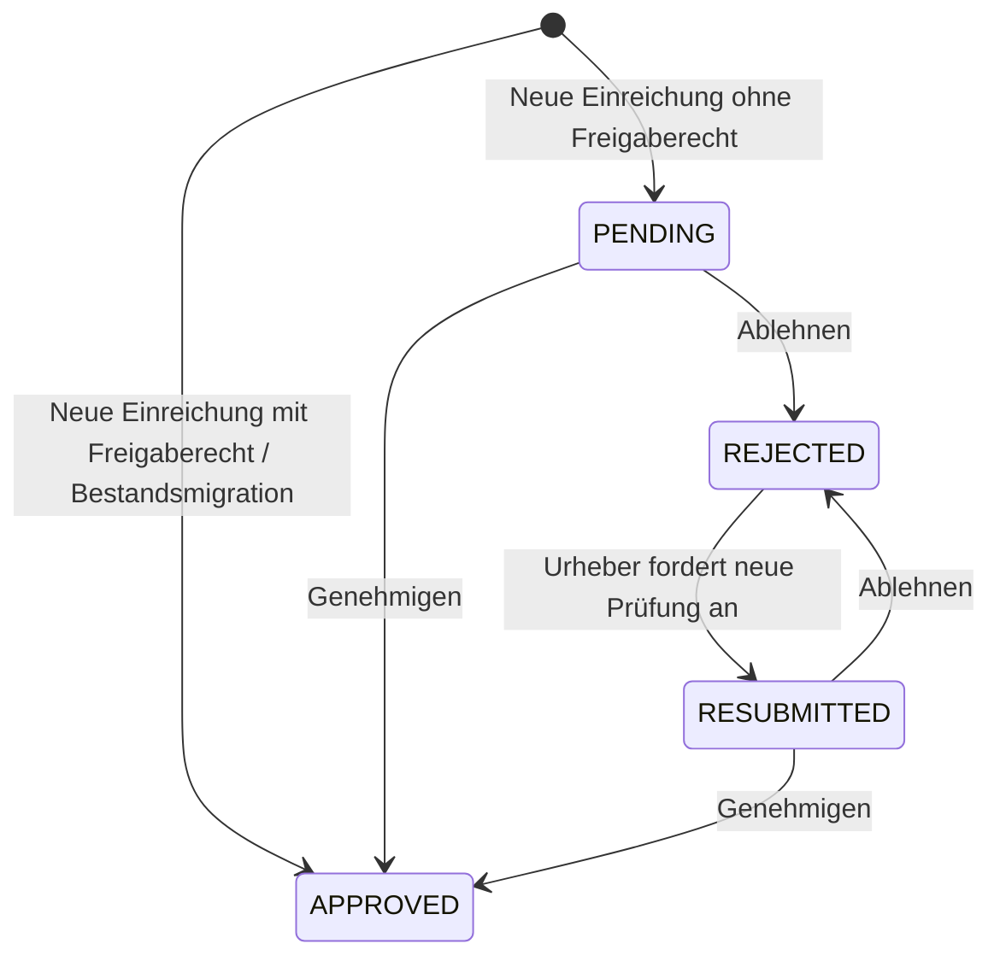

# Lösungsvorschlag: Snapshot-Moderation und eigene Einreichungen

Stand: 2026-10-18. Geprüfter Repository-Stand: `e4faf2c`.

**Status: Technischer Vorschlag zur Genehmigung. Diese Änderung enthält ausschließlich Dokumentation. Die Implementierung beginnt erst nach ausdrücklicher Genehmigung.**

## 1. Ziel und bestätigte Entscheidungen

Snapshots erhalten einen dauerhaften Moderationsstatus. Neue Einreichungen gewöhnlicher oder anonymer Benutzer werden zunächst verarbeitet und anschließend zur Prüfung vorgelegt. Erst genehmigte, erfolgreich verarbeitete Snapshots sind im öffentlichen Archiv verfügbar. Berechtigte Einreichende umgehen die manuelle Erstprüfung. Bestehende Einreichungen bleiben genehmigt.

Die folgenden Entscheidungen wurden im Interview bestätigt:

1. Ein abgelehnter Snapshot kann zunächst **ohne inhaltliche oder metadatenbezogene Änderungen** erneut zur Prüfung eingereicht werden. Es findet dabei kein neuer Capture und kein erneuter Upload statt.
2. Die Fortschrittsanzeige bleibt **ohne Anmeldung und ohne neuen Zugriffsschlüssel** erreichbar. Sie erhält einen Hinweis, wenn der Snapshot zur Genehmigung übermittelt wurde.
3. Die Moderationsseite einschließlich Genehmigen und Ablehnen erfordert **`admin.access` und die neue Berechtigung `admin.snapshots.access`**. `snapshots.review` entfällt.
4. Die vorhandene Berechtigung **`snapshots.publish_without_approval`** bleibt für Einreichungen ohne manuelle Erstprüfung zuständig.
5. Texte der Benutzeroberfläche bleiben Englisch; dieses Planungsdokument ist Deutsch.

### Abdeckung der Anforderungen

| Anforderung                                      | Vorgeschlagene Umsetzung                                                                    |
| ------------------------------------------------ | ------------------------------------------------------------------------------------------- |
| `PENDING`, `APPROVED`, `REJECTED`, `RESUBMITTED` | Eigenes dauerhaftes Enum am Snapshot, getrennt vom technischen Verarbeitungsstatus          |
| Nur genehmigte Snapshots öffentlich              | Gemeinsame Sichtbarkeitsbedingung für Suche, Statistiken, Details, Inhalte und Screenshots  |
| Ausstehende Snapshots im Admin-Portal genehmigen | Neuer Bereich `/admin/snapshots` mit Warteliste und eigener Detailseite                     |
| Optionale Begründung                             | Optionales Klartextfeld für beide Entscheidungen; Speicherung in der Moderationshistorie    |
| Geschützte Entscheidungen                        | Beide Berechtigungen serverseitig prüfen, einschließlich erneuter Prüfung beim Schreiben    |
| Bestehende Einreichungen automatisch genehmigt   | Expliziter Daten-Backfill für alle zum Migrationszeitpunkt vorhandenen Snapshots            |
| Privilegierte Einreichung ohne Prüfung           | Effektive Berechtigung bei der Erstellung aus der Datenbank auswerten                       |
| Andere Einreichungen benötigen Genehmigung       | Initial `PENDING`, unabhängig davon, ob ein Konto vorhanden ist                             |
| Eigene Einreichungen und Status                  | Geschützte eigene Übersicht und Detailseite, erreichbar über den erweiterten Account-Dialog |

## 2. Befunde im bestehenden Code

Backend und Worker verwenden .NET 10, EF Core und PostgreSQL; das Frontend verwendet Svelte 5 und SvelteKit. Der bestehende Stil mit kleinen Controllern, Core-Repositories, Ergebnis-Records und Mapperly-Projektionen bleibt erhalten.

| Bestehender Bereich                                                                   | Befund und Bedeutung für die Erweiterung                                                                                                                                                                                                                                                                                      |
| ------------------------------------------------------------------------------------- | ----------------------------------------------------------------------------------------------------------------------------------------------------------------------------------------------------------------------------------------------------------------------------------------------------------------------------- |
| `backend/Archive.Core/Entities/Snapshot.cs`                                           | Enthält Urheber, Metadaten und Capture-Ergebnis, jedoch keinen Moderationsstatus. `CreatedByUserId` ist bei anonymen Einreichungen `null`.                                                                                                                                                                                    |
| `backend/Archive.Core/Authorization/ArchivePermissions.cs` und `PermissionCatalog.cs` | `snapshots.review` und `snapshots.publish_without_approval` sind bereits definiert, der Moderationsablauf ist jedoch noch nicht implementiert.                                                                                                                                                                                |
| `PermissionEvaluator.cs`                                                              | Vollständige Registrierung ist Voraussetzung. Individuelle Allow-/Deny-Overrides haben Vorrang vor den Rollenvorgaben; Admins erhalten die bestehenden Rechte standardmäßig.                                                                                                                                                  |
| `SnapshotRepository.Creation.cs`                                                      | URL und Upload verwenden denselben Erstellungspfad. Derzeit werden nur vollständig registrierte Benutzer als Urheber zugeordnet; für einen vollständigen Kontoverlauf muss die private Eigentümerzuordnung künftig auch vor Registrierungsabschluss erhalten bleiben. Snapshot und Queue-Eintrag werden zusammen gespeichert. |
| `SnapshotRepository.Search.cs`                                                        | Öffentliche Ergebnisse, globale Registerzahlen, letzte Erfassungen und Jahresverteilungen verwenden bisher `Quality != null` als Veröffentlichungskriterium.                                                                                                                                                                  |
| `SnapshotRepository.cs`                                                               | Detailmetadaten sind teilweise bereits während des Captures erreichbar; Inhalte und Screenshots verlangen bislang lediglich ein Capture-Ergebnis.                                                                                                                                                                             |
| `SnapshotProcessingRepository.Worker.cs`                                              | `PublishAsync` speichert das Capture-Ergebnis. Die Bezeichnungen `Published`/`Unpublished` beschreiben aktuell zugleich Speicherung und Veröffentlichung.                                                                                                                                                                     |
| `SnapshotProcessingRepository.Cleanup.cs`                                             | Erfolgreiche Snapshots bleiben erhalten; erfolglose Snapshots werden nach dem kurzen terminalen Verarbeitungsfenster gelöscht. Das reicht für eine dauerhafte Kontoübersicht nicht aus.                                                                                                                                       |
| `SnapshotsController.Processing.cs`                                                   | Erstellung, Status, SSE und Abbruch sind bereits verfügbar. Status und Fortschrittsstream sind bewusst anonym erreichbar.                                                                                                                                                                                                     |
| `frontend/src/lib/archive-submission.ts` und `/archive/new/+page.svelte`              | Der Abschluss eines Captures wird als öffentlich lesbares Ergebnis präsentiert. Zur Wiederherstellung von Metadaten wird der öffentliche Detailendpunkt verwendet.                                                                                                                                                            |
| `frontend/src/lib/admin/access.ts`, `sections.ts`, `server/admin.ts`                  | Portalzugang und Benutzerverwaltung sind getrennt geschützt. Bisher ist nur `Users` als Portalbereich registriert.                                                                                                                                                                                                            |
| `AccountDialog.svelte`                                                                | Kompakter Account-Dialog mit Profil, optionalem Portal-Link und Abmeldung; eigene Einreichungen fehlen.                                                                                                                                                                                                                       |
| `frontend/openapi-ts.config.ts`                                                       | API-Typen werden direkt von `http://localhost:5200/openapi/v1.json` generiert. Dieser Zugriffsweg bleibt bestehen.                                                                                                                                                                                                            |

Bei der Bestandsaufnahme wurden keine `AGENTS.md` und keine regulären automatisierten Testprojekte im Repository gefunden. Für die spätere Implementierung sind gezielte fachliche Integrationstests einzuplanen.

## 3. Fachliches Modell und Sichtbarkeit

### 3.1 Zwei unabhängige Zustände

Der **Verarbeitungsstatus** beantwortet, ob der Capture wartet, läuft, erfolgreich beendet wurde, fehlgeschlagen ist oder abgebrochen wurde. Er verwendet weiterhin die bestehenden Werte wie `QUEUED`, `RUNNING`, `COMPLETED` und `FAILED`.

Der **Moderationsstatus** beantwortet, ob eine Einreichung öffentlich freigegeben ist:

| API-Wert      | Bedeutung                                           | Englische Anzeige |
| ------------- | --------------------------------------------------- | ----------------- |
| `PENDING`     | Neue Einreichung wartet auf ihre erste Entscheidung | `Pending review`  |
| `APPROVED`    | Automatisch oder manuell genehmigt                  | `Approved`        |
| `REJECTED`    | Manuell abgelehnt                                   | `Rejected`        |
| `RESUBMITTED` | Nach einer Ablehnung erneut zur Prüfung vorgelegt   | `Resubmitted`     |

Die öffentliche Sichtbarkeit lautet fachlich:

```text
IsPublic = ModerationStatus == APPROVED && Quality != null
```

`Quality != null` bezeichnet weiterhin einen erfolgreich gespeicherten Capture. Ein erfolgreich gespeichertes Ergebnis mit Qualität `INCOMPLETE` darf nach Genehmigung öffentlich erscheinen; diese Qualitätsstufe ist kein technischer Fehlschlag. `ContentPrefix` und die bestehenden Ergebnisdaten müssen beim erfolgreichen Abschluss konsistent gesetzt sein.

Eine automatische Genehmigung während der Erstellung macht einen noch laufenden Capture deshalb nicht öffentlich. Ebenso kann ein vollständig gespeicherter Capture weiterhin auf Moderation warten. Fehlgeschlagene Captures bekommen keinen erfundenen Moderationsstatus wie `FAILED`; die Kontoübersicht zeigt den technischen Fehler separat an.

### 3.2 Zustandsübergänge



Für diesen Umfang gelten folgende konkrete Regeln:

- Genehmigen und Ablehnen sind nur bei `PENDING` oder `RESUBMITTED` und erfolgreich gespeichertem Capture zulässig. Das verhindert Entscheidungen ohne prüfbares Ergebnis.
- Der Eigentümer kann ausschließlich seinen eigenen `REJECTED`-Snapshot erneut vorlegen. Metadaten, Quell-URL, Capture-Zeitpunkt und gespeicherte Dateien bleiben unverändert.
- Nach einer erneuten Vorlage steht der Status bis zur nächsten Entscheidung auf `RESUBMITTED`. Ein zweiter identischer Aufruf erzeugt keinen weiteren Prüfauftrag.
- Eine bereits ausdrücklich abgelehnte Einreichung bleibt auch dann im manuellen Prüfablauf, wenn ihr Urheber später das Recht zum Einreichen ohne Erstprüfung erhält. Der erneute Prüfauftrag hebt eine bestehende Ablehnung nicht automatisch auf.
- Das Recht zum Einreichen ohne Genehmigung wird bei **neuen** Einreichungen ausgewertet. Spätere Rollen- oder Berechtigungsänderungen ändern vorhandene Moderationsentscheidungen nicht rückwirkend.
- Für eine vorhandene Genehmigung ist in diesem Umfang keine nachträgliche Rücknahme vorgesehen. Damit bleibt der erste Ausbau auf Erstprüfung und erneute Prüfung begrenzt.
- Personen mit beiden Moderationsberechtigungen dürfen auch eigene Einreichungen prüfen. Eine zusätzliche Vier-Augen-Regel wird nicht eingeführt.
- Anonyme Einreichungen werden moderiert. Eine erneute Prüfung über die Eigentümerfunktion setzt ein zugeordnetes Konto voraus; eine Snapshot-ID allein begründet kein Eigentum. Eine spätere Kontozuordnung anonymer Einreichungen gehört nicht zu dieser Erweiterung.

Die letzten Regeln sind bewusste Umfangsentscheidungen dieses Vorschlags und werden bei der späteren Umsetzung als Akzeptanzkriterien behandelt.

### 3.3 Gründe und Historie

Bei `Approve` und `Reject` ist `Reason (optional)` ein optionales Klartextfeld mit maximal 2.048 Zeichen. Führende und nachfolgende Leerzeichen werden entfernt, leere Eingaben als `null` gespeichert. Die Längenvalidierung erfolgt ebenfalls serverseitig. Mehrzeilige Begründungen sind erlaubt; HTML wird nicht interpretiert.

Begründungen sind für den Urheber und berechtigte Moderatoren sichtbar. Sie erscheinen weder in der öffentlichen Suche noch in öffentlichen Snapshot-Details oder der anonymen Fortschrittsanzeige. Die interne Identität des Moderators wird nur im Admin-Bereich angezeigt; der Urheber benötigt Status, Zeitpunkt und Begründung.

Eine neue Entscheidung überschreibt keine alte Begründung. Die Historie enthält initiale Einreichung, automatische Freigaben, Entscheidungen und erneute Prüfaufträge in stabiler Reihenfolge. Nach `RESUBMITTED` ist die frühere Ablehnung weiterhin als vergangene Entscheidung erkennbar.

## 4. Berechtigungen

### 4.1 Endgültige Aufteilung

| Aktion                                                            | Voraussetzung                                                                                            |
| ----------------------------------------------------------------- | -------------------------------------------------------------------------------------------------------- |
| Admin-Portal öffnen                                               | `admin.access`                                                                                           |
| Moderationsbereich ansehen, Details/Historie/Vorschaubilder lesen | `admin.access` **und** `admin.snapshots.access`                                                          |
| Genehmigen oder Ablehnen                                          | `admin.access` **und** `admin.snapshots.access`                                                          |
| Benutzerverwaltung                                                | Weiterhin `admin.access` **und** `admin.users.access`; Schreibaktionen behalten ihre zusätzlichen Rechte |
| Neue eigene Einreichung automatisch genehmigen                    | Effektives `snapshots.publish_without_approval`                                                          |
| Eigene Einreichungen lesen / erneute Prüfung anfordern            | Authentifiziertes, existierendes Eigentümerkonto; keine Admin-Berechtigung                               |
| Fortschritt verfolgen                                             | Wie bisher ohne Anmeldung über die Snapshot-ID                                                           |

`ArchivePermissions.AccessAdminSnapshots` mit Schlüssel `admin.snapshots.access` ersetzt `ReviewSnapshots`. Die neue Katalogbeschreibung nennt sowohl Sichtzugriff als auch Genehmigen und Ablehnen. Admins erhalten das Recht standardmäßig; gewöhnliche Benutzer können es per Override erhalten.

Die Auswertung bleibt beim vorhandenen `PermissionEvaluator`: Ein ausdrückliches Deny gilt auch für einen Admin. Es wird kein paralleler Rollen-Shortcut eingeführt. Das Veröffentlichungsrecht gewährt keinen Portalzugang; das Moderationsrecht genehmigt neue eigene Einreichungen nicht automatisch, wenn das Veröffentlichungsrecht fehlt.

Im Frontend ergänzt `adminAccess()` die Fähigkeit `snapshots = portal && has("admin.snapshots.access")`. `requireAdmin()` akzeptiert die neue Sektion, und `availableAdminSections()` registriert sie. Layout und jede geschützte Seite prüfen ihre Voraussetzungen unabhängig, entsprechend dem bestehenden Muster.

Im Backend verwendet der neue Controller beide `RequirePermission`-Attribute. Auch beim transaktionalen Schreiben wird der handelnde Benutzer erneut aus der Datenbank geladen und mit dem Core-Evaluator geprüft. Berechtigungen aus Browserdaten oder veralteten Session-Projektionen sind keine Schreibberechtigung.

### 4.2 Ablösung von `snapshots.review`

Die Datenmigration überführt bestehende Allow-/Deny-Overrides von `snapshots.review` nach `admin.snapshots.access`. Das zusätzliche `admin.access` wird dabei nicht automatisch vergeben. Damit wird aus einem alten Moderationsrecht kein unerwarteter allgemeiner Portalzugang.

Da der neue Schlüssel im geprüften Stand noch nicht existiert, sind regulär keine Konflikte zu erwarten. Sollte in einem Zielsystem bereits ein Override für den neuen Schlüssel vorhanden sein, hat dieser explizite neue Eintrag Vorrang; der alte Eintrag wird entfernt. Danach werden alte Konstante und Katalogeintrag entfernt. Die Session liefert nur die effektiven aktuellen Schlüssel.

## 5. Datenmodell und Migration

### 5.1 Snapshot-Erweiterungen

| Feld                  | Typ / Zweck                                                                                                        |
| --------------------- | ------------------------------------------------------------------------------------------------------------------ |
| `ModerationStatus`    | Nicht-nullbares `SnapshotModerationStatus`, PostgreSQL-Enum `types.snapshot_moderation_status`                     |
| `ModerationUpdatedAt` | `timestamptz`, Zeitpunkt des letzten Moderationsübergangs; Reihenfolge der Prüfwarteliste                          |
| `Revision`            | Positiver `bigint`, Startwert 1; wird bei Snapshot-Änderungen erhöht und unterstützt konkurrierende Entscheidungen |
| `CaptureOutcome`      | Nullable bestehendes `ProcessingStatus`-Enum; ausschließlich dauerhaft gespeicherte terminale Ergebnisse           |

`SnapshotModerationStatus` wird wie `SnapshotQuality` mit expliziten `PgName`- und `JsonStringEnumMemberName`-Werten definiert. Die Zuordnung muss in `Injection.cs` **und** `DataContextFactory.cs` registriert werden; EF-Migrationsmetadaten und `DataContextModelSnapshot.cs` werden mitgeführt.

Der sichere Standard für **neue** Datensätze ist `PENDING`, sowohl im CLR-Modell als auch in der Datenbank. Der Client erhält kein beschreibbares Status- oder Bypass-Feld.

`CaptureOutcome` speichert nur `COMPLETED`, `FAILED`, `CANCELLED`, `DISCARDED` oder `ABORTED`; eine Check-Constraint schließt `QUEUED` und `RUNNING` aus. Aktive Fortschrittsdaten bleiben ausschließlich in `processing.snapshot_processing`. Beim terminalen Abschluss werden dessen tatsächlicher Startzeitpunkt und der Endzeitpunkt in die vorhandenen Snapshot-Felder `CaptureStartedAt` und `CaptureCompletedAt` übernommen. Vorher liefern die aktiven Processing-Daten den Startzeitpunkt. Dafür wird keine zusätzliche Snapshot-Schreibsperre im bestehenden Claim-Pfad benötigt. Auch erfolglose Verarbeitungen können dadurch nachvollziehbar angezeigt werden.

### 5.2 Moderationshistorie

Eine kleine neue Entität `SnapshotModerationEvent` im Schema `archive` hält die Historie:

| Feld                        | Zweck                                                                                                                       |
| --------------------------- | --------------------------------------------------------------------------------------------------------------------------- |
| `Id`                        | UUID des Ereignisses                                                                                                        |
| `SnapshotId`                | Fremdschlüssel zum Snapshot, Cascade bei endgültiger Snapshot-Löschung                                                      |
| `Revision`                  | Snapshot-Revision, zu der das Ereignis entstand                                                                             |
| `PreviousStatus` / `Status` | Vorheriger und neuer Moderationsstatus; vorheriger Status bei Erstellung `null`                                             |
| `Kind`                      | Begrenzter, validierter Ereignistyp: `SUBMITTED`, `AUTO_APPROVED`, `APPROVED`, `REJECTED`, `RESUBMITTED`, `LEGACY_APPROVED` |
| `Reason`                    | Optionale Begründung, maximal 2.048 Zeichen                                                                                 |
| `ActorUserId`               | Nullable Fremdschlüssel, bei Kontolöschung `SET NULL`                                                                       |
| `CreatedAt`                 | Serverseitiger UTC-Zeitpunkt                                                                                                |

`Kind` kann als kurzer String mit Check-Constraint gespeichert werden; dafür ist kein zweites neues PostgreSQL-Enum nötig. Automatische Freigaben und Bestandsfreigaben werden als Systemereignisse mit `ActorUserId = null` gespeichert. Ein Prüfauftrag durch den Urheber verwendet dessen Benutzer-ID.

Die Kombination `(SnapshotId, Revision)` ist eindeutig. Statuswechsel und Ereignis werden in derselben Transaktion gespeichert. Die Historie wird nur angefügt; sie benötigt keine eigene allgemeine Audit-Infrastruktur. Begründungen werden aus den Ereignissen projiziert, ohne zusätzlich einen zweiten veränderlichen Begründungsstand am Snapshot zu pflegen.

### 5.3 Indizes

- Eigene Übersicht: `(CreatedByUserId, CreatedAt DESC, Id DESC)`.
- Moderationswarteliste: `(ModerationStatus, ModerationUpdatedAt, Id)`, auf erfolgreich erfasste Snapshots begrenzt, falls der geprüfte Abfrageplan davon profitiert.
- Historie: eindeutiger Index `(SnapshotId, Revision)`; die Historie wird damit zugleich pro Snapshot geordnet lesbar.
- Bestehende Zeit- und URL-Indizes bleiben erhalten. Ob der öffentliche Zeitindex ein zusätzliches Prädikat für genehmigte Ergebnisse benötigt, wird anhand des tatsächlichen PostgreSQL-Abfrageplans entschieden.

Der Status hat wenige unterschiedliche Werte. Ein zusätzlicher alleiniger Statusindex wird deshalb nicht vorsorglich angelegt. Die Warteliste verwendet eine explizite fachliche Sortierung und keine PostgreSQL-Enum-Reihenfolge.

### 5.4 Bestandsmigration

Die Migration wird bei gestoppten schreibenden API-/Worker-Instanzen ausgeführt:

1. Neues Enum, Spalten und Historientabelle anlegen. Die Statusspalte zunächst nullable **ohne Default** anlegen, damit Altbestand explizit von neuen Datensätzen getrennt behandelt wird.
2. Sämtliche vorhandenen Snapshots auf `APPROVED` setzen, auch zum Umstellungszeitpunkt wartende, laufende oder noch vorhandene erfolglose Einreichungen. Öffentliche Sichtbarkeit setzt trotzdem weiterhin ein gespeichertes Capture-Ergebnis voraus.
3. Pro Bestands-Snapshot ein `LEGACY_APPROVED`-Ereignis mit Migrationszeitpunkt, Revision 1 und ohne erfundenen menschlichen Prüfer anlegen. Bestehende `CreatedAt`-/Capture-Zeiten nicht verändern.
4. Für erfolgreiche Ergebnisse `CaptureOutcome = COMPLETED` setzen. Für andere noch vorhandene terminale Verarbeitungen das reale Ergebnis übernehmen. Laufende und wartende Verarbeitungen erhalten noch keinen terminalen Outcome.
5. Status und Zeitstempel verpflichtend machen, finalen Datenbank-Default `PENDING` setzen, Revision und Constraints absichern und Indizes erstellen.
6. Berechtigungs-Overrides gemäß Abschnitt 4.2 migrieren und den alten Schlüssel entfernen.
7. Neue API und Worker mit denselben Enum-Zuordnungen starten; anschließend das passende Frontend bereitstellen.

Damit entsteht kein dauerhafter `APPROVED`-Default, der neue unprivilegierte Einreichungen versehentlich freigibt. Bei großen Beständen werden Laufzeit und Tabellenlocks vorab auf einer Kopie gemessen. Die vorhandene automatische Migration beim API-Start ersetzt keine koordinierte Umstellung: alte API-Instanzen würden das neue Sichtbarkeitskriterium noch nicht anwenden.

Ein technisches `Down` kann Spalten und Historie entfernen, verliert dabei jedoch Moderationsentscheidungen. Ein Rollback auf die alte API würde außerdem neue ungeprüfte Captures öffentlich machen. Nach Annahme neuer Einreichungen ist daher eine Vorwärtskorrektur oder Wiederherstellung eines konsistenten Gesamtstands vorgesehen.

## 6. Backend-Abläufe

### 6.1 Neue Einreichung

URL-Erstellung und Dateiimport behalten ihren gemeinsamen Erstellungspfad. Bei authentifizierter Anfrage wird der existierende Benutzer einschließlich Rolle und Overrides aus der Datenbank gelesen. Seine ID wird unabhängig vom Registrierungsabschluss als privater Eigentümer gespeichert, damit auch vor Abschluss der Registrierung eingereichte Snapshots später im richtigen Konto erscheinen. Das ist eine gezielte Anpassung der bisherigen Erstellung, die solche Einreichungen noch anonym zuordnet.

Das effektive Veröffentlichungsrecht wird weiterhin mit `PermissionEvaluator` geprüft und setzt vollständige Registrierung voraus. Ohne Anmeldung ist die Eigentümer-ID `null`; unvollständig registrierte Konten erhalten keinen Bypass. Die öffentliche Urheberprojektion bleibt bei ihrem bisherigen Schutz: Name und Handle erscheinen erst nach vollständiger Registrierung. Eine ungültige Session mit nicht mehr existierendem Benutzer wird nicht still als gültiges Eigentümerkonto übernommen.

Mit `snapshots.publish_without_approval` entstehen Snapshot und `AUTO_APPROVED`-Ereignis mit Status `APPROVED`; andernfalls entstehen Status `PENDING` und ein `SUBMITTED`-Ereignis. Snapshot, initiales Ereignis und Queue-Eintrag werden atomar gespeichert. Die bisherige Upload-Validierung und Behandlung verwaister temporärer Uploads bleiben erhalten.

Die Berechtigungsentscheidung wird im abschließenden kurzen Datenbankvorgang getroffen, nach den potenziell langen Upload-/Formatprüfungen. Sie wird nicht erst vom Worker aus später möglicherweise veränderten Berechtigungen abgeleitet.

### 6.2 Capture und Bereinigung

Der Worker verarbeitet genehmigte und ungeprüfte Einreichungen auf dieselbe Weise. Moderation findet nach dem Capture statt, damit ein echtes Ergebnis einschließlich Screenshot geprüft werden kann.

`PublishAsync` und `SnapshotPublication` sollten im betroffenen Ablauf in Namen wie `CompleteCaptureAsync` und `SnapshotCaptureResult` überführt werden. `ProcessingCompletion.Published`/`Unpublished` beschreiben künftig `Stored`/`NotStored`. Entscheidend ist die fachliche Trennung: Diese Ergebnisse bestätigen die dauerhafte Speicherung und entscheiden, ob Capture-Objekte beim Fehlerausgleich gelöscht werden dürfen; sie sagen nichts über öffentliche Freigabe aus.

Alle zugehörigen Aufrufer, Fehlertexte, Recovery-Pfade und Kommentare werden zusammen angepasst. Besonders `SnapshotProcessor` muss ein gespeichertes `PENDING`-, `RESUBMITTED`- oder `REJECTED`-Ergebnis als dauerhaft erhalten behandeln. Eine pauschale Ersetzung seiner Speicherprüfung durch die neue öffentliche Sichtbarkeitsprüfung würde ungeprüfte Archivobjekte löschen und ist falsch.

Beim terminalen Abschluss werden `CaptureOutcome`, vorhandene Start-/Endzeitpunkte und Revision atomar aktualisiert. Das gilt für erfolgreichen Abschluss, Fehler, Discard, Abbruch, Recovery nach Worker-Unterbrechung und direkt in der Queue abgebrochene Einreichungen.

Die Bereinigung darf nach dem bisherigen kurzen Verarbeitungsfenster:

- bei erfolgreich gespeichertem Capture ausschließlich den temporären Processing-Datensatz entfernen, unabhängig vom Moderationsstatus;
- bei erfolgloser **zugeordneter** Einreichung ebenfalls nur temporäre Verarbeitungsdaten und temporäre Uploads entfernen, damit der Kontoverlauf bestehen bleibt;
- bei erfolgloser anonymer Einreichung das bestehende Löschverhalten beibehalten, einschließlich abhängiger Historieneinträge.

Die dauerhafte Kontoanzeige projiziert aktive Daten aus `SnapshotProcessing` und nach deren Bereinigung den gespeicherten terminalen `CaptureOutcome`. Ein Capture-Fehler darf nicht wie ein noch wartender Moderationsauftrag erscheinen. Erfolgreiche ungeprüfte oder abgelehnte Inhalte erhalten in dieser Erweiterung keine automatische Löschfrist.

### 6.3 Moderationsentscheidung

Der neue Core-Bereich `SnapshotModerationRepository` bietet kleine explizite Operationen für Warteliste, Detail, Entscheidung und erneute Prüfung. Er verwendet bestehende Validierungs- und Ergebnis-Record-Muster. Eine allgemeine Workflow-Engine, zusätzliche Queue oder ein Event-Bus ist nicht erforderlich.

Für eine Entscheidung:

1. Anfrage und optionale Begründung validieren; aktuelles `If-Match` verlangen.
2. Transaktion beginnen und den handelnden Benutzer samt effektiven Rechten erneut prüfen.
3. Snapshot mit `FOR UPDATE` sperren und ETag/Revision gegen den gelesenen Stand prüfen.
4. Erfolgreiches Capture sowie aktuellen Status `PENDING` oder `RESUBMITTED` prüfen.
5. Status, `ModerationUpdatedAt` und Revision ändern; Entscheidung mit Begründung und Akteur anfügen.
6. Zusammen committen und den aktuellen Detailstand samt neuem ETag zurückgeben.

Die bestehende Benutzerverwaltung verwendet bereits ETag/`If-Match` und eine transaktionale erneute Rechteprüfung. Dieses Muster wird fachlich wiederverwendet, ohne die Benutzerverwaltung durch einen allgemeinen Schreibrahmen umzubauen.

Um gleichzeitigen Rechteentzug konsistent zu behandeln, wird die Akteurzeile vor dem Lesen ihrer Overrides innerhalb der Transaktion lesend gesperrt. Änderungen an Rolle/Overrides verwenden in der bestehenden Zugriffspflege eine Schreibsperre auf derselben Benutzerzeile. Für neue Operationen gilt die Reihenfolge **Akteur → Snapshot → gegebenenfalls Processing**; bestehende Worker-Sperren bleiben **Snapshot → Processing**. Externe Storage-Zugriffe finden außerhalb dieser Sperren statt.

Ein Moderations-ETag ist ein opaker Fingerprint des relevanten Zustands einschließlich Snapshot-ID, Revision, Metadaten, Capture-Bereitschaft und Ressourcensicht. Jede Änderung dieses Zustands erhöht die Revision; reine Fortschrittsschritte in der temporären Processing-Tabelle müssen die Moderationsrevision nicht verändern. Gleichzeitige Entscheidungen dürfen weder den neueren Stand überschreiben noch doppelte Historieneinträge erzeugen.

### 6.4 Erneute Prüfung ohne Änderungen

Der Server leitet die Benutzer-ID aus der Session ab und sucht den Snapshot mit `CreatedByUserId == currentUserId`. Er akzeptiert keine Eigentümer-ID aus dem Request. Bei unbekannter ID oder fremdem Snapshot wird gleichermaßen `404` zurückgegeben.

Nur `REJECTED` mit vorhandenem Capture-Ergebnis darf nach `RESUBMITTED` wechseln. Der Request hat keinen Metadaten-Body. Nach ETag-Prüfung werden Status, Moderationszeitpunkt, Revision und ein `RESUBMITTED`-Ereignis atomar gespeichert. Die vorherige Entscheidung und ihre Begründung bleiben erhalten. Ein weiterer Capture oder eine neue Snapshot-ID entsteht nicht.

Die Prüfwarteliste sortiert nach `ModerationUpdatedAt ASC, Id ASC`. Eine erneute Vorlage erhält somit ihren tatsächlichen neuen Wartezeitpunkt. Der ursprüngliche Einreichungszeitpunkt bleibt unverändert.

## 7. Öffentliche Archivzugriffe und Fortschritt

### 7.1 Öffentliche Archivdaten konsequent filtern

Im bestehenden `SnapshotRepository` wird eine interne, wiederverwendbare Query für öffentliche Snapshots eingeführt. Sie verwendet die Bedingung aus Abschnitt 3.1. Die folgenden Zugriffe bauen darauf auf:

| Zugriff                                                | Erforderliches Verhalten                                                                                                      |
| ------------------------------------------------------ | ----------------------------------------------------------------------------------------------------------------------------- |
| `GET /api/snapshots`                                   | Nur öffentliche Ergebnisse, auch bei direkter URL-, Tag- oder Qualitätsfilterung                                              |
| Gesamtzahlen, jüngste Erfassungen und Jahresverteilung | Dieselbe genehmigte Grundmenge; die bestehende Reihenfolge von Metadaten- und Zeitfiltern bleibt bestehen                     |
| `GET /api/snapshots/{id}`                              | `404`, solange nicht genehmigt oder noch kein erfolgreiches Capture vorhanden ist                                             |
| `GET /api/snapshots/{id}/content/{**path}`             | Dieselbe Prüfung vor jedem Storage-Zugriff, einschließlich `index.html`, Ressourcen, Manifest und ursprünglicher Upload-Datei |
| `GET /api/snapshots/{id}/screenshot`                   | Dieselbe Prüfung vor dem Öffnen des Screenshots                                                                               |
| Frontend `/snapshots/{id}`                             | Nutzt weiterhin öffentliche Metadaten; ungeprüfte IDs führen zu `404`                                                         |

Auch ein angemeldeter Admin erhält über diese **öffentlichen** Endpunkte keine ungeprüften Inhalte. Geschützte Eigentümer- und Moderationsabfragen werden ausdrücklich getrennt. Ein Query-Parameter wie `includePending=true` oder eine automatische Ausnahme für eingeloggte Benutzer wird nicht eingeführt.

Ein globaler EF-Query-Filter ist dafür ungeeignet, weil Worker, Moderation und eigene Einreichungen ungeprüfte Datensätze regulär lesen müssen. Stattdessen kapselt eine kleine interne Query-Erweiterung die öffentliche Bedingung. Neue private Repository-Methoden benennen ihren Zugriffszweck ausdrücklich; ein öffentlich beeinflussbarer Filter-Schalter entfällt.

Die bestehenden Content-Sicherheitsregeln bleiben erhalten: Pfadvalidierung, `nosniff`, restriktive CSP, Sandbox, Download-Behandlung ursprünglicher Quelldateien und Byte-Range-Unterstützung. Der Object-Storage bleibt privat; es werden keine direkt erreichbaren öffentlichen Storage-URLs für ungeprüfte Dateien erzeugt.

### 7.2 Bestätigte Ausnahme: anonyme Fortschrittsanzeige

`GET /api/snapshots/{id}/status` und `GET /api/snapshots/{id}/events` bleiben ohne Anmeldung erreichbar. Es werden weder neue Tokens noch neue Login-Anforderungen oder geheime URL-Parameter eingeführt. Die bestehende Abbruchfunktion wird in diesem Ausbau ebenfalls nicht mit einem neuen Berechtigungsmodell versehen.

Diese technischen Endpunkte sind die im Interview ausdrücklich bestätigte Ausnahme zu „nur genehmigte Snapshots über die öffentliche API“. Sie liefern weiterhin Fortschritt und Queue-Position, ergänzt um `moderationStatus` und `isPublic`. Sie liefern **keine ungeprüften Snapshot-Metadaten, Inhalte, Screenshots, Begründungen, Prüferidentitäten oder vollständige Historie**.

`SnapshotProcessingResponse.status` behält seine technische Bedeutung. `COMPLETED` bedeutet künftig klar „Capture gespeichert“. Es wird nicht in „Moderation beendet“ umgedeutet. Ein eigener Boolean `isPublic` verhindert, dass das Frontend aus `COMPLETED` irrtümlich einen öffentlich nutzbaren Link ableitet.

Die SSE-Verbindung endet wie bisher bei einem terminalen Capture-Status. Ein Prüfauftrag hält sie nicht über Stunden offen. Der zuletzt gelieferte Status enthält den Moderationsstand zum Abfragezeitpunkt; eine erneute Statusabfrage oder ein Neuladen aktualisiert ihn. Die Abschlussansicht kann dafür eine zurückhaltende Aktion `Refresh status` anbieten.

### 7.3 Abschluss- und Wiederherstellungsansicht korrigieren

`/archive/new` unterscheidet nach erfolgreichem Capture:

- Genehmigt: `Capture complete` und Link `Open archived page`.
- Erstprüfung ausstehend: `Capture complete` mit `Your snapshot has been submitted for approval.`
- Erneut vorgelegt: `Your snapshot has been submitted for review again.`
- Abgelehnt: `This snapshot was not approved.`; angemeldete Eigentümer gelangen zu ihrer geschützten Detailseite.

Der existierende `loadMetadata()`-Aufruf darf zur Wiederherstellung ungeprüfter Einreichungen nicht mehr den öffentlichen Detailendpunkt benutzen. Direkt nach dem Einreichen sind Titel und Quelle bereits aus dem Formular bekannt. Bei einem späteren anonymen Aufruf der Fortschritts-URL reichen Snapshot-ID, technischer Fortschritt und Moderationsstatus; geschützte Metadaten werden darüber nicht nachgeladen. Für angemeldete Eigentümer steht zusätzlich die private Detailabfrage zur Verfügung.

Das bisherige Redirect in `/snapshots/[snapshotId]/+page.server.ts` für `quality === null` wird entfernt beziehungsweise an den neuen Vertrag angepasst: Nicht öffentliche Snapshots werden vom öffentlichen Detailendpunkt gar nicht mehr geliefert. Eine Statusansicht wird weiterhin über ihre bestehende Fortschritts-URL geöffnet.

## 8. Vorgeschlagene API-Verträge

Die folgenden Verträge sind **Planungsentscheidungen**, noch keine Änderungen an OpenAPI oder Anwendungscode. Bestehende Namen bleiben erhalten, soweit ihre Bedeutung weiterhin stimmt.

### 8.1 Neue geschützte Endpunkte

| Methode und Pfad                           | Zweck                                                      | Zugriff                                |
| ------------------------------------------ | ---------------------------------------------------------- | -------------------------------------- |
| `GET /api/admin/snapshots`                 | Paginierte Moderationsliste                                | Beide Moderationsberechtigungen        |
| `GET /api/admin/snapshots/{id}`            | Moderationsdetail mit letzter Entscheidung und ETag        | Beide Moderationsberechtigungen        |
| `GET /api/admin/snapshots/{id}/history`    | Paginierte Moderationshistorie                             | Beide Moderationsberechtigungen        |
| `GET /api/admin/snapshots/{id}/screenshot` | Geschütztes Vorschaubild                                   | Beide Moderationsberechtigungen        |
| `POST /api/admin/snapshots/{id}/review`    | Genehmigen oder Ablehnen, mit `If-Match`                   | Beide Moderationsberechtigungen        |
| `GET /api/users/snapshots`                 | Paginierte eigene Einreichungen                            | Authentifiziertes, existierendes Konto |
| `GET /api/users/snapshots/{id}`            | Eigenes Detail mit letzter Entscheidung und ETag           | Eigentümer                             |
| `GET /api/users/snapshots/{id}/history`    | Paginierte eigene Statushistorie                           | Eigentümer                             |
| `GET /api/users/snapshots/{id}/screenshot` | Eigene private Screenshot-Vorschau                         | Eigentümer                             |
| `POST /api/users/snapshots/{id}/resubmit`  | Erneute Prüfung ohne Änderungen, ohne Body, mit `If-Match` | Eigentümer                             |

Die Benutzerpfade folgen dem bestehenden Muster `/api/users/profile`: Der aktuelle Benutzer wird aus der Session bestimmt. Es gibt keine frei wählbare Benutzer-ID zur Abfrage fremder Einreichungen.

Die Moderationsliste lädt standardmäßig erfolgreich erfasste `PENDING`- und `RESUBMITTED`-Snapshots. Ein optionaler exakter `moderationStatus`-Filter erlaubt außerdem historische `APPROVED`- oder `REJECTED`-Ergebnisse. Eine begrenzte Textsuche kann Titel und Quell-URL durchsuchen. Weitere öffentliche Suchfilter werden nicht vollständig in das Admin-Portal kopiert.

Beide Listen verwenden die vorhandene Pagination-Konvention `page`/`pageSize`, Standard 25 und die vorhandenen Höchstgrenzen aus `SnapshotValidation`. Ungültige Enum-Werte oder Seitengrößen liefern `400` mit Feldfehlern. Eigene Einreichungen erscheinen nach `CreatedAt DESC, Id DESC`; der Moderationsstandard folgt Abschnitt 6.4. Listen enthalten einen kleinen DTO-Ausschnitt und laden keine vollständigen Historien pro Zeile.

### 8.2 DTOs und Schreibanfragen

Vorgeschlagene neue Verträge:

- `SnapshotModerationStatus`: die vier exakten Stringwerte.
- `SnapshotSubmissionListResponse` / `SnapshotSubmissionSummaryResponse`: paginierte Metadaten, Moderationsstatus, technischer Status, letzte Statusänderung und öffentlich nutzbarer Link, falls bereits verfügbar.
- `SnapshotSubmissionDetailResponse`: eigene Metadaten, technischer Status, Moderationsstatus, erlaubte Eigentümeraktionen und letzte Entscheidung ohne interne Prüferidentität.
- `SnapshotModerationListResponse` / `SnapshotModerationSummaryResponse`: wartende bzw. gefilterte Ergebnisse einschließlich vorhandener Urheberzuordnung; `Anonymous` bei fehlendem Konto und `Registration incomplete` bei noch unvollständigem Profil.
- `SnapshotModerationDetailResponse`: prüfbare Metadaten, Qualität und Capture-Daten, Moderationsstatus, verfügbare Aktionen und letzte Entscheidung einschließlich Prüferzuordnung.
- `SnapshotModerationHistoryResponse` und eine Eigentümersicht ohne interne Prüferidentität: paginierte Ereignisse, geordnet nach Revision absteigend. Die jeweiligen `/history`-Endpunkte verwenden `page` und `pageSize` mit denselben Höchstgrenzen. Dadurch bleiben Detail-ETags unabhängig von der gerade betrachteten Historienseite.
- `ReviewSnapshotRequest`: `decision` mit ausschließlich `APPROVED` oder `REJECTED`, dazu nullable `reason`. `PENDING` und `RESUBMITTED` sind hier unzulässige Entscheidungen.

Privat gelieferte Aktionsflags wie `canReview` oder `canResubmit` vereinfachen die Darstellung. Der Server prüft jede Aktion erneut. Eine Liste liefert keine öffentlichen Content-URLs für ungeprüfte Snapshots; ein `publicUrl` ist bis zur tatsächlichen Veröffentlichung `null`.

Die privaten Vorschauen verwenden die oben genannten geschützten Screenshot-Endpunkte. Es wird kein vollständiger privater HTML-Viewer benötigt: Die Moderationsdetailseite zeigt Screenshot, vollständige Metadaten und Capture-Qualität. Das ist der vorgesehene Prüfumfang dieser ersten Version. Gespeichertes HTML wird erst nach Genehmigung über den vorhandenen öffentlichen Viewer verfügbar.

Dieser Umfang vermeidet zugleich einen Eingriff in die vorhandene Normalisierung archivierter Seiten: `OfflinePageNormalizer` schreibt derzeit einen festen öffentlichen Content-Basispfad. Ein späterer interaktiver privater HTML-Viewer müsste auch verschachtelte Ressourcen und diese Basispfade vollständig autorisiert auflösen und ist kein beiläufiger Alias des öffentlichen Endpunkts.

### 8.3 Änderungen an vorhandenen Verträgen

| Vertrag / Operation                                   | Änderung                                                                                                                                                                                                   |
| ----------------------------------------------------- | ---------------------------------------------------------------------------------------------------------------------------------------------------------------------------------------------------------- |
| `SnapshotCreationResponse`                            | `moderationStatus` ergänzen; bestehende `id`, `statusUrl` und `snapshotUrl` behalten. Beschreiben, dass `snapshotUrl` erst bei öffentlicher Sichtbarkeit abrufbar ist.                                     |
| `SnapshotProcessingResponse`                          | `moderationStatus` und `isPublic` ergänzen; technische Felder behalten. Keine Begründungen oder privaten Metadaten hinzufügen.                                                                             |
| Status-/SSE-OpenAPI                                   | Neue Felder, reale Abschlussbeispiele und bestehende terminale Stream-Semantik dokumentieren.                                                                                                              |
| `SnapshotResponse` und öffentliche GET-Beschreibungen | Zugriffsbedingung `APPROVED` plus gespeicherter Capture klar dokumentieren. Ein zusätzliches öffentliches Moderationsfeld ist nicht erforderlich, da dort ausschließlich genehmigte Ergebnisse existieren. |
| Berechtigungskatalog und Session                      | `admin.snapshots.access` anbieten; `snapshots.review` entfernen.                                                                                                                                           |

Neue DTOs werden gemäß vorhandener Konvention mit XML-Kommentaren, `Description`, expliziten JSON-Namen und passenden Validierungsattributen dokumentiert. Die vorhandenen OpenAPI-Transformer für Tags, Erstellung, SSE und Zugriffsschutz werden für die neuen Verträge gezielt erweitert, ohne den Generatorzugriff umzubauen.

### 8.4 Fehler, Sicherheit und konkurrierende Anfragen

| HTTP-Status | Bedeutung                                                                                                                         |
| ----------- | --------------------------------------------------------------------------------------------------------------------------------- |
| `200`       | Lesen oder erfolgreicher Moderations-/Resubmit-Vorgang; Detailantwort mit aktuellem ETag                                          |
| `202`       | Bestehende asynchrone Neuerstellung                                                                                               |
| `400`       | Ungültige Entscheidung, zu lange Begründung, ungültiger Filter oder ungültiges `If-Match`                                         |
| `401`       | Fehlende oder ungültige Session bei privaten Endpunkten                                                                           |
| `403`       | Fehlende Berechtigungen, unvollständige Registrierung bei Admin-Aktionen oder unzulässiger Origin bei geschützter Mutation        |
| `404`       | Nicht vorhandener Snapshot, fremdes Eigentümerobjekt oder nicht öffentliches Objekt am öffentlichen Archivendpunkt                |
| `409`       | Fachlich unzulässiger Übergang, beispielsweise erneutes Vorlegen eines bereits wartenden Snapshots oder Entscheidung ohne Capture |
| `412`       | ETag stimmt nicht mehr; aktuellen Stand laden                                                                                     |
| `428`       | `If-Match` fehlt                                                                                                                  |
| `503`       | Vorübergehende Datenbank-/Verarbeitungsstörung; keine Umdeutung als erfolgreicher Vorgang                                         |

Fehler verwenden die vorhandenen `ProblemDetails`-/Validierungsstrukturen mit stabilen Fehlercodes, beispielsweise `snapshot_changed`, `snapshot_not_reviewable` und `snapshot_not_resubmittable`. Ein wiederholter Schreibaufruf mit altem ETag liefert `412`; eine Anfrage mit aktuellem ETag, aber unzulässigem Status liefert `409`.

Cookie-geschützte Mutationen verlangen wie die vorhandene Benutzerverwaltung den konfigurierten Frontend-Origin, JSON für die Review-Anfrage und die bestehende credential-fähige CORS-Policy. Der bodylose Resubmit prüft Origin und `If-Match` ebenfalls. Mutationen erfolgen niemals über GET.

Private Antworten einschließlich Vorschaubildern und Autorisierungsfehlern erhalten `Cache-Control: private, no-store`. Die vorhandene Cache-Middleware muss neben `/api/admin` auch die neuen privaten Benutzer-Snapshot-Pfade abdecken. SvelteKit darf deren servergerenderte Seiten und Load-Daten ebenfalls nicht öffentlich cachen. Öffentliche Fehler auf ungeprüfte IDs sollten nicht dauerhaft gecacht werden, damit eine spätere Genehmigung sofort wirksam wird.

## 9. Frontend und Gestaltung

### 9.1 Moderationsübersicht `/admin/snapshots`

Der bestehende Admin-Rahmen erhält den Navigationseintrag `Snapshots`. Sichtbarkeit und Einstieg auf `/admin` werden aus derselben effektiven Sektionsliste abgeleitet. Benutzer mit bloßem `admin.access` erhalten dadurch keinen Zugriff auf Snapshotdaten.

Die Seite trägt den Titel `Snapshot moderation`. Unter einer ruhigen Einführung folgen Suchfeld, Statusfilter, Ergebnisliste und Pagination. Standard ist `Awaiting review`, das `PENDING` und `RESUBMITTED` zusammenfasst. Weitere Filter heißen `Pending`, `Resubmitted`, `Approved` und `Rejected`.

Desktop-Zeilen zeigen Titel/Quell-URL, Urheber oder `Anonymous`, Einreichungszeit, Zeitpunkt des Prüfauftrags, Status und `Review snapshot`. Es gibt keine Entscheidung aus einer unvollständigen Zeilenvorschau und keine Massenfreigabe. Vor einer Entscheidung öffnet sich die prüfbare Detailseite.

Auf schmalen Geräten werden dieselben Datensätze als vertikal geordnete Zeilen mit beschrifteten Metadaten angezeigt. URL und Titel umbrechen; wesentliche Aktionen benötigen keinen horizontalen Tabellen-Scroll. Die Seite erhält englische leere und fehlgeschlagene Zustände, etwa `No snapshots awaiting review` und `Snapshots could not be loaded` mit einer konkreten Wiederholungsaktion.

### 9.2 Moderationsdetail `/admin/snapshots/[snapshotId]`

Die Detailseite enthält Breadcrumb, Titel, vollständige kopierbare Quell-URL, Urheber, Capture-Zeiten, Qualität und Speicher-/Ressourcendaten. Ein geschützter Screenshot ergänzt diese Angaben. Darunter folgen nachvollziehbare Statushistorie und Entscheidungsbereich.

Die Entscheidung ist bewusst eindeutig: eine beschriftete Auswahl `Decision` mit `Approve` oder `Reject`, `Reason (optional)` und genau eine primäre Aktion `Save decision`. Vor dem Speichern zeigt eine knappe Zusammenfassung, welche Wirkung die gewählte Entscheidung hat. Ein zusätzlicher Bestätigungsdialog ist für diesen Ablauf nicht erforderlich.

Während einer Anfrage wird die Aktion gegen Doppelklick gesperrt. Bei Erfolg werden Status und Historie aktualisiert; `Next awaiting review` führt bei Bedarf weiter. Bei `412` bleiben Auswahl und Begründungsentwurf erhalten, während die Seite `This snapshot has changed. Reload before saving.` anzeigt. Ein inzwischen entschiedener Snapshot wird mit seinem aktuellen Stand angezeigt und kann nicht erneut überschrieben werden.

Ein nicht verfügbares Vorschaubild erhält einen konkreten Fehlerzustand mit `Retry preview`; die Oberfläche behauptet keinen erfolgreichen Bildabruf. Vollständige Metadaten bleiben lesbar. Die Entscheidung bleibt eine bewusste Prüfung des verfügbaren Capture-Ergebnisses.

Geschützte Screenshots werden mit `credentials: "include"` als Blob geladen und über eine lokale Object-URL angezeigt; diese wird beim Austausch/Verlassen wieder freigegeben. Das folgt der vorhandenen API-/Frontend-Trennung und verhindert, dass ein privater Screenshot-Link als öffentliche Resource-URL behandelt wird. Lade- und Autorisierungsfehler werden ausdrücklich dargestellt.

### 9.3 Account-Dialog und eigene Einreichungen

Der kompakte `AccountDialog.svelte` erhält für angemeldete Benutzer einen Eintrag `My submissions`. Bei Öffnen erscheint ein kleiner, bedarfsweise geladener Ausschnitt der letzten drei eigenen Einreichungen mit Titel und Status. Der Link `View all submissions` führt zur vollständigen Übersicht. So sind Status bereits im Dialog sichtbar, während umfangreiche Historien einen geeigneten eigenen Platz erhalten. Bei unvollständiger Registrierung bleibt die vorhandene Aufforderung zum Registrierungsabschluss zusätzlich erhalten.

Die Daten werden erst beim Öffnen des Dialogs geladen, mit `credentials: "include"` und `no-store`; nicht für jeden Seitenaufruf im globalen Session-Hook. Laden, Fehler und leere Liste erhalten eigene Zustände. Fehlgeschlagenes Laden beeinträchtigt weder Profil noch Abmeldung. Nach erfolgreichem Resubmit und beim erneuten Öffnen werden die eigenen Einreichungen aktualisiert. Die vorhandene Begrenzung der Dialoghöhe bleibt erhalten; Vorschau und Aktionen müssen auch in niedrigen mobilen Viewports erreichbar bleiben.

Neue private Frontend-Routen:

- `/account/submissions`: paginierte eigene Einreichungen, optional nach Moderationsstatus filterbar.
- `/account/submissions/[snapshotId]`: Metadaten, technischer Status, Moderationsstatus, Begründungen, Historie und gegebenenfalls `Request another review`.

Die Übersicht enthält auch noch laufende sowie fehlgeschlagene oder abgebrochene eigene Einreichungen. Der technische Zustand wird neben dem Moderationsstatus deutlich benannt, beispielsweise `Capture failed · Pending review`, mit dem Hinweis, dass kein prüfbares Ergebnis vorliegt. Für diese Einträge wird keine Aktion zum erneuten Prüfen angezeigt.

Die erneute Prüfung eines abgelehnten, erfolgreich erfassten Snapshots verwendet eine klare einzelne Aktion. Ein kurzer Text erklärt: `Request another review of this snapshot. The archived content will remain unchanged.` Nach Erfolg erscheint `Resubmitted`; die Aktion wird entfernt. Ein neuer Upload oder ein Metadatenformular wird nicht angeboten.

Eigene Seiten prüfen Session und Eigentum serverseitig und liefern `noindex, nofollow` sowie private Cache-Header. Anonyme Benutzer gelangen bei Aufruf der Kontoübersicht zum Login mit zulässigem Rücksprungziel. Fremde Detail-IDs liefern `404`. Ein unvollständiges Profil verhindert den Zugriff auf eigene Einreichungen nicht; der Registrierungsabschluss bleibt über die bestehende Kontofunktion erreichbar.

### 9.4 Verbindliches Gestaltungssystem

Die Umsetzung folgt [Designing Editorial Interfaces](../../.agents/skills/designing-editorial-interfaces/SKILL.md) und dessen [Designsystem](../../.agents/skills/designing-editorial-interfaces/references/design-system.md). Die vorhandenen Tokens in `frontend/src/app.css` werden wiederverwendet.

- **Hierarchie:** Newsreader für Seitentitel und bedeutende Snapshot-Titel, Source Sans 3 für Bedienung und Begründungen, IBM Plex Mono für URLs, IDs und Zeitstempel. Linien, Abstände und Metadaten strukturieren die Seite.
- **Flächen:** Vorhandene Reading-Room-/Night-Stacks-Flächen und dezente Trennlinien; keine dekorativen Gradients, schwebenden Karten oder zusätzlichen Schattenflächen.
- **Status:** `Approved` mit Haken und Preservation Green; `Pending review` mit Wartesymbol und Warning Ochre; `Rejected` mit eindeutigem Symbol, Text und Time Copper; `Resubmitted` mit Wiederholungs-/Rückkehrsymbol und lesbarem Text. Farbe ist jeweils nur ein ergänzendes Signal.
- **Aktionen:** Register Blue für die primäre Speicheraktion, sichtbarer Fokus, mindestens 44 × 44 CSS-Pixel große Ziele. Time Copper wird nicht als konkurrierende primäre Aktionsfarbe verwendet.
- **Responsive Verhalten:** Desktop mit sinnvoll verteilten Metadaten und Vorschau; mobil einspaltige Reihenfolge. Lange URLs mit `overflow-wrap: anywhere` und sichtbarer Copy-Aktion. Kleine Ansichten funktionieren ab 320 CSS-Pixeln und bei 200 % Textvergrößerung.
- **Zugänglichkeit:** Verknüpfte Labels und Fehlermeldungen, Tastaturbedienung, verständliche Fokusführung nach Speichern/Fehlern, zurückhaltende `aria-live`-Statusmeldungen und Beachtung reduzierter Bewegung.
- **Archivtreue:** Screenshot und später öffentlich angezeigte archivierte Inhalte behalten ihre originalen Farben; die umgebende Oberfläche setzt den eigenen Theme-Rahmen.

Vorhandene Bausteine für Button, Input/Textarea, Dialog, Tabs, Breadcrumb, Tabelle und Pagination werden genutzt. Neue Bausteine wie `SnapshotModerationStatus.svelte` kapseln wiederholte konkrete Darstellung, ohne eine allgemeine Status- oder Formular-Engine einzuführen. Bei der späteren Erstellung wiederverwendbarer Komponenten ist zusätzlich der Repository-Skill `building-reusable-ui-components` anzuwenden.

## 10. Betroffene Dateien und Zuständigkeiten

Die folgende Liste beschreibt spätere Änderungen; diese Dateien werden im aktuellen Dokumentationsschritt nicht angepasst.

| Bereich                           | Geplante Dateien / Änderungen                                                                                                                                                                                                    |
| --------------------------------- | -------------------------------------------------------------------------------------------------------------------------------------------------------------------------------------------------------------------------------- |
| Persistenz                        | `backend/Archive.Core/Entities/Snapshot.cs`, neues Enum und Moderationsereignis, zugehörige Konfigurationen, `DataContext.cs`, `Injection.cs`, `DataContextFactory.cs`, neue EF-Migration einschließlich Designer/Model-Snapshot |
| Rechte                            | `ArchivePermissions.cs`, `PermissionCatalog.cs`, Berechtigungs-Backfill; zentralen Evaluator wiederverwenden                                                                                                                     |
| Öffentliche Snapshot-Abfragen     | `SnapshotRepository.cs`, `SnapshotRepository.Search.cs`, `ISnapshotRepository.cs`, kleine interne Query-Erweiterung                                                                                                              |
| Erstellung                        | `SnapshotRepository.Creation.cs`, entsprechende interne Ergebnis-/Projektionsmodelle und Mapper                                                                                                                                  |
| Verarbeitung                      | Alle drei Dateien des `SnapshotProcessingRepository`, `SnapshotProcessingState.cs`, `SnapshotProcessingResults.cs`, `SnapshotProcessor.cs`; Benennung, persistente Endzustände und Cleanup konsistent anpassen                   |
| Moderation / eigene Einreichungen | Neues `SnapshotModerationRepository` mit Interface, kleine Core-Request-/Result-/Page-Modelle; ausdrücklich geschützte Eigentümerabfragen                                                                                        |
| API                               | Neue Controller unter `Controllers/Admin` und `Controllers/User`, Moderations-/Einreichungsverträge und Mapper; vorhandene Snapshot-Controller/Antworten und OpenAPI-Transformer anpassen                                        |
| API-Infrastruktur                 | `Program.cs` für neue Registrierungen und private Cache-Pfade; vorhandene Auth-/CORS-Mechanismen wiederverwenden                                                                                                                 |
| Admin-Frontend                    | `lib/admin/access.ts`, `lib/admin/sections.ts`, `lib/server/admin.ts`, neue Routen unter `(site)/admin/snapshots` und kleine fachliche Komponenten                                                                               |
| Account-Frontend                  | `AccountDialog.svelte`, gegebenenfalls `AccountControl.svelte`, eigene Routen unter `(site)/account/submissions`, Loader und Datenzugriffe für Einreichungen                                                                     |
| Capture-Frontend                  | `lib/archive-submission.ts`, `(site)/archive/new/+page.svelte`, öffentlicher Snapshot-Loader unter `routes/snapshots/[snapshotId]`                                                                                               |
| Generierte API-Typen              | `frontend/src/lib/api/*`, ausschließlich über den bestehenden Generator                                                                                                                                                          |
| Nachweis                          | Gezielte Backend-Tests für Sichtbarkeit, Berechtigungen, Migration und Übergänge; Browserprüfung der tatsächlich geänderten Oberflächen                                                                                          |

`readAdmin()` enthält derzeit benutzerspezifische Fehlermeldungen. Für den neuen Bereich wird entweder ein kleiner fachlicher Snapshot-Reader verwendet oder der bestehende Helfer um ausdrücklich übergebene Bereichstexte erweitert. Es wird vermieden, dass ein Snapshot-Fehler fälschlich von `User administration` spricht. Cookie-Weiterleitung bleibt auf den konfigurierten API-Origin begrenzt.

## 11. Umsetzung nach Genehmigung

1. **Domäne und Migration:** Enum, Felder, Ereignisse, Ergebnis-Records und Rechteaufteilung anlegen; Backfill und persistente Capture-Ausgänge absichern.
2. **Speicherung und Sichtbarkeit:** Gemeinsame Erstellung, Worker-Abschluss und Cleanup anpassen; alle öffentlichen Lesewege auf dieselbe genehmigte Grundmenge umstellen.
3. **Geschützte APIs:** Moderation und eigene Einreichungen mit Eigentumsschutz, optionalen Gründen, ETags, Origin-Prüfung und privaten Cache-Regeln ergänzen.
4. **OpenAPI und Typen:** Verträge/Beispiele prüfen und Typen bei laufendem Backend neu generieren.
5. **Oberflächen:** Moderationsbereich, Kontoübersicht/-detail und Account-Dialog ergänzen; Capture-Abschluss und Wiederherstellung korrigieren.
6. **Verifikation:** Fachliche Tests, Builds und integrierte Browserprüfung durchführen; Abweichungen beheben.
7. **Bereitstellung vorbereiten:** Koordinierten Migrations-/Deploymentablauf prüfen und die fachlichen Änderungen in sinnvollen semantischen Commits festhalten.

### Verbindlicher API-Generierungsablauf

Nach tatsächlichen Ergänzungen, Änderungen oder Entfernungen von API-Verträgen:

1. Backend mit den erforderlichen lokalen Datenbank-/Storage-Diensten und aktueller Migration starten, sodass die bestehende OpenAPI-URL auf Port 5200 verfügbar ist.
2. Im Verzeichnis `frontend` ausführen:

   ```sh
   bun --bun run generate:api
   ```

3. Generierten Diff prüfen; neue Statuswerte, Request-/Response-Typen und entfernte Berechtigungsschlüssel in den Verbrauchern berücksichtigen.
4. Weder `@hey-api/openapi-ts` noch dessen Konfiguration auf eine lokale Spezifikationsdatei, einen Ersatz-Fetcher oder einen anderen Zugriffsweg umstellen. Generierte Typen nicht manuell nachpflegen.

Im aktuellen Dokumentationsschritt wird dieser Befehl nicht ausgeführt, weil keine API-Verträge im Anwendungscode verändert werden.

## 12. Prüfplan und Abnahmekriterien

### 12.1 Fachliche und technische Tests der späteren Implementierung

Die Tests konzentrieren sich auf sichtbare Sicherheits- und Workfloweigenschaften. PostgreSQL-spezifische Migrationen, Enum-Zuordnungen und Sperren müssen gegen PostgreSQL geprüft werden; ein In-Memory-Provider bildet diese Eigenschaften nicht ab.

| Fall                                                              | Erwartung                                                                                                                       |
| ----------------------------------------------------------------- | ------------------------------------------------------------------------------------------------------------------------------- |
| Altbestand vor Migration                                          | Alle vorhandenen Snapshots `APPROVED`; vorhandene erfolgreiche öffentliche Daten und URLs bleiben nutzbar                       |
| Neue anonyme oder gewöhnliche Einreichung                         | `PENDING`, auch nach erfolgreichem Capture nicht öffentlich                                                                     |
| Effektives Veröffentlichungsrecht                                 | Neue Einreichung `APPROVED`, erst nach erfolgreicher Speicherung öffentlich                                                     |
| Admin mit explizitem Veröffentlichungs-Deny                       | Keine automatische Genehmigung                                                                                                  |
| Unvollständiges Konto                                             | Kein Bypass und kein öffentliches unvollständiges Profil; private Eigentümerzuordnung und eigener Kontoverlauf bleiben erhalten |
| Öffentliches Lesen ungeprüfter/abgelehnter/erneut vorgelegter IDs | Leere Suchmenge bzw. `404` für Details, Inhalte, Upload-Datei und Screenshot; gilt auch bei angemeldetem Moderator              |
| Öffentliche Statistiken                                           | Keine ungeprüften Datensätze in Gesamtzahl, jüngsten Erfassungen oder Jahresverteilung                                          |
| Genehmigung                                                       | Status und Historie atomar gespeichert; öffentliches Ergebnis unmittelbar abrufbar                                              |
| Ablehnung ohne oder mit Begründung                                | Beides zulässig; Grund ausschließlich im geschützten Verlauf sichtbar                                                           |
| Überlange/ungültige Entscheidung                                  | Verständlicher Validierungsfehler ohne Teiländerung                                                                             |
| Portalzugang ohne Seitenrecht und umgekehrt                       | Kein Moderationszugriff; beide Rechte sind erforderlich                                                                         |
| Altes Recht migriert                                              | Allow/Deny nach `admin.snapshots.access` übertragen; kein automatisches `admin.access`; alter Schlüssel entfernt                |
| Parallelentscheidungen                                            | Genau eine Entscheidung für den Ausgangsstand; andere Anfrage erhält `412`                                                      |
| Rechteentzug während einer Entscheidung                           | Transaktional geordnete Auswertung; kein Speichern auf Grundlage allein veralteter Frontend-Rechte                              |
| Eigene Übersicht und fremde IDs                                   | Nur eigene Datensätze; direkte fremde Detail-/Historien-/Screenshot-/Resubmit-Anfragen `404`                                    |
| Erneute Prüfung                                                   | Nur eigener abgelehnter Capture; Status `RESUBMITTED`; gleiche Snapshot-ID, Metadaten, Dateien und Capture-Zeiten               |
| Wiederholtes Resubmit                                             | Kein zusätzlicher Prüfauftrag und kein Duplikat in der Historie                                                                 |
| Erfolgreicher ungeprüfter Capture nach Cleanup                    | Ergebnis und Moderation erhalten, technischer Status weiterhin `COMPLETED`                                                      |
| Fehlgeschlagene/abgebrochene eigene Einreichung nach Cleanup      | Kontoverlauf und terminaler technischer Zustand bleiben erhalten                                                                |
| Worker-Recovery / unklarer Commit                                 | Gespeicherte ungeprüfte Ergebnisse werden weder verworfen noch irrtümlich als öffentlich interpretiert                          |
| Anonymer Fortschritt                                              | Status und SSE weiterhin ohne Login nutzbar; Abschluss nennt Genehmigung, private Gründe/Metadaten fehlen                       |
| Cache und Origin                                                  | Private Antworten nicht gemeinsam cachebar; geschützte Mutationen ohne zulässigen Origin blockiert                              |

### 12.2 Builds und integrierte Browserprüfung

Nach der späteren Implementierung werden mindestens der Backend-Solution-Build sowie `bun --bun run check` und `bun --bun run build` im Frontend ausgeführt. Vorhandene Formatprüfungen werden auf den betroffenen Umfang angewendet. Neue Tests decken die obigen fachlichen Fälle ab und spiegeln nicht bloß interne Methoden nach.

Für visuelle Änderungen ist der **integrierte Browser** verbindlich. Geprüft werden tatsächlich gerenderte Admin- und Account-Seiten sowie Fortschrittsansichten in Light/Dark und beispielsweise 1440, 768, 390 und 320 CSS-Pixel Breite:

- lange Titel, URLs und mehrzeilige Begründungen;
- alle vier Moderationsstatus sowie laufende und erfolglose Captures;
- leere Listen, Pagination, Ladefehler, fehlender Screenshot, verlorene Berechtigung und ETag-Konflikt;
- Account-Dialog mit null, wenigen und vielen eigenen Einreichungen;
- Fokus, vollständige Tastaturbedienung, Dialogposition, 200 % Textgröße und reduzierte Bewegung;
- keine abgeschnittenen Aktionen, unerwünschten horizontalen Überläufe oder themenabhängig unlesbaren Zustände;
- genehmigte öffentliche Ansicht und `404` bei direktem Aufruf ungeprüfter IDs.

Browserbefunde werden vor Abschluss behoben. In diesem reinen Planungsschritt gibt es keine visuelle Implementierung zu prüfen.

## 13. Umfang und Freigabe

Der Vorschlag umfasst die Moderation, den Bestandsschutz, das neue Seitenrecht, unveränderte anonyme Fortschrittszugriffe, private eigene Einreichungen und die erneute Prüfung vorhandener abgelehnter Inhalte. Die erste Version prüft anhand von Screenshot und Metadaten. Benachrichtigungen per E-Mail, Sammelentscheidungen, Änderungen an eingereichten Inhalten, nachträglicher Entzug von Genehmigungen und Zuordnung anonymer Einreichungen zu einem späteren Konto sind eigenständige spätere Erweiterungen.

Die entscheidenden Grenzen sind nachvollziehbar: Ein gespeicherter Capture ist nicht automatisch veröffentlicht; eine frei erreichbare Fortschrittsanzeige gibt keine privaten Inhalte frei; Portalrechte und Eigentümerrechte werden am Backend durchgesetzt. Alle bisherigen Einreichungen werden explizit genehmigt, neue Einreichungen haben einen sicheren Standard.

**Freigabegegenstand ist dieser Lösungsvorschlag. Bis zur Genehmigung werden weder Anwendungscode, Datenbankschema, öffentliche Verträge noch generierte Frontend-Typen verändert.**
